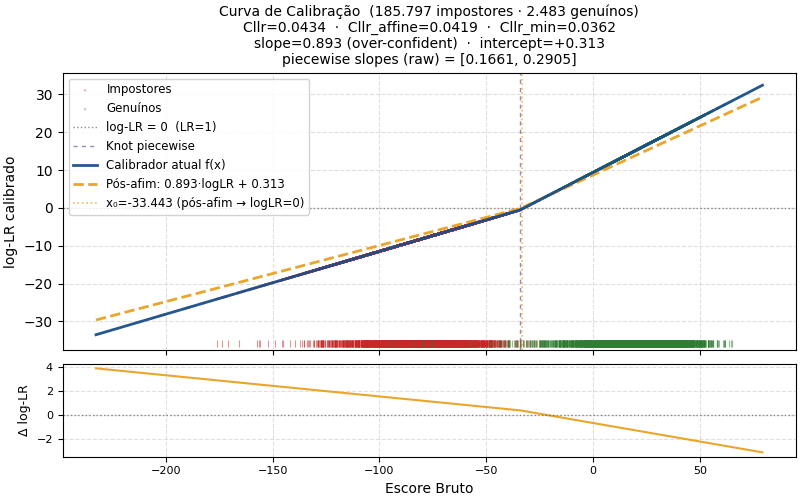
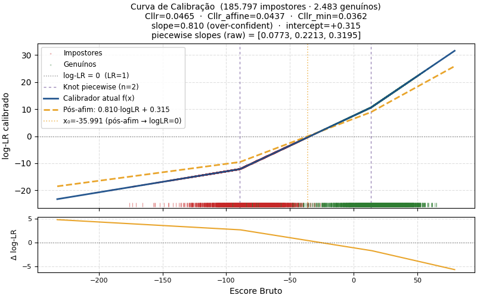
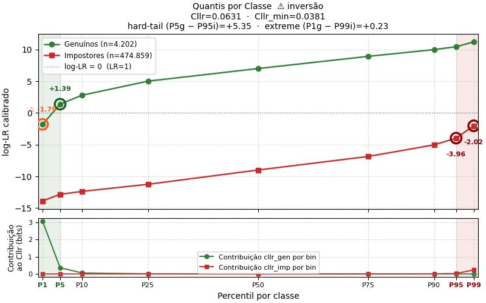
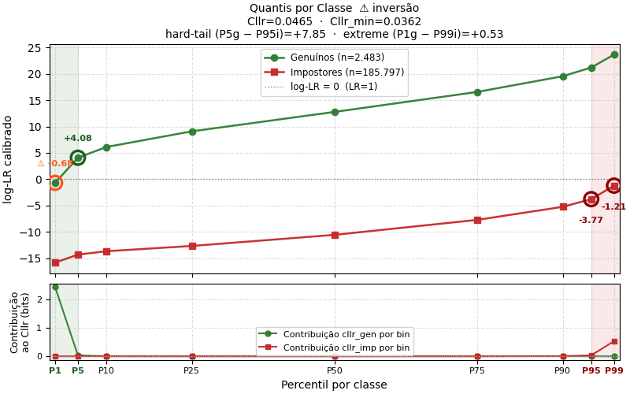

# Calibração piecewise-linear de razão de verossimilhança

Este documento descreve a calibração piecewise-linear implementada no
FaceAudit como extensão interna do calibrador de regressão logística.
Cobre o escopo do componente, a fundamentação forense, a formulação
matemática, as opções de configuração disponíveis na ferramenta, os
diagnósticos persistidos, considerações sobre uso operacional e
limitações conhecidas.

---

## 0. Escopo e status

### 0.1 O que está implementado

Os elementos descritos neste documento estão presentes no código:

- Expansão de basis piecewise-linear interna ao calibrador, ativada
  via `CalibrationBasisMode.PIECEWISE_LINEAR`.
- Estimação do ponto âncora $s_0$ por LogReg auxiliar univariado
  fold-aware (`HingeAnchorMode.AUTO_LOGREG`) ou valor fixo (`MANUAL`).
- Escala dos offsets em score bruto (`KnotScale.RAW`) ou em log-LR do
  calibrador auxiliar (`KnotScale.AUX_LOG_LR`).
- Posicionamento manual (`KnotPlacement.MANUAL`) ou automático
  (`KnotPlacement.AUTO_FROM_MEDIANS`).
- Validação pós-fit de crescimento estrito por trecho, com política
  configurável (`MonotonicityPolicy.ERROR` ou `WARNING`).
- Algoritmo geral para identificar o ponto de cruzamento efetivo de
  log-LR = 0 por segmento.
- Persistência de diagnósticos para auditoria (§7).

### 0.2 O que é estabelecido vs. experimental

| Componente | Status |
|---|---|
| Calibração por regressão logística (linear) | Estabelecido na literatura forense (Brümmer & du Preez 2006, Morrison 2013). |
| Expansão piecewise-linear como basis function | Estabelecido em estatística (Hastie, Tibshirani & Friedman 2009, §5.2). |
| Validação pós-fit de crescimento estrito por trecho | Política operacional implementada no FaceAudit. |
| Heurística `AUTO_FROM_MEDIANS` para posicionamento dos knots | Heurística experimental proposta no projeto. Não consta da literatura citada. Deve ser validada externamente no domínio de aplicação. |

### 0.3 LR bruta do modelo vs. LR reportável

O calibrador piecewise produz um valor de log-LR bruto a partir do
`decision_function` da regressão logística. Esse valor é a saída
matemática não censurada do componente.

Decisões sobre **reportabilidade** — limites superiores e inferiores
aceitos em laudo, política de exibição em casos onde o score
extrapola o range de treino, e relato qualitativo da força da
evidência — constituem uma camada operacional separada. O
componente piecewise não define essa política; ele se limita a
produzir o estimador. A guideline ENFSI para relatórios avaliativos
enfatiza transparência, robustez e disponibilidade para auditoria da
metodologia de atribuição do LR (ENFSI 2015).

---

## 1. Fundamento forense

### 1.1 Proposições e LR baseada em score

A apresentação avaliativa de evidência em comparação facial é
formulada em termos de duas proposições mutuamente excludentes:

- $H_p$: as imagens comparadas provêm do mesmo indivíduo.
- $H_d$: as imagens comparadas provêm de indivíduos distintos.

A razão de verossimilhança (LR) avalia a probabilidade dos achados
condicionada a cada proposição:

$$
\text{LR}(s) \;=\; \frac{p(s \mid H_p)}{p(s \mid H_d)}.
$$

Quando $s$ é uma estatística-resumo derivada das imagens (e.g. score
de similaridade entre embeddings), o resultado é uma **LR baseada em
score** (*score-based LR*). A calibração piecewise-linear descrita
aqui é um estimador dessa LR — ela melhora o mapeamento entre score
e log-LR, mas não acrescenta informação ausente do score.

Quando o score contém apenas similaridade, a suficiência da
estatística-resumo para as proposições do caso deve ser demonstrada
empiricamente. Informações adicionais (e.g. tipicidade da face
questionada em relação à população relevante) exigem modelagem
própria ou fusão multivariada. Morrison (2013, 2021) discute a
relevância de incorporar tipicidade nos sistemas forenses
biométricos.

### 1.2 Convenção logarítmica

Neste documento, log-LR significa $\ln(\text{LR})$, em nats (logaritmo
natural). Conversões úteis:

| log-LR (nats) | LR aproximada | log10(LR) |
|---|---|---|
| 0 | 1 | 0 |
| $\ln(3) \approx 1{,}10$ | 3 | $\approx 0{,}48$ |
| $\ln(10) \approx 2{,}30$ | 10 | 1 |
| $\ln(100) \approx 4{,}61$ | 100 | 2 |
| $\ln(10^4) \approx 9{,}21$ | $10^4$ | 4 |

A regressão logística do scikit-learn opera em log-odds em base
natural, e o método `decision_function` retorna o logit não censurado.

### 1.3 Estimação por regressão logística

Brümmer & du Preez (2006) e Morrison (2013) propõem a regressão
logística como estimador de log-LR a partir de pares score/rótulo.
Sob certas hipóteses, o modelo

$$
\log \text{LR}(s) \;=\; \beta_z \cdot s \;+\; \beta_0
$$

é consistente quando $P(H_p \mid s)$ é logística em $s$. A regressão
logística é o calibrador padrão na literatura forense de
reconhecimento biométrico (voz, face, etc).

#### 1.3.1 Relação entre log-odds posteriores e log-LR

A regressão logística estima log-odds posteriores efetivos:

$$
\eta(s) \;=\; \log \frac{P_{\text{eff}}(H_p \mid s)}{P_{\text{eff}}(H_d \mid s)}.
$$

Para convertê-los em log-LR é necessário subtrair os log-odds do
prior efetivo no treino:

$$
\log \text{LR}(s) \;=\; \eta(s) \;-\; \log \frac{\pi_{\text{eff}}}{1 - \pi_{\text{eff}}}.
$$

No FaceAudit, o LogReg principal é treinado com
`class_weight="balanced"`, que pondera as amostras de modo que a soma
de pesos por classe seja idêntica. Isso resulta em
$\pi_{\text{eff}} = 0{,}5$ e, portanto, $\log(\pi/(1-\pi)) = 0$. Nesse
caso, `decision_function` retorna $\eta(s)$ idêntico a $\log
\text{LR}(s)$. Essa propriedade é persistida no metadata como
`effective_training_prior_hp = 0.5`, `effective_training_prior_hd =
0.5`, `prior_log_odds_correction = 0.0`. Configurações de
`class_weight` diferentes exigem revisão dessa relação antes de
tratar `decision_function` como log-LR direto.

---

## 2. Por que uma calibração afim pode ser insuficiente

A linearidade $\log \text{LR}(s) = \beta_z \cdot s + \beta_0$ assume
inclinação constante em toda a faixa do score. Essa hipótese pode
falhar em distribuições reais quando há **regimes distintos** em
faixas diferentes:

- Em modelos como o PLDA, a distribuição $p(s \mid H_d)$ pode ter
  pico numericamente distante do pico de $p(s \mid H_p)$. Em regiões
  onde apenas uma classe tem massa relevante, a razão local de
  densidades muda de comportamento.
- Em regiões com pouca sobreposição entre classes, o LogReg linear
  extrapola a inclinação estimada no centro da distribuição e produz
  log-LRs nas caudas que podem divergir da razão de densidades
  empírica.
- O uso de `class_weight="balanced"` equaliza o gradiente do log-loss
  por classe, mas a flexibilidade na **forma** da curva permanece
  restrita a uma reta.

A literatura compara calibrações lineares e não lineares (Brümmer,
Swart & van Leeuwen 2014) e discute limitações de transformações
afins em pontos operacionais distintos. A calibração piecewise-linear
é uma extensão controlada da regressão logística que admite mudanças
de inclinação em pontos pré-definidos do score, sem perder a
estrutura paramétrica que a torna auditável.

---

## 3. Formulação matemática

### 3.1 Basis expansion piecewise-linear

Seja $s_0 \in \mathbb{R}$ um ponto âncora (definido em §5.1) e
$\delta_1 < \delta_2 < \cdots < \delta_K$ um conjunto de offsets
relativos ao âncora. Define-se a variável centrada $z = s - s_0$ e a
expansão piecewise-linear:

$$
\boldsymbol{\phi}(s) \;=\; \big[\, z, \; \max(z - \delta_1, 0), \; \max(z - \delta_2, 0), \; \ldots, \; \max(z - \delta_K, 0) \,\big] \in \mathbb{R}^{K+1}.
$$

A regressão logística é treinada sobre $\boldsymbol{\phi}(s)$ em vez
de $s$:

$$
\log \text{LR}(s) \;\approx\; \beta_0 \;+\; \beta_z \cdot z \;+\; \sum_{j=1}^{K} \beta_j \cdot \max(z - \delta_j, 0).
$$

Cada função $\max(z - \delta_j, 0)$ é uma **função hinge** (dobradiça)
que vale zero abaixo do knot absoluto $k_j = s_0 + \delta_j$ e cresce
linearmente com inclinação 1 acima dele.

O termo $\beta_z \cdot z$ é incluído explicitamente — todas as
features hinge são interpretadas como modificações da inclinação base
$\beta_z$. Essa estrutura preserva o princípio de marginalidade
(Nelder 1977): o termo linear principal deve estar presente sempre
que termos de interação ou expansão dele estiverem.

### 3.2 Inclinação por trecho

A derivada de $\log \text{LR}$ em relação a $s$ no trecho $j$
(isto é, em $s \in [k_{j-1}, k_j)$, com a convenção $k_0 = -\infty$ e
$k_{K+1} = +\infty$) é:

$$
m_j \;\equiv\; \frac{d \log \text{LR}}{ds}\bigg|_{s \in [k_{j-1}, k_j)} \;=\; \beta_z \;+\; \sum_{i=1}^{j-1} \beta_i.
$$

A inclinação no trecho $j$ é a soma cumulativa de $\beta_z$ com os
coeficientes das hinges que já "ativaram". A curva é um polinômio
piecewise de grau 1 com vértices em $\{k_1, \ldots, k_K\}$.

### 3.3 Validação pós-fit de crescimento estrito

A implementação não impõe restrições durante o ajuste — a regressão
logística é treinada sem restrições e o sistema **valida os slopes
cumulativos após o fit**. Fits que produzem trechos não-crescentes
são rejeitados por default.

Formalmente, exige-se:

$$
m_j \;>\; m_{\min} \quad \forall j \in \{1, \ldots, K+1\},
$$

onde $m_{\min} \geq 0$ é um limiar numérico (`min_allowed_slope`,
default $10^{-8}$). Embora uma função monotônica não-decrescente
possa conter platôs ($m_j = 0$), o FaceAudit adota crescimento
estrito como política operacional para evitar trechos sem
discriminação e instabilidades numéricas.

Quando a regressão logística sobre $\boldsymbol{\phi}(s)$ viola essa
restrição (tipicamente em trechos com pouco suporte estatístico, onde
o $\beta_j$ pode ficar fortemente negativo), o calibrador é rejeitado
com diagnóstico detalhado por trecho (§7.4).

### 3.4 Standardização interna

O calibrador no FaceAudit é treinado via `sklearn.Pipeline` composto
por: `PiecewiseLinearScoreTransformer` → `StandardScaler` →
`LogisticRegression`. A `StandardScaler` aprende $\mu_j, \sigma_j$ das
features expandidas em treino e standardiza:

$$
\tilde\phi_j(s) \;=\; \frac{\phi_j(s) - \mu_j}{\sigma_j}.
$$

Os coeficientes aprendidos $\beta_j^{\text{std}}$ vivem na escala
standardizada. Para auditoria e cálculo de inclinações na escala
bruta do score, recupera-se:

$$
\beta_j^{\text{raw}} \;=\; \beta_j^{\text{std}} / \sigma_j, \qquad
\beta_0^{\text{raw}} \;=\; \beta_0^{\text{std}} \;-\; \sum_j \beta_j^{\text{std}} \cdot \mu_j / \sigma_j.
$$

Esta conversão é feita após o `fit` e os coeficientes em escala bruta
são persistidos no metadata.

### 3.5 Ponto de cruzamento efetivo de log-LR = 0

O âncora $s_0$ é o ponto onde o LogReg auxiliar linear cruza log-LR =
0 (§5.1). Em geral, **não coincide** com o zero do calibrador
piecewise final, porque o piecewise tem inclinações diferentes do
auxiliar e intercepto efetivo distinto.

O zero do piecewise é determinado segmento por segmento. Em cada
segmento $r$, seja $A_r = \{j : \delta_j < z\}$ o conjunto de hinges
ativas no intervalo. A função pode ser escrita como

$$
f_r(z) \;=\; c_r \;+\; m_r \cdot z,
$$

com

$$
m_r \;=\; \beta_z \;+\; \sum_{j \in A_r} \beta_j, \qquad
c_r \;=\; \beta_0^{\text{raw}} \;-\; \sum_{j \in A_r} \beta_j \cdot \delta_j.
$$

A raiz candidata no segmento é $z_r = -c_r / m_r$. A raiz é aceita
apenas quando $z_r$ pertence ao intervalo do segmento. Sob
crescimento estrito ($m_r > 0$ para todo $r$), existe no máximo uma
raiz válida. O valor persistido é

$$
s_{LR = 0} \;=\; s_0 + z_r,
$$

acompanhado do índice do segmento onde foi encontrado
(`effective_log_lr_zero_crossing_segment_index`) e de uma flag
indicando se cai dentro do range observado de treino
(`effective_log_lr_zero_crossing_inside_training_range`).

> **Nota histórica.** Versões anteriores do componente reportavam
> $s_{LR=0} = s_0 - \beta_0^{\text{raw}} / m_{K+1}$, fórmula correta
> apenas no caso degenerado de zero knots ou knots todos em $\delta =
> 0$. O algoritmo geral por segmento foi introduzido em maio de 2026.

---

## 4. Treinamento sem leakage

### 4.1 LogReg auxiliar e knots dentro do `Pipeline`

O `PiecewiseLinearScoreTransformer` é um transformer
`sklearn`-compatível inserido em um `sklearn.Pipeline`. Ao ser
chamado dentro de `GridSearchCV`, seu `fit(X_train, y_train)` é
re-executado em cada fold com apenas os dados de treino do fold:

- Estimação do âncora $s_0$ via LogReg auxiliar (§5.1) ocorre **dentro
  do fit do transformer**. Cada fold tem seu próprio $s_0$ estimado
  apenas com seus dados de treino.
- Conversão `aux_log_lr → raw` em `KnotScale.AUX_LOG_LR` usa o
  $\alpha_{\text{aux}}$ daquele fold.
- Cálculo dos knots em `KnotPlacement.AUTO_FROM_MEDIANS` (§6.2) usa
  medianas calculadas apenas no subset de treino do fold.

Nenhuma dessas operações lê dados do fold de validação. A propriedade
fold-aware é garantida pela própria mecânica do `Pipeline` (ver
documentação do scikit-learn sobre `Pipeline` e `GridSearchCV`).

### 4.2 Agrupamento por identidade

A propriedade fold-aware acima previne leakage de $s_0$ e dos knots
entre treino e validação **do fold**, mas não previne leakage por
correlação entre pares. Em comparação biométrica, múltiplos pares
podem compartilhar a mesma identidade (e.g. par A=face1×face2 e par
B=face1×face3 compartilham face1). Se folds forem construídos por par
(via `StratifiedKFold` padrão), face1 pode aparecer simultaneamente
no treino e na validação de um mesmo fold.

Recomenda-se, sempre que possível, **construir folds agrupados por
identidade ou por unidade independente relevante** (e.g.
`StratifiedGroupKFold` do scikit-learn, com `groups` = identidade ou
captura). A prevenção de leakage na estimação de $s_0$ e nos knots
não elimina o leakage decorrente de pares correlacionados.

O FaceAudit hoje não impõe agrupamento automático nos folds do
calibrador. Essa escolha cabe ao desenho do pipeline do projeto. Se
você usa `cv_folds = 5` em `LogisticRegressionCalibrationModelConfig`,
verifique como o dataset de calibração foi construído antes de tratar
o $C_{\text{llr}}$ de cross-validation interno como medida limpa.

---

## 5. Âncora e knots

### 5.1 O ponto âncora $s_0$

A basis expansion é parametrizada pelo âncora $s_0$. Os knots
absolutos são $k_j = s_0 + \delta_j$. A escolha de $s_0$ define o que
significa "centrar a expansão". Há dois modos.

#### Estimação automática (`HingeAnchorMode.AUTO_LOGREG`)

Um LogReg auxiliar univariado é treinado sobre os mesmos $(s, y)$ do
treino do calibrador:

$$
\log \text{LR}_{\text{aux}}(s) \;=\; \alpha_{\text{aux}} \cdot s + \beta_{\text{aux}}.
$$

O ponto $s_0$ é definido como o $s$ tal que
$\log \text{LR}_{\text{aux}}(s_0) = 0$:

$$
s_0 \;=\; -\beta_{\text{aux}} \,/\, \alpha_{\text{aux}}.
$$

A inclinação $\alpha_{\text{aux}}$ tem interpretação útil: é o fator
de conversão entre score bruto e log-LR linear local. Esse fator é
usado pela escala `AUX_LOG_LR` (§5.2) e pelo posicionamento
`AUTO_FROM_MEDIANS` (§6.2).

#### Valor fixo (`HingeAnchorMode.MANUAL`)

O usuário fornece $s_0$ diretamente via
`hinge_anchor_manual_value`. Útil para reproduzir calibradores
externos já auditados ou aplicar regras de domínio explícitas. Não
gera $\alpha_{\text{aux}}$ — escalas e modos que dependem dele ficam
restritos.

### 5.2 Escala dos offsets (`KnotScale`)

| Valor | Significado |
|---|---|
| `RAW` | Offsets diretamente em unidades de score. Backward-compat com configs antigos. |
| `AUX_LOG_LR` (default em novos calibradores) | Offsets em unidades de log-LR do calibrador auxiliar (nats). Conversão $\delta_j^{\text{raw}} = \delta_j^{\text{aux\_log\_lr}} / \alpha_{\text{aux}}$ feita no fit. Exige `HingeAnchorMode.AUTO_LOGREG`. |

A escala `AUX_LOG_LR` reduz a dependência do domínio numérico do
score (cosseno em ±1 vs. PLDA em ±100). Não garante, no entanto,
que os knots resultantes caiam dentro do range observado do score:
em casos de $\alpha_{\text{aux}}$ muito pequeno, offsets numéricos
grandes em log-LR auxiliar podem mapear para valores raw fora do
domínio dos dados. O metadata persistido inclui o campo
`knot_inside_training_range` por knot para auditar essa condição.

A escala se chama `AUX_LOG_LR` para evidenciar que vive na escala do
**LogReg auxiliar**, não na curva piecewise final. O log-LR do
piecewise final pode divergir do log-LR auxiliar quando o piecewise
muda de inclinação.

### 5.3 Posicionamento (`KnotPlacement`)

Quem decide a posição dos knots.

| Valor | Significado |
|---|---|
| `MANUAL` | Usuário escreve `knot_offsets` na configuração. |
| `AUTO_FROM_MEDIANS` (default em novos calibradores) | Transformer popula `knot_offsets` no fit usando a heurística experimental de §6.2. |

Em `AUTO_FROM_MEDIANS`, os campos `knot_offsets` e `knot_scale` do
DTO são ignorados; o transformer determina ambos automaticamente. A
UI esconde esses campos quando AUTO está selecionado.

---

## 6. Posicionamento dos knots

### 6.1 Modo MANUAL

O usuário escreve `knot_offsets` no DTO. Exemplos com interpretação
clara em `KnotScale.AUX_LOG_LR`:

| `knot_offsets` (nats) | Interpretação |
|---|---|
| `[0.0]` | Um knot em $s_0$ (ponto neutro do auxiliar). |
| `[-ln(10), 0, +ln(10)]` $\approx$ `[-2.30, 0, +2.30]` | Três knots: LR auxiliar 1:10 contra Hp, neutro, e 10:1 a favor de Hp. |
| `[-ln(100), 0, +ln(100)]` $\approx$ `[-4.61, 0, +4.61]` | Três knots em LR auxiliar 1:100, neutro, e 100:1. |

A escolha entre alternativas pré-definidas deve ser feita via
cross-validation interna ou dev set, **nunca pelo $C_{\text{llr}}$
medido no mesmo holdout usado para reportar a métrica final** — esse
procedimento constitui tuning sobre o test set.

A figura abaixo ilustra um calibrador piecewise com
`knot_offsets = [0.0]` (um único knot em $s_0$) treinado e validado
sobre o mesmo domínio (BFW split, com identidades disjuntas entre os
subsets). A curva piecewise (azul) tem dois segmentos com
inclinações `[0.166, 0.291]` — slope mais íngreme acima de $s_0$,
refletindo a transição empírica entre regiões dominadas por Hd e por
Hp. A linha tracejada laranja é a calibração afim ótima a posteriori
(`pós-afim: 0.893·logLR + 0.313`), com `slope ≈ 0.89 < 1` indicando
ligeira sobreconfiança da curva piecewise. As barras vermelhas e
verdes na base mostram a distribuição empírica de impostores e
genuínos.

### 6.2 Modo AUTO_FROM_MEDIANS (heurística experimental)

**Status.** `AUTO_FROM_MEDIANS` é uma heurística automática,
determinística e fold-aware proposta no FaceAudit. Não consta da
literatura citada. Sua utilidade operacional deve ser validada
externamente no domínio de aplicação antes de ser adotada como
protocolo de produção.

#### Definição

A heurística posiciona dois knots em

$$
\boldsymbol\delta \;=\; \mathrm{sorted}\big(\big[\, -\, \hat\ell_p, \;\; -\, \hat\ell_d \,\big]\big),
$$

onde $\hat\ell_p$ e $\hat\ell_d$ são as medianas log-LR auxiliares de
cada classe estimadas no fold de treino:

$$
\hat\ell_p \;=\; \alpha_{\text{aux}} \cdot (\text{med}(s \mid y = 1) - s_0), \qquad
\hat\ell_d \;=\; \alpha_{\text{aux}} \cdot (\text{med}(s \mid y = 0) - s_0).
$$

A fórmula não exige treinar um segundo calibrador completo nem ter um
dev set separado; usa o próprio LogReg auxiliar já treinado para
$s_0$.

#### Intuição geométrica

Cada knot em $-\hat\ell_p$ ou $-\hat\ell_d$ posiciona-se no espelho em
torno de zero da mediana log-LR da classe correspondente. A heurística
pretende aproximar uma **região intermediária de transição** entre os
regimes de evidência. Essa interpretação é intuitiva mas não constitui
garantia matemática de que o intervalo entre knots corresponda
exatamente à região de sobreposição das classes.

#### Fold-awareness

Em `AUTO_FROM_MEDIANS`, o cálculo das medianas acontece dentro do
`PiecewiseLinearScoreTransformer.fit`, executado uma vez por fold do
`GridSearchCV`. Cada fold tem seu próprio $\alpha_{\text{aux}}, s_0,
\hat\ell_p, \hat\ell_d$ e, portanto, seus próprios knots, computados
estritamente sobre seus dados de treino. Não há leakage dos folds de
validação para a definição dos knots. (Subsiste o risco de leakage por
correlação entre pares — ver §4.2.)

#### Exemplo de curva treinada por AUTO_FROM_MEDIANS

A figura abaixo mostra um calibrador piecewise produzido por
`AUTO_FROM_MEDIANS` sobre o mesmo dataset usado em §6.1. Dois knots
foram posicionados nos espelhos das medianas log-LR auxiliares de
cada classe (em $-89{,}19$ e $+13{,}68$ na escala bruta), gerando
três segmentos com inclinações `[0.077, 0.221, 0.319]`. Note como o
segmento direito (acima do knot $+13{,}68$) tem inclinação maior que
os anteriores — o coeficiente da hinge correspondente é positivo
porque a regularização L2 escolhida (`C = 0.1`) foi suficiente para
manter o slope estritamente crescente mesmo num trecho com cobertura
assimétrica (sem Hd). Comparar com §9.2 e §8.3.

#### Limitação intrínseca: medianas do treino vs. holdout

Em estratégias com mismatch entre as distribuições de treino e
holdout (e.g. PLDA cross-condition entre populações diferentes), as
medianas $\hat\ell_p, \hat\ell_d$ computadas no treino divergem das do
holdout. Os knots ótimos para minimizar $C_{\text{llr}}$ no holdout
podem cair fora da posição escolhida por AUTO. Mesmo nesses casos,
AUTO não introduz leakage e o $C_{\text{llr}}$ reportado é honesto.

#### Health checks recomendados

Antes de aceitar um calibrador produzido por `AUTO_FROM_MEDIANS`,
verificar no metadata:

- `hinge_anchor_aux_coef > 0` — auxiliar não degenerou.
- `piecewise_auto_log_lr_hp_p50 > 0` e
  `piecewise_auto_log_lr_hd_p50 < 0` — as medianas auxiliares estão em
  lados opostos do zero.
- `knot_inside_training_range = [true, true]` — todos os knots caem
  dentro do range observado de scores.
- `segment_counts_total[r]` razoável em todos os trechos (e.g. ≥ 30).
- **Cobertura por classe em cada trecho**: `segment_counts_hp[r] > 0` e
  `segment_counts_hd[r] > 0`. Quando uma das classes está totalmente
  ausente num trecho (e.g. cauda direita pura Hp ou cauda esquerda
  pura Hd), o LogReg principal não tem contraste discriminativo para
  estimar inclinação estritamente positiva — o coeficiente $\beta_j$
  da hinge correspondente pode assumir valor próximo de zero ou
  ligeiramente negativo, violando a monotonicidade. Esse risco é
  intrínseco ao posicionamento por medianas, porque os knots ficam
  exatamente nas fronteiras onde a outra classe começa a desaparecer.
- `segment_support_warnings` vazio.
- `is_monotonic = true`.

Se as medianas não estiverem em lados opostos do zero, isso indica que
o LogReg auxiliar não estratifica adequadamente as classes em torno do
ponto neutro neste domínio — `AUTO_FROM_MEDIANS` pode não ser
adequado. O metadata `piecewise_auto_log_lr_hp_p50` /
`piecewise_auto_log_lr_hd_p50` permite essa verificação ex-post.

#### Caso de fallback

A heurística posiciona dois knots fixos. Em distribuições com regimes
abruptos próximos a $s_0$ (caso observado em cosseno, onde $s_0$ pode
ficar próximo do threshold de decisão associado à região de
equilíbrio entre erros, e as distribuições $H_p$ e $H_d$ são
aproximadamente simétricas em torno dele), a curva ótima pode ter uma
única dobra em $z = 0$ em vez de duas em $-\hat\ell_p$ e $-\hat\ell_d$.
Para essa situação, `MANUAL` com `knot_offsets = [0.0]` em
`KnotScale.AUX_LOG_LR` é o equivalente direto.

---

## 7. Diagnósticos persistidos

Após o fit, o calibrador armazena em `self.metadata` o conjunto
abaixo de campos. Todos são serializados no pickle e ficam disponíveis
para auditoria forense e reprodução. Esta seção é o **schema do
contrato de auditoria** do componente.

### 7.1 Configuração geral

- `calibration_basis_mode`: `"PIECEWISE_LINEAR"` ou `"NONE"`.
- `piecewise_enabled`: bool.
- `knot_placement_protocol_version`: identificador da versão da
  heurística usada (e.g. `"auto_from_medians_v1"`, `"manual_v1"`).

### 7.2 Convenção de log-LR

- `log_lr_base`: `"natural"` — base do logaritmo.
- `log_lr_computation_method`: `"decision_function"` — método usado
  para extrair log-LR do estimador.
- `positive_class_label`: rótulo numérico da classe positiva no
  treino.
- `effective_training_prior_hp`, `effective_training_prior_hd`:
  prior efetivo de cada classe no treino. Com
  `class_weight="balanced"`, ambos = 0.5.
- `prior_log_odds_correction`: $\log(\pi/(1-\pi))$ que deve ser
  subtraído de `decision_function` para obter log-LR. Com prior
  balanceado = 0.0.

### 7.3 Âncora $s_0$

- `hinge_anchor_mode`: `"AUTO_LOGREG"` ou `"MANUAL"`.
- `hinge_anchor_s0`: $s_0$ aprendido ou informado.
- `hinge_anchor_aux_coef`, `hinge_anchor_aux_intercept`,
  `hinge_anchor_aux_C`: parâmetros do LogReg auxiliar (None em modo
  MANUAL).
- `hinge_anchor_training_method`: `"auto_logreg"` ou `"manual"`.
- `hinge_anchor_inside_training_range`: bool — $s_0$ cai dentro do
  range observado dos scores de treino?

### 7.4 Knots e suporte

- `piecewise_knot_scale`: `"RAW"` ou `"AUX_LOG_LR"`.
- `piecewise_knot_placement`: `"MANUAL"` ou `"AUTO_FROM_MEDIANS"`.
- `piecewise_knot_offsets_user`: offsets na escala do usuário.
- `piecewise_knot_offsets_raw`: offsets em escala de score (sempre).
- `piecewise_knots_absolute`: posições absolutas $k_j$ em escala de
  score.
- `piecewise_auto_log_lr_hp_p50`, `piecewise_auto_log_lr_hd_p50`:
  medianas log-LR computadas no fit (None em modo MANUAL).
- `knot_inside_training_range`: lista bool — cada knot cai dentro do
  range observado?
- `fraction_scores_above_each_knot`: fração da amostra de treino
  acima de cada knot.
- `segment_counts_total`, `segment_counts_hp`, `segment_counts_hd`:
  contagem de pares por trecho.
- `segment_fractions_total`: fração da amostra de treino em cada
  trecho.
- `segment_support_warnings`: lista de avisos quando algum trecho
  tem suporte abaixo dos limiares operacionais.

### 7.5 Coeficientes

- `calibrator_coef_standardized`, `calibrator_intercept_standardized`:
  parâmetros na escala da `StandardScaler` interna.
- `calibrator_coef_raw`, `calibrator_intercept_raw`: parâmetros em
  escala de score bruta (§3.4).

### 7.6 Inclinações e monotonicidade

- `segment_slopes_raw`: lista $[m_1, m_2, \ldots, m_{K+1}]$ na
  escala de score.
- `is_monotonic`: bool.
- `min_allowed_slope`: $m_{\min}$ usado na verificação.
- `monotonicity_check`: descreve a política aplicada (
  `"strict_increasing_post_fit"`).

### 7.7 Ponto de cruzamento efetivo

- `effective_log_lr_zero_crossing`: $s_{LR=0}$ (None se nenhum
  segmento contém zero válido).
- `effective_log_lr_zero_crossing_segment_index`: índice do segmento
  onde a raiz cai (0-indexado).
- `effective_log_lr_zero_crossing_inside_training_range`: bool.

### 7.8 Range observado

- `raw_score_min_training`, `raw_score_max_training`: extremos do
  score no treino.
- `raw_log_lr_min_training`, `raw_log_lr_max_training`: extremos do
  log-LR estimado pelo próprio piecewise nos pontos de treino.

### 7.9 Auxiliar

- `pipeline_feature_names`: nomes descritivos das features expandidas
  (e.g. `["z=score-s0", "max(z, 0)", "max(z - +2.0000, 0)", ...]`).

---

## 8. Uso operacional e reportabilidade

### 8.1 Distinção entre log-LR bruto do modelo e LR reportável

A curva piecewise é linear no último trecho e, portanto, extrapola
sem limite quando $s \to +\infty$ (assumindo slope final positivo) ou
$s \to -\infty$ (slope inicial positivo, log-LR → $-\infty$).

Isso é matematicamente correto, mas não implica que qualquer log-LR
produzido pelo calibrador seja defensável em laudo. Recomenda-se
distinguir, na arquitetura operacional:

- **`raw_model_log_lr`**: saída matemática não censurada do
  calibrador (o que o componente piecewise entrega).
- **`reportable_log_lr`**: valor eventualmente submetido a política
  conservadora de reportabilidade baseada em suporte empírico,
  validação externa, e diretrizes do laboratório/jurisdição.

A política de limite reportável não é definida pela expansão
piecewise-linear. Constitui uma camada operacional separada.

### 8.2 Extrapolação

Os campos `raw_score_min_training` e `raw_score_max_training`
permitem identificar se um par observado em validação ou casework
está dentro ou fora do range em que o calibrador foi estimado.
Recomenda-se documentar e tratar com cautela casos onde o score do
caso cai fora do `[raw_score_min_training, raw_score_max_training]` —
o log-LR nesses pontos é extrapolação linear, não interpolação.

### 8.3 Regularização L2 e seleção de `c_grid`

O calibrador é treinado com `LogisticRegression(C=...)` (inverso da
regularização L2). A escolha de `c_grid` no `GridSearchCV` afeta
diretamente o comportamento dos coeficientes das hinges:

- **`C` alto (≥ 10)** corresponde a regularização fraca. O LogReg fica
  flexível e tende a ajustar coeficientes individuais grandes em
  trechos com pouco contraste discriminativo. Em piecewise com
  cobertura assimétrica por classe (§9.2), isso pode produzir slopes
  negativos em trechos sem Hp ou sem Hd — violação da monotonicidade
  rejeitada por default.
- **`C` moderado a forte (0.001 a 1)** força coeficientes menores. A
  curva fica mais suave, e em trechos sem contraste o $\beta_j$ da
  hinge tende a zero, mantendo o slope efetivo do trecho próximo do
  slope do trecho anterior (positivo). Geralmente resolve violações
  de monotonicidade sem necessidade de reposicionar knots.

Um caso prático observado: com `c_grid = [0.01, 0.1, 1.0, 10.0, 100.0]`
e knots posicionados por `AUTO_FROM_MEDIANS` num PLDA com Hd ausente
no trecho direito, o GridSearch escolheu `C = 100` e produziu
$m_3 = -0{,}016$ (rejeição). Reduzindo para `c_grid = [0.01, 0.1]`, o
mesmo dataset produziu `C = 0.1` e $m_3 = +0{,}319$ (monotônica), sem
qualquer outra alteração na configuração.

Recomendação: usar `c_grid` moderado a forte como default
(`[0.001, 0.01, 0.1, 1.0]`). Valores de $C$ muito altos são
defensáveis apenas em datasets com cobertura simétrica robusta por
trecho.

### 8.4 Cllr_min e cal_loss como diagnósticos exploratórios

O `Cllr_min` (via PAVA in-sample) e `cal_loss = Cllr − Cllr_min`
calculados sobre o conjunto avaliado são **diagnósticos
exploratórios**, não medidas operacionais significativas do grau de
calibração. Morrison (2021) argumenta que métricas baseadas em
PAV/PAVA não devem ser tratadas como critério isolado para escolha
de sistema pericial em casework. Elas continuam úteis para diagnóstico
comparativo entre variantes do mesmo pipeline, mas não substituem:

- Validação externa em datasets independentes representativos do
  domínio de aplicação.
- Análise das caudas e da estabilidade do modelo.
- Avaliação da aplicabilidade ao caso específico.

### 8.5 Validação por bootstrap

Em uso forense, recomenda-se complementar o $C_{\text{llr}}$ pontual
com intervalos via bootstrap, preferencialmente reamostrando por
**identidade** (não por par) para preservar a estrutura de
correlação.

---

## 9. Limitações

### 9.1 Knots fora do domínio dos dados

Quando os knots absolutos $k_j = s_0 + \delta_j$ caem fora do range
observado dos scores, a feature $\max(z - \delta_j, 0)$ é constante
(zero em todos os pontos) ou linearmente colinear com $z$ em todos os
pontos. No primeiro caso, a feature não carrega informação e o
LogReg estima $\beta_j$ próximo de zero. No segundo caso, a feature
deixa de carregar informação independente e, na presença de
regularização L2, o coeficiente pode ser **reduzido, redistribuído
entre colunas colineares, ou tornar-se numericamente instável**.

O metadata `knot_inside_training_range` permite identificar esse
problema.

### 9.2 Suporte por trecho

Há duas situações distintas que comprometem a estabilidade da
inclinação num trecho, ambas detectadas e reportadas em
`segment_support_warnings`:

**(a) Suporte total baixo.** Quando o knot é colocado numa faixa
esparsa do score (cauda extrema), o número total de amostras no trecho
correspondente é pequeno. O coeficiente $\beta_j$ tem alta variância e
pode assumir valor fortemente negativo ao tentar acomodar ruído local,
violando a condição de monotonicidade do trecho seguinte.

**(b) Cobertura assimétrica por classe.** O suporte total pode ser
grande, mas uma das classes pode estar **totalmente ausente** no
trecho (e.g. cauda direita pura Hp, sem nenhuma amostra Hd; ou cauda
esquerda pura Hd, sem nenhuma amostra Hp). Nessa situação o LogReg
principal não tem contraste discriminativo para estimar inclinação
estritamente positiva — o gradiente da log-loss em relação a $\beta_j$
fica indeterminado em discriminação. Sob regularização L2 fraca
($C$ alto), $\beta_j$ pode assumir valor ligeiramente negativo, levando
ao slope negativo no trecho correspondente. Esse padrão é comum em
distribuições PLDA com classes bem separadas, exatamente onde a
heurística `AUTO_FROM_MEDIANS` posiciona os knots (na fronteira onde
uma das classes desaparece).

A mitigação preferencial para (b) é aumentar a regularização L2 via
`c_grid` mais restrito (§8.3). A mitigação alternativa, mais agressiva,
é reposicionar manualmente o knot para uma região onde ambas as
classes ainda têm representação.

Os campos `segment_counts_total`, `segment_counts_hp`,
`segment_counts_hd` e `segment_support_warnings` permitem identificar
ambas as situações após um fit bem-sucedido. Em fits rejeitados por
não-monotonicidade, a mensagem de erro exibe o suporte de cada classe
por trecho explicitamente.

### 9.3 Número de knots vs. graus de liberdade

Cada knot adiciona um parâmetro $\beta_j$ ao modelo. Com $K$ knots, o
calibrador tem $K + 2$ parâmetros (incluindo $\beta_0$ e $\beta_z$).
Em datasets pequenos ou desbalanceados, número grande de knots
favorece sobreajuste. O modo AUTO_FROM_MEDIANS usa 2 knots (com
colapso defensivo a 1 quando as duas medianas coincidem
numericamente).

### 9.4 Compatibilidade com `SCORE_VECTORIZATION`

A expansão piecewise-linear assume score 1D. Em pipelines de
calibração multivariada (input `SCORE_VECTORIZATION` com $D > 1$),
ativar `mode=PIECEWISE_LINEAR` resulta em erro. Para casos
multivariados, usar `SCORE_INTERACTION_FEATURE` externo com
calibrador linear, ou aplicar piecewise apenas após reduzir o vetor a
1D.

### 9.5 Score sem tipicidade explícita

Conforme §1.1, o calibrador piecewise produz uma LR baseada em
score. Quando o score representa apenas similaridade, sem incorporar
tipicidade da face questionada em relação à população relevante, a
LR resultante deve ser interpretada como tal. Incluir tipicidade
requer modelagem específica (e.g. `TYPICALITY_PAIR_SCORING` no
FaceAudit) e fusão multivariada, não compensável por refinamento da
calibração 1D.

---

## 10. Protocolo de validação: domain match

### 10.1 Motivação

A função de calibração estimada pelo componente piecewise depende da
distribuição empírica $(s, y)$ usada no treino do calibrador. Quando
o treino e o holdout vêm de **distribuições diferentes** — e.g.
pipeline + PLDA treinados num dataset A (CFP) e calibrador validado
num dataset B (BFW) — a função aprendida não reflete a geometria
real de B. Os parâmetros do LogReg auxiliar ($\alpha_{\text{aux}},
s_0$), as medianas log-LR estimadas para
`AUTO_FROM_MEDIANS`, e os coeficientes finais $\beta_j$ refletem A,
não B. Operacionalmente, isso compromete o $C_{\text{llr}}$
reportado.

A solução defensável é **particionar o dataset de validação** em dois
subsets disjuntos por identidade — uma fração para treino do
calibrador, outra para validação — preservando o pipeline e o modelo
de similaridade treinados externamente. No FaceAudit, isso é feito
via `PAIRED_DATASET_SPLIT` com `grouping_strategy =
PRESERVE_LOOKALIKES` aplicado ao par (frontal, lateral) do dataset
operacional.

### 10.2 Evidência empírica

A tabela abaixo compara duas configurações de protocolo no mesmo
pipeline PLDA SHRINK CROSS, holdout BFW:

| Protocolo | Calibrador | $C_{\text{llr}}$ |
|---|---|---|
| Calibrador treinado em CFP, holdout BFW completo | Linear puro | 0,0631 |
| (mesma configuração de pipeline e PLDA) | 1 knot em $s_0$ | 0,0662 |
|  | AUTO 2 knots | 0,0631 |
|  | BI GAUSS | 0,0509 |
| Calibrador treinado em BFW split A (60%), holdout BFW split B (40%) — identidades disjuntas | Linear puro | **0,0479** |
| (mesma configuração de pipeline e PLDA) | 1 knot em $s_0$ | **0,0434** |
|  | AUTO 2 knots | 0,0465 |
|  | BI GAUSS | 0,0597 |

Três observações empíricas:

**(a) Magnitude do ganho.** Os calibradores LogReg melhoraram entre
24 % e 34 % em $C_{\text{llr}}$ apenas pela mudança de protocolo —
nenhum hiperparâmetro do calibrador foi alterado. O `Cllr_min`
mudou marginalmente (0,038 → 0,036), indicando que a ordenação
subjacente do PLDA é praticamente a mesma. O ganho é integralmente de
**calibração**.

**(b) Inversão do ranking entre calibradores.** No protocolo
cross-domain (CFP → BFW), BI GAUSS foi o melhor calibrador
($C_{\text{llr}} = 0{,}0509$) e o 1-knot em $s_0$ foi o pior
($0{,}0662$). No protocolo split (BFW-A → BFW-B), 1-knot em $s_0$
foi o melhor ($0{,}0434$) e BI GAUSS foi o pior ($0{,}0597$). Não
existe um calibrador universalmente superior — o ranking depende do
protocolo de validação.

**(c) Sample efficiency.** A regressão logística paramétrica precisa
fixar 2 a 4 parâmetros e tolera bem amostras menores. BI GAUSS é
não-paramétrico (KDE em ambas as densidades) e perde precisão nas
caudas quando a amostra de treino diminui. O BFW split A
(36 identidades / ~684 amostras totais) é uma amostra pequena para
estimar duas densidades suavizadas.

### 10.3 Comportamento empírico das caudas

A figura abaixo mostra os quantis por classe ($H_p$ em verde,
$H_d$ em vermelho) em escala log-LR pós-calibração, para um
calibrador piecewise treinado no protocolo cross-domain (CFP →
BFW). O marcador ⚠ inversão no título indica que existe pelo menos
um par (percentil de $H_p$, percentil de $H_d$) em que o log-LR do
percentil de $H_p$ é menor que o do percentil de $H_d$ — em
particular, $H_p$ no percentil 1 cai em $-1{,}79$, abaixo do
$H_d$ no percentil 99 ($-2{,}02$). A barra esquerda em verde claro
mostra a contribuição ao $C_{\text{llr}}$ dos genuínos
mal-calibrados nessa região (alta no P1, indicando penalidade
forte).

A figura abaixo mostra os mesmos quantis para um calibrador piecewise
treinado no mesmo PLDA mas com o protocolo split (BFW-A → BFW-B). A
sobreposição entre caudas Hp/Hd diminuiu: $H_p$ no P1 ($-0{,}69$) está
agora acima de $H_d$ no P99 ($-1{,}21$) em magnitude relativa, e a
contribuição ao $C_{\text{llr}}$ no P1 caiu substancialmente. A
calibração reflete melhor a geometria empírica do domínio de
validação.

### 10.4 Implementação no FaceAudit

A instrução `PAIRED_DATASET_SPLIT` divide simultaneamente os dois
datasets de uma comparação cross-pose (e.g. frontal e lateral)
mantendo identidades emparelhadas. Parâmetros relevantes:

- `split_ratio`: fração da identidade alocada para o subset A.
  Valores típicos: 0,5 a 0,7 dependendo do tamanho do dataset
  operacional.
- `grouping_strategy = PRESERVE_LOOKALIKES`: mantém clusters de
  identidades parecidas no mesmo subset, prevenindo leakage por
  similaridade visual cross-identidade.
- `random_seed`: fixar para reprodutibilidade entre execuções.
- `min_calibration_pairs`, `min_calibration_ids`, `min_samples_per_id`:
  pisos operacionais. Se o split não consegue gerar pares ou
  identidades suficientes para calibração robusta, a instrução
  falha cedo.

O subset designado para calibração entra no pipeline corrente como
input da instrução `SIMILARITY_SCORING` que alimenta o
`CALIBRATION_MODEL_TRAINING`. O subset designado para validação
entra como input do `SIMILARITY_SCORING` na fase de validação. O
pipeline e o modelo de similaridade permanecem treinados em A
(CFP, no exemplo) — apenas o calibrador é treinado em B (BFW split
A).

### 10.5 Reportabilidade

No laudo, o protocolo de validação deve estar documentado
explicitamente. Itens mínimos:

- Dataset operacional e como foi particionado (ratio, seed,
  grouping_strategy, número final de identidades em cada subset).
- Confirmação empírica de disjunção de identidades entre treino do
  calibrador e validação ($|V \cap C| = 0$).
- Tamanho efetivo da amostra de calibração (pares e identidades).
- Política sobre amostras com pose ausente: o split paired pode
  produzir identidades com apenas uma das poses representadas em um
  dos subsets, reduzindo o $N$ efetivo de pares cross-pose.
- Intervalos via bootstrap por identidade (§8.5) quando o suporte
  por classe ou pose é fino.

---

## 11. Relação com `SCORE_INTERACTION_FEATURE`

A instrução `SCORE_INTERACTION_FEATURE` do FaceAudit também
implementa um termo `HINGE_BASE` ($\max(s - s_0, 0)$) como feature
auxiliar para calibradores multivariados. A diferença é onde a hinge
vive:

- **Piecewise-linear (este documento):** hinge interno ao
  calibrador. A regressão logística vê $\boldsymbol\phi(s)$ em vez de
  $s$. Restrito a score 1D.
- **`SCORE_INTERACTION_FEATURE` (HINGE_BASE):** hinge é uma feature
  externa, materializada como nova coluna em
  `SimilarityScoreDataset`. Permite combinar com outras features
  (tipicidade, raridade) em calibrador multivariado via
  `SCORE_VECTORIZATION`. O $s_0$ pode ser MANUAL, AUTO_LOGREG (com a
  mesma fórmula deste documento) ou herdado de execução anterior.

Os dois caminhos são matematicamente equivalentes no caso 1D com
mesmo $s_0$ e mesma regularização. O piecewise interno é a forma
ergonômica para o caso 1D; o `SCORE_INTERACTION_FEATURE` é a forma
para combinações multivariadas onde a hinge é uma entre várias
features.

---

## 12. Referências

- **Brümmer, N., & du Preez, J. (2006).** *Application-independent
  evaluation of speaker detection.* Computer Speech & Language,
  20(2–3), 230–275. Introduz $C_{\text{llr}}$ como métrica de
  calibração e a regressão logística como calibrador padrão de
  log-LR.
- **Brümmer, N., & van Leeuwen, D. (2006).** *On calibration of
  language recognition scores.* IEEE Odyssey 2006: The Speaker and
  Language Recognition Workshop. Aprofunda a teoria do
  $C_{\text{llr}}$ e da calibração afim.
- **Brümmer, N., Swart, A., & van Leeuwen, D. (2014).** *A
  comparison of linear and non-linear calibrations for speaker
  recognition.* Odyssey 2014: The Speaker and Language Recognition
  Workshop. Compara calibrações lineares e não lineares e discute
  limitações de transformações afins em diferentes pontos
  operacionais.
- **Morrison, G. S. (2013).** *Tutorial on logistic-regression
  calibration and fusion: Converting a score to a likelihood ratio.*
  Australian Journal of Forensic Sciences, 45(2), 173–197.
- **Morrison, G. S. (2021).** *In the context of forensic casework,
  are there meaningful metrics of the degree of calibration?*
  Forensic Science International: Synergy, 3, 100157. Argumenta que
  métricas baseadas em PAV/PAVA não são medidas operacionais
  significativas do grau de calibração em casework.
- **Nelder, J. A. (1977).** *A Reformulation of Linear Models.*
  Journal of the Royal Statistical Society. Series A, 140(1),
  48–63. Referência canônica do princípio de marginalidade/hierarquia
  em modelos com termos de interação ou expansão.
- **Hastie, T., Tibshirani, R., & Friedman, J. (2009).** *The
  Elements of Statistical Learning,* §5.2 — Piecewise polynomials
  and splines. Referência geral sobre expansão de basis functions
  piecewise-linear.
- **ENFSI (2015).** *Guideline for Evaluative Reporting in Forensic
  Science.* European Network of Forensic Science Institutes.
  Moldura geral de relato avaliativo, requisitos de transparência,
  robustez e auditabilidade na atribuição de LR em laudo.
