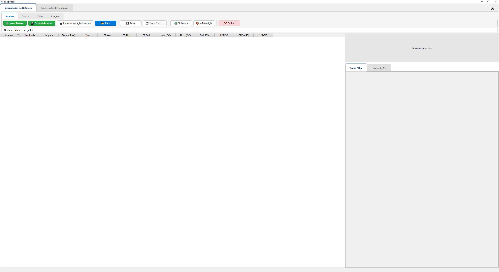
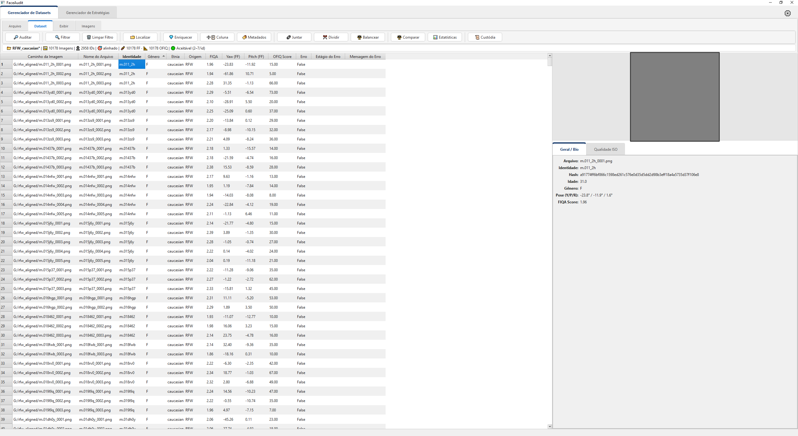
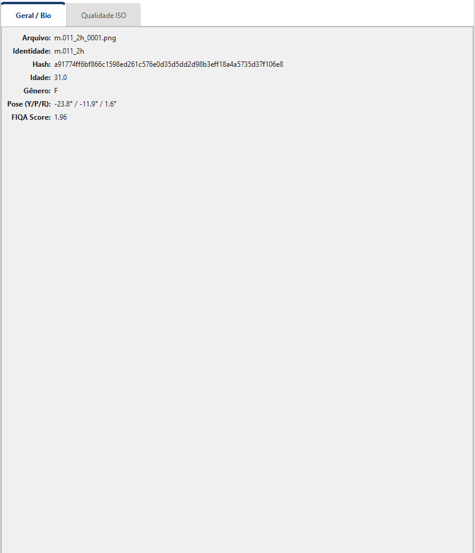
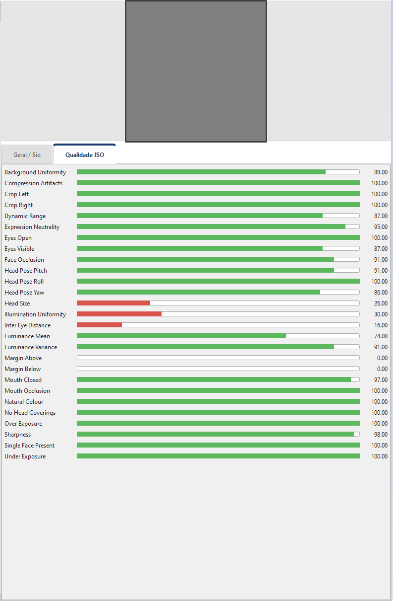

# 01 — Visão geral

## O que é o Gerenciador de Datasets

O **Gerenciador de Datasets** é o primeiro dos dois módulos principais
do FaceAudit (o outro é o **Gerenciador de Estratégias**). Sua função
é transformar **uma pasta de imagens faciais — ou um ou mais arquivos
de vídeo** — em um **dataset estruturado**: um arquivo `.parquet`
contendo, para cada face, todas as informações necessárias aos
cálculos forenses:

- **Embeddings biométricos** (vetores numéricos) extraídos por modelos
  **SEPAEL (V2 a V6)** via biblioteca *ForensicFace* — você escolhe
  quais rodar, entre os instalados na máquina.
- **Métricas de qualidade** — FIQA (do próprio ForensicFace) e OFIQ
  (ISO/IEC 29794-5).
- **Pose facial** estimada (yaw, pitch, roll).
- **Metadados administrativos** — identidade, gênero, etnia, origem,
  hash SHA-256 de cada imagem, caminho no disco.
- **Metadados de captura** (opcional) — EXIF/XMP da foto original:
  data, câmera, exposição, GPS.

Há **duas origens** possíveis para um dataset: uma **pasta de imagens**
(fluxo clássico — [capítulo 02](02_criando_dataset.md)) ou a **extração
de faces de vídeo(s)** por âncora, típica de material de vigilância
([capítulo 02b](02b_criando_dataset_de_video.md)).

Quando o dataset está pronto, ele é **enviado** ao Gerenciador de
Estratégias, onde participa de uma ou mais estratégias de cálculo de
razão de verossimilhança (LR).

> 💡 **Regra prática:** se a sua dúvida é *“como produzir embeddings a
> partir das minhas imagens?”* ou *“como conferir a qualidade do que
> tenho em mãos?”*, este é o módulo certo. Se for *“como comparar
> imagens A e B e obter um LR?”*, vá para o Gerenciador de Estratégias.

## Disponibilidade da aba

A aba do Gerenciador de Datasets **sempre aparece** na inicialização do
FaceAudit. Se a biblioteca `forensicface` ou os modelos SEPAEL não
estiverem disponíveis, a aba continua funcionando — apenas as
funcionalidades que **dependem** deles (criar/enriquecer com embeddings
e calcular qualidade) ficam **desabilitadas dentro dos diálogos**. Tudo
o que **não** depende do ForensicFace — **abrir**, **filtrar**,
**comparar**, **balancear**, **modificar caminhos**, **exportar** — continua
plenamente utilizável, inclusive só para leitura de datasets já prontos.

## Leiaute geral

Quando vazia (sem dataset carregado), a aba mostra a toolbar superior e
duas áreas em branco abaixo:

Os botões da toolbar que dependem de um dataset estão **desabilitados
em cinza**, indicando que é necessário primeiro **Abrir** ou criar
(**Novo**) um dataset.

Com um dataset carregado, o leiaute fica:

A janela divide-se em três blocos:

| Bloco | Posição | Conteúdo |
|---|---|---|
| **Toolbar (Ribbon)** | Faixa superior, ~130 px de altura | 4 abas (Arquivo / Dataset / Exibir / Imagens) + barra de status |
| **Tabela** | Painel esquerdo, ~70 % da largura | Uma linha por imagem; colunas configuráveis |
| **Painel de detalhes** | Painel direito, ~30 % da largura | Thumbnail + abas *Geral / Bio*, *Qualidade ISO* e *Metadados* |

O divisor entre tabela e detalhes é arrastável; a tabela tem
*stretch-factor* maior para que ela ocupe a maior parte do espaço quando
a janela é maximizada.

## A toolbar em formato ribbon

O FaceAudit adota o estilo **ribbon** do Microsoft Office para a barra
de ferramentas do Gerenciador de Datasets — os comandos são
agrupados em **4 abas**:

### Aba *Arquivo*

Operações de **ciclo de vida** do dataset:

| Botão | Função |
|---|---|
| ➕ **Novo Dataset** | Cria um dataset a partir de uma pasta de imagens (ver [capítulo 02](02_criando_dataset.md)) |
| 🎬 **Dataset de Vídeo** | Extrai faces de um ou mais vídeos por âncora, gerando um dataset (ver [capítulo 02b](02b_criando_dataset_de_video.md)) |
| 📥 **Importar extração de vídeo** | Reaproveita uma pasta de extração de vídeo já produzida (revisar + gerar dataset) |
| 📂 **Abrir** | Lê um `.parquet` existente do disco |
| 💾 **Salvar** / **Salvar Como…** | Sobrescreve o arquivo carregado / salva em outro caminho |
| 🧩 **Salvar Selecionados** | Grava os registros selecionados como um dataset novo, sem trocar o que está aberto (com opção de copiar as imagens junto) |
| 📚 **Biblioteca** | Copia o dataset para a biblioteca global (reusável entre projetos) |
| 🎯 **→ Estratégia** | Envia o dataset ao Gerenciador de Estratégias |
| ❌ **Fechar** | Descarta o dataset atual |

### Aba *Dataset*

Operações que **agem sobre o conteúdo**:

| Grupo | Botões | O que fazem |
|---|---|---|
| **Auditoria** | 🔎 *Auditar* | Análise de integridade biométrica + visualizações forenses |
| **Filtragem** | 🔍 *Filtrar* / 🗑️ *Limpar Filtro* | Subconjuntos por expressão; o filtro vira a visão ativa da tabela |
| **Exclusão** | 🗑️ *Excluir Selecionados* | Remove do dataset os registros selecionados, com a justificativa informada registrada na cadeia de custódia; nenhum arquivo de imagem é apagado e a exclusão é efetivada ao salvar |
| **Caminhos** | 🗂 *Modificar Caminhos* | Corrige `path_root`/`image_path` quebrado e/ou empacota o dataset em pasta portátil ([capítulo 03](03_carregando_e_localizando.md)) |
| **Enriquecimento** | 💎 *Enriquecer* / ➕📋 *Coluna* / 🏷️ *Metadados* | Adicionar/recalcular embeddings, FIQA e OFIQ, pose e demografia; coluna custom; editar rótulos e vocabulários |
| **Estrutural** | 🔗 *Juntar* / ✂️ *Dividir* / ⚖ *Balancear* | Concatenar; particionar por identidade ou índice; balancear amostras |
| **Análise** | ⚖️ *Comparar* / 📊 *Estatísticas* | Comparação par-a-par com outro dataset; estatísticas agregadas |
| **Custódia** | 📜 *Custódia* | Cadeia de custódia forense — log de operações com integridade SHA-256 |

### Aba *Exibir*

Controla **como o dataset é apresentado** — sem alterar o conteúdo:

| Botão | Função |
|---|---|
| 🖼 **Galeria** | Alterna entre tabela e galeria de thumbnails |
| 📋 **Colunas** | Abre o painel de colunas (*Relatório de Esquema*): quais ficam visíveis na tabela, cobertura, NaNs, mín/máx por coluna; exporta para CSV/Excel |

### Aba *Imagens*

Pipelines de **processamento de imagem** (desfoque, compressão JPEG/WebP,
recorte, oclusão, redimensionamento e passos de impressão/cópia como
curva de tons e meio-tom) que podem ser aplicados em lote a todas as
imagens do dataset:

| Botão | Função |
|---|---|
| ✂️ **Gerar Imagens** | Gera, numa pasta nova, a face de cada imagem de uma pasta escolhida — recortada com margem ou alinhada — com um manifesto de procedência. Não cria dataset e não exige dataset aberto |
| 🎨 **Editor** | Monta o pipeline interativamente com pré-visualização |
| 🌀 **Processar** | Aplica o pipeline a todas as imagens, gerando um **dataset novo**, autocontido, com as imagens processadas e o manifesto |

## A barra de status

Logo abaixo do ribbon, uma barra fina exibe o **status** do dataset
carregado: nome (com `*` quando há alterações não salvas), número de
imagens e de identidades, a marca *alinhado* quando for o caso, quantas
faces têm ForensicFace/OFIQ/SER-FIQ, o veredito de balanceamento e o
número de erros; com filtro ativo, a linha termina em *(Filtrado)*. Passe o mouse para ver um tooltip rich-text com metadados extras
(caminho do parquet, descrição, modo de caminho, cobertura por métrica,
detalhes do balanceamento, tamanho e data de modificação do arquivo).

Quando um filtro está ativo, o botão **Filtrar** muda para a cor
amarela e **Limpar Filtro** é habilitado.

## A tabela

A tabela do lado esquerdo é uma `QTableView` ligada a um modelo
declarativo (`DatasetTableModel`) que se adapta à estrutura do
dataset: cada coluna tem **rótulo** legível, **role** (identidade,
metadado ou derivada), **vocabulário** (para colunas tipo enum) e
**visibilidade-padrão**. Por isso:

- Ao **passar o mouse** sobre qualquer célula de uma linha, a dica
  mostra a miniatura da imagem (ou o caminho, quando a imagem não é
  encontrada).
- Colunas com vocabulário definido (gênero, etnia, origem) abrem um
  *combo box* na edição em vez de campo de texto livre.
- A ordenação por clique em cabeçalho funciona para colunas
  numéricas e ordenáveis; embeddings e estruturas complexas são
  ocultados por padrão.
- Clique-direito numa **célula** abre um menu de contexto (selecionar a
  coluna inteira, salvar a seleção como novo dataset, excluir os
  registros selecionados, definir/substituir valores em lote, comparar
  um par);
  clique-direito no **cabeçalho** oferece **Propriedades da Coluna**,
  **Remover Coluna** e **Mostrar/Ocultar Colunas**. Na **galeria** de
  miniaturas o clique-direito tem seu próprio menu de triagem. Todos
  detalhados no [capítulo 04](04_navegando_dataset.md).

## O painel de detalhes

Quando uma linha é selecionada, o painel direito mostra:

- **Topo:** miniatura grande da imagem (somente leitura).
- **Aba *Geral / Bio*:** arquivo, identidade, hash SHA-256, idade e
  gênero estimados, pose (Y/P/R), **FIQA Score** e **Detecção Score**:

- **Aba *Qualidade ISO*:** barras visuais com os indicadores **OFIQ**
  (sharpness, exposição, oclusão, pose, etc.). Se o dataset não tem
  colunas OFIQ, a aba mostra *"Dados OFIQ não calculados."*:

- **Aba *Metadados*:** árvore com todas as tags EXIF/XMP/IPTC lidas da
  foto original, agrupadas por origem, com um campo *"Filtrar por tag ou
  valor…"*. São declarações do arquivo, não medições — metadado
  embutido pode ser editado ou forjado. Só tem conteúdo quando o dataset
  foi criado (ou enriquecido) com a extração de EXIF/XMP ligada.

> ⚠️ Se a miniatura mostra *"Imagem não encontrada"* mesmo com o
> dataset carregado, é provável que o caminho `image_path` esteja
> quebrado — o parquet foi gerado em outra máquina (ou foi
> *commitado* sem as imagens). Use a função **Modificar Caminhos**
> ([capítulo 03](03_carregando_e_localizando.md)) para corrigir.

## Próximos passos

- **Quer criar um dataset do zero?** Vá para [capítulo 02 — Criando
  um dataset](02_criando_dataset.md).
- **Tem vídeos e quer achar um investigado neles?** Veja [capítulo 02b
  — Criando a partir de vídeo](02b_criando_dataset_de_video.md).
- **Já tem um parquet pronto?** Pule para [capítulo 03 — Carregando
  e modificando caminhos](03_carregando_e_localizando.md).
- **Quer adicionar métricas em um dataset existente?** Veja
  [capítulo 05 — Enriquecimento](05_enriquecimento.md).
