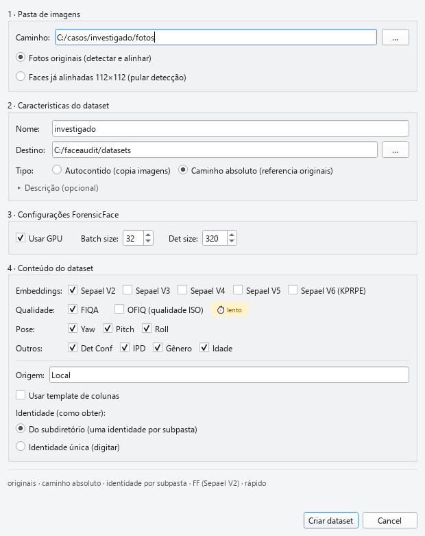

# 02 — Criando um dataset

Este capítulo descreve o fluxo completo de **criar um dataset do zero**,
a partir de uma pasta de imagens faciais. O ponto de entrada é o botão
➕ **Novo** da aba *Arquivo* da toolbar.

> 🎬 Para criar um dataset **a partir de vídeo** (procurar um investigado
> ao longo de gravações de CFTV/celular), veja o
> [capítulo 02b](02b_criando_dataset_de_video.md) — é um fluxo próprio,
> com âncora e revisão humana.

## Sumário do capítulo

1. [Antes de começar — o que você precisa](#antes-de-começar)
2. [O diálogo *Novo dataset* — os quatro grupos](#o-diálogo-novo-dataset)
3. [Grupo 1 — Pasta de imagens e tipo de entrada](#grupo-1)
4. [Grupo 2 — Características do dataset](#grupo-2)
5. [Identidade: subdiretório, única ou template](#identidade)
6. [O Criador de Template — mapeando metadados a partir da estrutura de pastas](#o-criador-de-template)
7. [Grupo 3 — Configurações ForensicFace](#grupo-3)
8. [Grupo 4 — Conteúdo do dataset (por tipo de coluna)](#grupo-4)
9. [Alinhamento — original ou já alinhada](#alinhamento-facial)
10. [O que acontece quando você clica **Criar dataset**](#o-que-acontece)
11. [Erros comuns e como evitá-los](#erros-comuns)
12. [Workflows recomendados](#workflows-recomendados)

---

## Antes de começar

Para criar um dataset você precisa de:

| Item | Por que |
|---|---|
| **Uma pasta de imagens** | A entrada de tudo. Formatos suportados: `.jpg`, `.jpeg`, `.png`, `.bmp`, `.tif`, `.tiff`. |
| **Forensic Face** (lib `forensicface`) instalada e funcional | Detecção facial, alinhamento e extração de embeddings. Sem ela, o botão *Novo* fica indisponível e a aba inteira é desabilitada. |
| **Modelos SEPAEL** (V2 e/ou V4) acessíveis | Pesos do encoder de embedding. Configurados na variável `paths.library` do `config.json`. |
| **Binário OFIQ** (`OFIQSampleApp`) + pasta `data/` do OFIQ | Apenas se você quiser scores OFIQ. Caminho configurado em `config.json → ofiq`. |
| **GPU NVIDIA com CUDA** *(opcional, mas fortemente recomendado)* | Inferência em CPU é viável para datasets pequenos mas fica impraticável acima de algumas centenas de imagens. |

> 💡 Se você só vai abrir um `.parquet` que outra pessoa preparou,
> nada disso é necessário — vá direto para [capítulo 03](03_carregando_e_localizando.md).

## O diálogo Novo dataset

Ao clicar em ➕ **Novo** abre-se o diálogo **"Novo dataset"**, empilhado
em quatro grupos numerados:



| Grupo | O que controla |
|---|---|
| **1 · Pasta de imagens** | Caminho da pasta + tipo de entrada (fotos originais vs faces já alinhadas) |
| **2 · Características do dataset** | Nome, pasta de destino, tipo de armazenamento e de imagem, descrição opcional |
| **3 · Configurações ForensicFace** | GPU, *batch size* e *det size* do motor de detecção/embedding |
| **4 · Conteúdo do dataset** | Quais colunas gerar (embeddings, qualidade, pose, demografia), a origem e a estratégia de identidade |

No rodapé, um **resumo dinâmico** cinza descreve a configuração atual
(ex.: *"originais · caminho absoluto · identidade por subpasta · FF
(Sepael V2) · rápido"*), um **aviso vermelho** aponta o primeiro
impedimento, e o botão **Criar dataset** só habilita quando não há
bloqueio.

## Grupo 1 — Pasta de imagens e tipo de entrada

| Campo | Descrição |
|---|---|
| **Caminho:** | Pasta a ser ingerida. O botão `…` abre um seletor nativo. Ao escolher, se o **Nome** ainda estiver vazio, ele é preenchido com o nome da pasta. |
| ⦿ **Fotos originais (detectar e alinhar)** *(padrão)* | Suas imagens estão "como saíram da câmera". O ForensicFace **detecta e alinha** cada face durante a extração. |
| ⦿ **Faces já alinhadas 112×112 (pular detecção)** | Seu input já é crop 112×112 pós-ForensicFace. Pula detect+align (**~50% mais rápido**). Este rádio é o **interruptor mestre**: ao marcá-lo, some tudo que só existe na foto original (pose, demografia, OFIQ, *det size*). |

## Grupo 2 — Características do dataset

| Campo | Padrão | Descrição |
|---|---|---|
| **Nome:** | (vazio) | Nome lógico do dataset — vira o arquivo `.parquet` e identifica o dataset em todos os diálogos. |
| **Destino:** | pasta de datasets | Pasta onde o `.parquet` será gravado (+ botão `…`). |
| **Tipo:** | **Caminho absoluto** | *Autocontido (copia imagens)* torna o dataset portátil; *Caminho absoluto (referencia originais)* é mais leve mas quebra se as imagens mudarem de lugar. |
| **Imagem:** | Face alinhada | **Só aparece no modo Autocontido** — decide *o que copiar*: *Face original* ou *Face alinhada*. (Em *Faces já alinhadas*, *Face original* fica desabilitada.) |
| ▸ **Descrição (opcional)** | (recolhido) | Painel colapsável com um campo de texto livre — metadado do **dataset inteiro** (não é coluna). |

## Identidade

A estratégia de identidade fica no **grupo 4**, controlada pelo checkbox
**Usar template de colunas**:

**Sem template** (padrão) — o campo **Identidade (como obter):** oferece:

| Opção | Como funciona |
|---|---|
| ⦿ **Do subdiretório (uma identidade por subpasta)** *(padrão)* | A identidade de cada imagem é o **nome da pasta-pai**. `John_Doe/img_001.png` → `identity="John_Doe"`. Cobre os datasets clássicos (CASIA-WebFace, LFW, etc.). |
| ⦿ **Identidade única (digitar)** | Todas as imagens são **da mesma pessoa**. Revela os campos **Identidade:** (obrigatório), **Gênero:** (`""`/`Male`/`Female`) e **Etnia:**. Ideal para um caso pericial de um só investigado. |

**Com template** — marque **Usar template de colunas** para revelar o
combo **Template:** (lista *"Nenhum (usar identidade base)"* + cada
template salvo, prefixado com 📄) e o botão **Criar template…**. O
template extrai `identity` **e** outras colunas (gênero, etnia, origem,
colunas custom) da estrutura de pastas/arquivos. Veja a seção seguinte.

## O Criador de Template

Um *template* é um arquivo `.json` salvo em `data/templates/` que
descreve como derivar metadados a partir da estrutura de pastas e
nomes de arquivo. Uma vez salvo, o template aparece automaticamente
no dropdown **Template** do diálogo *Novo Dataset*.

### Anatomia do template

```json
{
  "name": "BFW_Oficial",
  "description": "Balanced Faces in the Wild",
  "separator": "_",
  "use_separator": true,
  "folder_map": {
    "0": ["identity"],
    "1": ["gender"]
  },
  "filename_map": {
    "0": "identity",
    "1": "ethnicity"
  },
  "identity_from_parent": false
}
```

| Campo | Significado |
|---|---|
| `name` | Nome exibido no dropdown |
| `description` | Texto livre (não usado pela engine) |
| `separator` | Caractere separador para dividir nomes de pasta e arquivo (`_`, `-`, `.`, etc.) |
| `use_separator` | Quando `false`, a divisão não é aplicada — o nome inteiro vira o valor único |
| `folder_map` | Para cada **nível de profundidade** (`0` = primeira subpasta), lista de atributos a extrair, na ordem |
| `filename_map` | Para cada **índice de parte do nome do arquivo** (após split pelo separador), qual atributo recebe o valor |
| `identity_from_parent` | Quando `true`, **força** `identity` a ser o nome da pasta-pai imediata, ignorando `folder_map` para esse atributo |

### Aplicando o template

Para a estrutura abaixo, com o template do exemplo acima:

```
dataset_root/
├── John_Male/
│   └── person_001.jpg     → identity="John", gender="Male" (folder_map)
│                            identity sobrescrita="person", ethnicity="001" (filename_map)
└── Jane_Female/
    └── person_002.jpg
```

O sistema:
1. Percorre os níveis de pasta aplicando `folder_map` em ordem
2. Aplica `filename_map` sobrepondo eventuais valores anteriores
3. Se `identity_from_parent=true`, sobrescreve `identity` no fim

> ⚠️ Quando o mesmo atributo (ex: `identity`) aparece tanto em
> `folder_map` quanto em `filename_map`, **a última definição
> prevalece**. Se você quer ignorar uma parte específica, use o
> atributo especial `Ignorar` (não diferencia maiúsculas).

### O diálogo do criador

O criador tem duas abas:

| Aba | Função |
|---|---|
| 📁 **Estrutura de Pastas** | Permite adicionar regras `[Nível X] → atributo`. Use o `SpinBox` (0–10) para o nível e o combo para o atributo. |
| 📄 **Nome do Arquivo** | Permite adicionar regras `[Parte X] → atributo`. Mesmas faixas e atributos. |

No topo: nome do template + ativação do separador + checkbox
*"Usar nome da pasta pai imediata como Identidade"*.

Templates são salvos automaticamente em `data/templates/{name}.json`.

## Grupo 3 — Configurações ForensicFace

Uma linha com os parâmetros do motor de detecção/embedding. **GPU** e
**batch size** herdam o default das *Configurações do Sistema*; alterá-los
aqui vale **só para esta extração** (não grava no global).

| Controle | Faixa | Padrão | Significado |
|---|---|---|---|
| ☑️ **Usar GPU** | — | do Sistema | Roda a inferência na GPU. Muito mais rápido acima de algumas centenas de imagens. |
| **Batch size:** | 1 – 512 | do Sistema | Faces por chamada do modelo. Maior = mais paralelismo/GPU, mas mais memória. |
| **Det size:** | 160 – 1280 (passo 32) | 320 | Resolução do detector. Maior detecta faces menores/de baixa resolução (**~2× o custo** ao dobrar). **Só afeta fotos originais** — some em *Faces já alinhadas* (vira a dica *"Det size não se aplica a faces já alinhadas"*). |

## Grupo 4 — Conteúdo do dataset

O conteúdo é agrupado **por tipo de coluna**. Marque só o que precisa —
**desmarcar remove a coluna** do parquet.

| Categoria | Itens | Padrão |
|---|---|---|
| **Embeddings:** | Um checkbox **por modelo instalado** (`Sepael V2`, `V3`, `V4`, `V5`, `V6 (KPRPE)`). Marcar dois gera `embedding_v2` **e** `embedding_v4` no mesmo parquet. | `Sepael V2` marcado |
| **Qualidade:** | **FIQA** (CR-FIQA — disponível também em faces já alinhadas) · **OFIQ (qualidade ISO)** ⏱ lento (exige a foto **original**; some no modo alinhado) | FIQA marcado; OFIQ desmarcado |
| **Pose:** | **Yaw**, **Pitch**, **Roll** (some no modo *Faces já alinhadas*) | todos marcados |
| **Outros:** | **Det Conf**, **IPD**, **Gênero**, **Idade** (some no modo *Faces já alinhadas*) | todos marcados |

Abaixo de uma divisória:

| Campo | Padrão | Observação |
|---|---|---|
| **Origem:** | `Local` | Proveniência de **cada face** — vira a coluna `origin`. Rótulo livre útil pra distinguir fontes (`Local`, `CCTV_Aeroporto`, `Documento_ID`). Constante nesta ingestão. |
| ☑️ **Usar template de colunas** | desmarcado | Alterna entre a estratégia de **identidade** (subdiretório/única) e o **template** de colunas — veja a [seção Identidade](#identidade). |

> 💡 A antiga opção **SER-FIQ** foi **removida da interface** (o backend
> ainda a suporta, mas o diálogo não a expõe). Use **FIQA** ou **OFIQ**
> para qualidade de imagem.

> 💡 Recomendação geral: **`Sepael V2` + FIQA + pose/demografia**, GPU
> ligada. Marque um segundo modelo (ex.: `Sepael V4`) quando for fazer
> experimentos comparativos de pipeline — ou adicione depois pelo
> [capítulo 05](05_enriquecimento.md).

## Alinhamento facial

O comportamento de alinhamento é decidido pelo **tipo de entrada**
(grupo 1) combinado com o **tipo de imagem** (grupo 2, só no modo
Autocontido):

| Cenário | Configuração | Resultado |
|---|---|---|
| **A — Originais, alinhar em RAM** | *Fotos originais* + *Caminho absoluto* (ou Autocontido/*Face original*) | O ForensicFace detecta e alinha só para extrair o embedding. **As imagens no disco continuam as originais.** |
| **B — Originais, materializar alinhadas** | *Fotos originais* + *Autocontido* + *Imagem = Face alinhada* | Salva as faces **112×112 alinhadas** na pasta do dataset; o parquet aponta para elas. |
| **C — Já alinhadas** | *Faces já alinhadas 112×112* | Pula detect+align (**~50% mais rápido**). Some tudo que só existe na foto original (pose, demografia, OFIQ, *det size*). |

> ⚠️ Sem ao menos um modelo de **embedding** marcado, não há detecção nem
> alinhamento — os cenários A/B exigem o ForensicFace. Se nenhum modelo
> estiver instalado, os checkboxes de conteúdo ficam desabilitados.

## O que acontece

Ao clicar em **Criar dataset**, o fluxo é assíncrono — um *worker* em
thread separada conduz toda a extração, enquanto a UI mostra um diálogo
de progresso. Em alto nível, o pipeline executa:

```
0 % — Inicializando
 ↓
EXTRACT (≈10 %)
 ├── Varre a pasta (por subpasta, identidade única ou template)
 ├── Aplica o template (ou identifica pela pasta-pai)
 └── Calcula SHA-256 de cada imagem
 ↓
TRANSFORM
 ├── Aplica gênero/etnia/origem padrão se informados
 ├── (15 → 60 %) ForensicFace — embeddings + FIQA + pose/demografia
 │    [modo Autocontido/Face alinhada: salva PNGs 112×112 no destino]
 └── (60 → 95 %) OFIQ — métricas ISO (se marcado)
 ↓
LOAD (≈100 %)
 ├── Marca faces que falharam (coluna `error`, `error_stage`, `error_message`)
 └── Salva `{Destino}/{nome}.parquet`
 ↓
Dataset carregado na UI
```

O progresso é exibido em tempo real (mensagens + porcentagem).
Você pode cancelar a qualquer momento — o sistema **salva o parquet
parcial** antes de abortar.

## Erros comuns

| Sintoma | Causa | Solução |
|---|---|---|
| Botão **Criar dataset** travado em cinza | O aviso vermelho no rodapé aponta o que falta (pasta, nome, destino, template ou identidade única) | Preencha o campo indicado no aviso |
| Nenhum checkbox de conteúdo habilitado | ForensicFace indisponível (nenhum modelo em `~/.forensicface/models/`) | Instale/configure os modelos SEPAEL — veja [Antes de começar](#antes-de-começar) |
| Dataset criado mas **vazio** | A pasta não continha imagens de formato suportado | Confira se há `.jpg`/`.png`/`.bmp`/`.tif`. O log do worker lista o que foi varrido |
| Muitas linhas com `error=True` | ForensicFace não detectou face (faces muito pequenas, pose extrema, fora de foco) | Aumente **Det size** para 640/960; confira se as imagens **não estão já alinhadas** sendo tratadas como originais |
| Erro `ForensicFace não encontrado` na inicialização | A lib `forensicface` ou os modelos SEPAEL não estão instalados/configurados | Veja a seção [Antes de começar](#antes-de-começar) |
| GPU OOM (Out of Memory) | Imagens grandes + **Det size** alto + dois modelos de embedding simultâneos | Marque só um modelo, baixe **Det size** ou o **Batch size** |

## Workflows recomendados

### Workflow 1 — Caso pericial simples (uma pessoa)

> 📷 *"Tenho 200 fotos do investigado em pasta única, formato JPG variado."*

1. ➕ **Novo** → **Caminho:** selecionar a pasta
2. Entrada **Fotos originais (detectar e alinhar)**
3. Grupo 4 → **Identidade única (digitar)** → *Identidade:* `SUSPEITO_001` (Gênero/Etnia opcionais)
4. **Origem:** `Caso_2024_001`
5. Conteúdo: `Sepael V2` + FIQA + pose/demografia; marque **OFIQ** se precisar de qualidade ISO
6. **Criar dataset**

### Workflow 2 — Dataset de pesquisa (várias identidades)

> 🎓 *"CASIA-WebFace baixado, estrutura `casia/n000001/0001.jpg`."*

1. ➕ **Novo** → **Caminho:** `casia/`
2. Grupo 4 → **Do subdiretório (uma identidade por subpasta)** — o nome da subpasta vira a identidade
3. **Origem:** `CASIA-WebFace`
4. Conteúdo: marque `Sepael V2` **e** `Sepael V4` se quiser comparar pipelines depois
5. **Criar dataset**

### Workflow 3 — Dataset complexo (template customizado)

> 🧪 *"Tenho `bfw/asian_male/identity_42/photo_03.jpg` e quero
> `identity`, `gender`, `ethnicity` separados."*

1. ➕ **Novo** → **Caminho:** `bfw/`
2. Grupo 4 → marcar **Usar template de colunas** → **Criar template…**
3. Na aba *Estrutura de Pastas*:
   - Nível 0 → `ethnicity` *(separator=`_` ativo: `asian_male` vira `["asian","male"]`)*
   - Nível 0 → `gender` *(captura o segundo item)*
   - Nível 1 → `identity`
4. Sem split de filename (ou Nível 0 → `Ignorar`)
5. Salvar template como `BFW` e selecioná-lo no combo **Template:**
6. **Criar dataset**

### Workflow 4 — Já alinhado, máxima velocidade

> ⚡ *"500 PNGs 112×112 prontos, só preciso dos embeddings."*

1. ➕ **Novo** → **Caminho:** selecionar a pasta
2. Entrada **Faces já alinhadas 112×112 (pular detecção)**
3. Identidade por subdiretório ou única, conforme a organização
4. Conteúdo: só os embeddings + FIQA (Pose/Outros/OFIQ somem por serem inaplicáveis a faces alinhadas)
5. **Criar dataset**

---

[← Capítulo 01 — Visão geral](01_visao_geral.md) · [Capítulo 03 — Carregando e localizando →](03_carregando_e_localizando.md)
