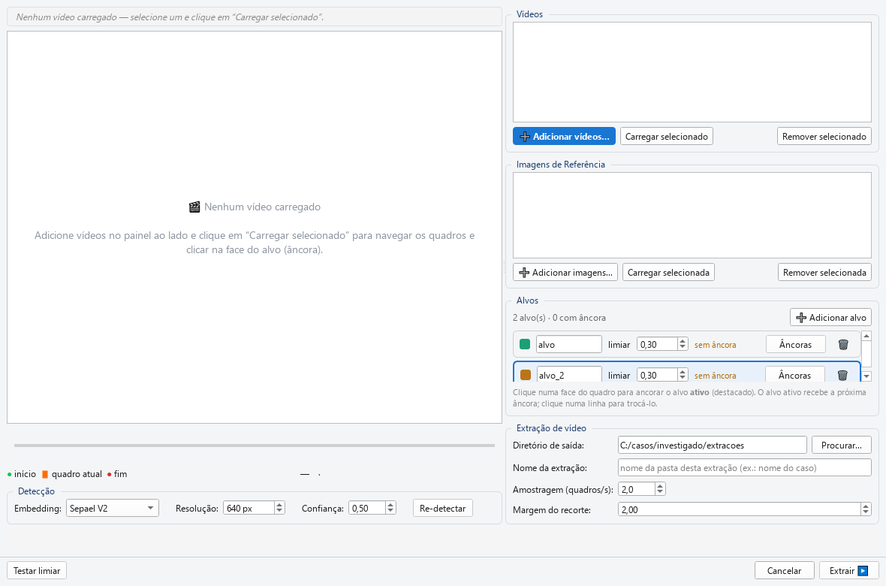
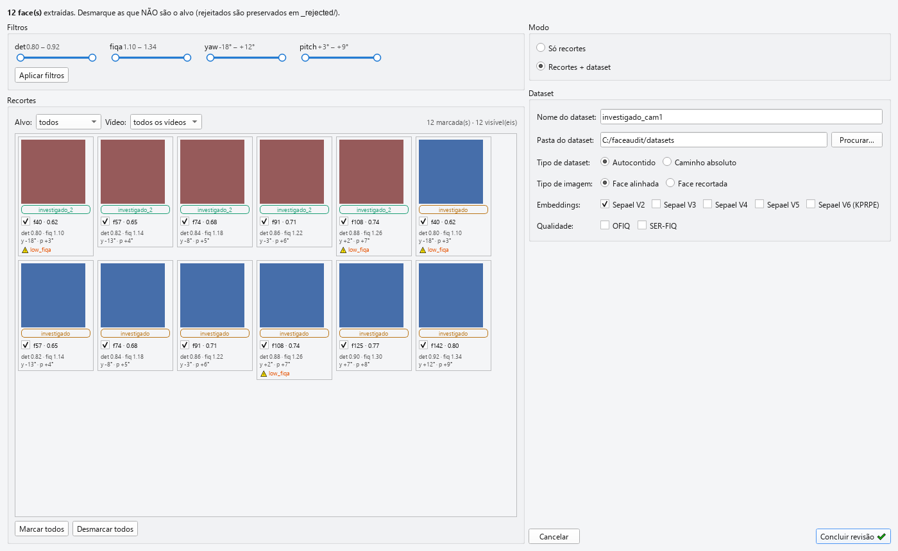

# 02b — Criando um dataset a partir de vídeo

Este capítulo descreve como **extrair um dataset facial de um ou mais
vídeos**, procurando uma pessoa-alvo ao longo das imagens. É o fluxo
típico de perícia sobre material de vigilância (CFTV), gravações de
celular ou qualquer vídeo onde você precisa recortar as faces de um
investigado.

Diferente do [capítulo 02](02_criando_dataset.md), que parte de uma
pasta de imagens, aqui o ponto de partida é o **vídeo** e uma **âncora**
(a face de referência que a ferramenta vai perseguir quadro a quadro).

## Sumário do capítulo

1. [Quando usar — e a lógica das três etapas](#quando-usar)
2. [Os dois botões de vídeo](#os-dois-botões)
3. [Janela A — configurar a extração](#janela-a)
   - [Grupo *Vídeos*](#grupo-vídeos)
   - [Prévia e linha do tempo](#prévia-e-linha-do-tempo)
   - [Grupo *Detecção*](#grupo-detecção)
   - [Grupo *Alvos* e ancoragem](#grupo-alvos)
   - [Grupo *Imagens de Referência*](#grupo-imagens-de-referência)
   - [*Testar limiar* — calibrando a identidade](#testar-limiar)
   - [Grupo *Extração de vídeo*](#grupo-extração-de-vídeo)
   - [*Extrair*](#extrair)
4. [Janela B — revisão e configuração do dataset](#janela-b)
5. [Importar uma extração já produzida](#importar)
6. [A pasta do run e o manifesto de reprodutibilidade](#a-pasta-do-run)
7. [Ressalva forense — seleção condicionada](#ressalva-forense)
8. [Erros comuns](#erros-comuns)
9. [Workflows recomendados](#workflows-recomendados)

---

## Quando usar

Use a extração de vídeo quando você tem **um vídeo (ou vários)** e a
**foto/face de um investigado**, e quer produzir um dataset só com as
aparições daquela pessoa.

| Você tem… | Use… |
|---|---|
| Uma pasta de imagens já separadas | [Novo Dataset](02_criando_dataset.md) |
| Um ou mais vídeos + uma face de referência do alvo | **Dataset de Vídeo** (este capítulo) |
| Uma pasta de extração de vídeo que **já rodou** (sua ou de um colega) | **Importar extração de vídeo** ([abaixo](#importar)) |

### A lógica das três etapas

O fluxo é deliberadamente **separado em três momentos** — isso é o que
o torna defensável em laudo:

```
1. EXTRAÇÃO (automática)      →  2. REVISÃO (humana)        →  3. DATASET
   percorre o(s) vídeo(s),        o perito confirma face a       monta o parquet só
   recorta as faces que se        face o que é (e o que          com as faces aceitas
   parecem com a âncora           NÃO é) o alvo                   e extrai embeddings
   (Janela A → run em disco)      (Janela B, grade de recortes)   (Janela B, modo dataset)
```

A **extração** nunca decide sozinha o dataset final: ela produz uma
**pasta de run** com candidatos + toda a proveniência. A **revisão
humana** é obrigatória antes de gerar o dataset. Você pode fazer as
três de uma vez, ou parar na etapa 1 (produzir o run agora, revisar e
importar depois).

## Os dois botões

Na aba **Arquivo** da toolbar do Gerenciador de Datasets há dois botões
de vídeo:

| Botão | O que faz |
|---|---|
| 🎬 **Dataset de Vídeo** *(verde)* | Inicia uma extração **nova** — abre a Janela A para você escolher vídeos, cravar a âncora e extrair. |
| 📥 **Importar extração de vídeo** | Reaproveita uma **pasta de run já existente** no disco — pula direto para a revisão (Janela B). Não reprocessa o vídeo. |

> 💡 Os dois caminhos **convergem na Janela B** (revisão). A diferença é
> só onde você começa: no vídeo cru (🎬) ou numa extração pronta (📥).

---

## Janela A

Clicar em 🎬 **Dataset de Vídeo** abre a janela **"🎬 Criar Dataset a
partir de Vídeo"**, dividida em **duas colunas**:



| Coluna | Conteúdo |
|---|---|
| **Esquerda** | A **prévia** grande (onde você navega os quadros e clica na face), a **linha do tempo** e a barra **Detecção**. |
| **Direita** | Os grupos **Vídeos**, **Imagens de Referência**, **Alvos** e **Extração de vídeo**. |

Na base há uma **barra de ações fixa** (sempre visível): **Testar
limiar**, **Cancelar** e **Extrair ▶**. Ao abrir, a janela já cria **um
alvo** vazio chamado `alvo`.

### Grupo *Vídeos*

| Elemento | Função |
|---|---|
| **Lista de vídeos** | Um vídeo por linha. Cada linha tem os campos **Início** e **Fim** (HH:mm:ss) — você pode definir o **trecho** a percorrer *direto na linha, sem carregar o vídeo*. Padrão = vídeo inteiro (`0` → duração). |
| ➕ **Adicionar vídeos…** | Escolhe um ou mais arquivos. Aceita os contêineres comuns (`.mp4`, `.mov`, `.avi`, `.mkv`, `.wmv`), os de CFTV/vigilância (`.ts`/`.m2ts`/`.mts`, `.asf`, `.dav` da Dahua) e outros suportados pelo OpenCV/FFmpeg. O alvo é procurado em **todos** eles, gerando **um único dataset** (cada face marcada com seu vídeo de origem). |
| **Carregar selecionado** | Abre o vídeo selecionado na prévia (inicializa o detector com a Resolução/Confiança atuais). Duplo-clique na linha faz o mesmo. |
| **Remover selecionado** | Tira o vídeo da lista. |

> 💡 O botão em **destaque azul** muda com o estado: com a lista vazia,
> *Adicionar vídeos…* fica realçado; assim que há um vídeo, o realce
> passa para *Carregar selecionado*.

### Prévia e linha do tempo

O topo da coluna esquerda mostra o **cabeçalho "carregado"** (ex.:
*🎬 Vídeo carregado: cam1.mp4*) — distinto do que está apenas
selecionado na lista.

A **prévia** exibe o quadro atual. Depois de detectar, cada face ganha
um retângulo: **azul** para faces não ancoradas, na **cor do alvo** para
faces já ancoradas naquele quadro. **Clicar** sobre uma face a define
como âncora do alvo ativo.

A **linha do tempo** (sob a prévia) tem **três alças** e **não** tem
play/pause:

| Alça | Cor | Papel |
|---|---|---|
| **início** | 🟢 verde | Limite inicial do **trecho** percorrido na extração |
| **quadro atual** | 🟧 laranja | Só navega para você visualizar e ancorar |
| **fim** | 🔴 vermelho | Limite final do **trecho** |

As alças de início/fim e os campos **Início/Fim** da lista ficam
sincronizados. Abaixo, uma linha de informação mostra *"Quadro i / N"* e
*"Janela: quadro s–e · N quadro(s) · X.Xs"*.

### Grupo *Detecção*

Barra sob a prévia com os parâmetros do detector:

| Controle | Faixa | Padrão | Significado |
|---|---|---|---|
| **Embedding:** | modelos instalados | Sepael V2 | Modelo usado na re-identificação — é o **cosseno dele** que decide se a face é o alvo. Só aparecem os modelos instalados na máquina. **Trocar o modelo invalida todas as âncoras** e exige recarregar o vídeo. |
| **Resolução:** | 256–1280 px (passo 32) | **640 px** | Tamanho de entrada do detector. Maior = detecta faces menores/distantes (vigilância), mais lento. `320 ≈ rápido · 640 ≈ recomendado · 960 ≈ faces pequenas`. |
| **Confiança:** | 0.05–0.9 (passo 0.05) | **0.50** | Confiança mínima da detecção. ↓ aceita detecções fracas ao custo de mais falsos positivos. |
| ☑️ **Metadados do vídeo** | — | desmarcado | Lê os metadados embutidos no arquivo de vídeo (início da gravação, câmera, taxa de bits, localização). A data de captura de **cada face** é *início da gravação + instante do quadro*, e a data normalizada só sai quando o arquivo declara o fuso explicitamente. |
| **Re-detectar** | — | — | Aplica a Resolução/Confiança atuais e re-detecta o quadro exibido **sem recarregar o vídeo**. Reconstrói o detector só quando esses valores mudaram. |

> 💡 A **rotação** declarada no contêiner (vídeo de celular gravado em
> retrato) é **sempre** lida e aplicada a todo quadro — na prévia, no
> quadro-âncora e na extração —, independente da caixa *Metadados do
> vídeo*. O OpenCV ignora essa etiqueta, e sem a correção o quadro
> chegaria deitado ao detector. A rotação aplicada fica registrada no
> manifesto.

### Grupo *Alvos*

Um **alvo** é uma pessoa a procurar. Cada alvo vira uma **identidade**
(uma pasta) no dataset. O cabeçalho mostra *"N alvo(s) · M com âncora"* +
o botão ➕ **Adicionar alvo**.

Cada linha de alvo tem:

| Elemento | Função |
|---|---|
| 🔵 **bolinha de cor** | Cor estável do alvo (nas caixas da prévia e nos chips da revisão). |
| **rótulo editável** | Vira a pasta da face e a coluna `identity` do dataset. |
| **limiar** | Spin (−1.0 a 1.0, passo 0.05, padrão **0.30**) — limiar de identidade (cosseno) **próprio de cada alvo**; abaixo dele a face é descartada. |
| **status da âncora** | Âmbar *"sem âncora"* → verde *"N âncora(s) · X vídeo · Y foto"*. |
| **Âncoras** | Abre o diálogo para ver/combinar/remover as âncoras (desabilitado enquanto não há âncora). |
| **🗑** | Remove o alvo (sempre resta ≥1). |

**Como ancorar:** selecione a linha do alvo (o **ativo** fica com borda
azul) e **clique na face dele** no quadro. O primeiro clique cria a
âncora; **cliques adicionais no mesmo alvo, em outros quadros ou outros
vídeos, acrescentam âncoras** (multifonte). O status passa a contar
quantas âncoras e de que fontes.

**Diálogo *Âncoras · &lt;rótulo&gt;*** — lista cada âncora com miniatura
e origem (*"📷 foto · arquivo"* ou *"🎞 vídeo · quadro i"*), cada uma com
**Remover**. No topo, a **Combinação**:

| Modo | Comportamento |
|---|---|
| **Centroide (média das âncoras)** | Compara cada face com a **média** das âncoras. Mais conservador. |
| **Todas as âncoras (casa com qualquer uma)** | Casa com o **máximo** entre as âncoras. Mais permissivo (recall). |

> 💡 Várias âncoras (a pessoa em ângulos/iluminações diferentes) deixam a
> busca mais robusta. Use *Centroide* quando as âncoras são todas boas e
> frontais; *Todas as âncoras* quando você tem poses bem distintas.

### Grupo *Imagens de Referência*

Espelha o grupo *Vídeos*, mas para **fotos estáticas** do alvo
("tenho a foto da pessoa, ache nos vídeos"):

| Elemento | Função |
|---|---|
| **Lista de imagens** | Fila de fotos de referência. |
| ➕ **Adicionar imagens…** | Multi-seleção de imagens (os mesmos formatos aceitos na criação a partir de pasta: `.jpg`/`.jpeg`/`.jfif` e variantes, `.png`, `.bmp`, `.webp`, `.tif`/`.tiff`). |
| **Carregar selecionada** | Abre a foto na prévia em **modo imagem** para você clicar na face e ancorar o alvo ativo. |
| **Remover selecionada** | Tira a foto da lista. |

Quando uma imagem é carregada, a **linha do tempo é substituída** por
uma barra de navegação de imagem: **◀ Anterior** · *"Imagem i / N —
nome"* · **Próxima ▶** (cíclica). Clique na face da foto para ancorar,
exatamente como num quadro de vídeo.

> 💡 As imagens de referência **carregadas** ficam registradas no
> manifesto (com hash), mesmo as que você não chegou a usar como âncora
> — parte da cadeia de custódia. Veja [a pasta do run](#a-pasta-do-run).

### Testar limiar

O botão **Testar limiar** (barra de ações) amostra **~14 quadros
distribuídos por todos os vídeos** e mostra, para o alvo **ativo**, a
distribuição (mín / p5 / mediana / p95 / máx) de:

- **similaridade** com a âncora,
- **det_score** (confiança da detecção),
- **fiqa** (qualidade),

além dos contadores **aceitos (≥ limiar) / abaixo do limiar / sem face**.

Use-o para **calibrar o limiar de identidade** de cada alvo *antes* de
extrair — subir o limiar reduz falsos positivos; baixá-lo aumenta o
recall. Exige o alvo ativo já ancorado.

### Grupo *Extração de vídeo*

| Campo | Padrão | Significado |
|---|---|---|
| **Diretório de saída:** | `{paths.library}/video_runs` | Pasta-mãe onde a **pasta do run** será criada (+ botão *Procurar…*). |
| **Nome da extração:** | nome do 1º vídeo | Vira o **nome da pasta do run**. Se a pasta já existir, um número é acrescentado — **nunca sobrescreve**. Um aviso vermelho bloqueia *Extrair* em caso de colisão. |
| **Amostragem (quadros/s):** | **2.0** | FPS-alvo — quantos quadros/s são examinados. Ao lado, *"≈ 1 a cada N quadros · ~M no total"*. |
| **Margem do recorte:** | **2.0** | Fator de expansão da caixa da face **no recorte de evidência** (não em pixels; faixa 1.0–5.0). Afeta só a imagem salva para laudo — **não** o embedding (que usa a face alinhada 112×112). O recorte é ampliado automaticamente quando a margem pedida não cobre a janela de alinhamento da face (cabeça inclinada), para que um enriquecimento posterior possa realinhar a face a partir do recorte sem perder pixels. |

> ⚠️ O **modo** (só recortes vs dataset) e a configuração do dataset
> (embeddings, OFIQ, destino) **não** ficam aqui — foram movidos para a
> **Janela B** (revisão). Aqui você **só extrai**.

### Extrair

**Extrair ▶** inicia o run. Habilita só com **≥1 âncora e sem colisão de
nome**. Ao clicar, valida: ≥1 vídeo existente, ≥1 âncora, **nenhum alvo
sem âncora** (destaca o pendente), e **rótulos não-vazios e únicos**
(cada alvo é uma identidade distinta).

A extração roda em *worker* com barra de progresso e é **cancelável** —
o run parcial continua auditável. Ao terminar, a **Janela B** abre
automaticamente.

---

## Janela B

A janela **"Revisão das faces extraídas e configuração do dataset"** abre
após a extração **e** ao *Importar extração de vídeo*. É onde o perito
faz a **triagem humana** e, opcionalmente, gera o dataset. Também tem
duas colunas.



O cabeçalho resume: *"**N face(s)** extraídas. Desmarque as que NÃO são o
alvo (rejeitados são preservados em `_rejected/`)."* — o modelo mental é:
**tudo começa aceito; você só desmarca o que não pertence ao alvo.** Nada
é apagado.

### Coluna esquerda — Filtros e Recortes

**Grupo *Filtros*** — quatro **sliders de intervalo** (duas alças cada),
seguidos de **Aplicar filtros**:

| Filtro | Intervalo de… |
|---|---|
| **det** | `det_score` (confiabilidade da detecção). |
| **fiqa** | `fiqa_score` (qualidade CR-FIQA — **não** é escala 0–1; ~1,0–1,4). |
| **yaw** | rotação horizontal (graus; −20°..+20° ≈ frontal). |
| **pitch** | rotação vertical (graus). |

Os limites de cada slider vêm dos **valores reais observados neste run**.
**Aplicar filtros** marca os recortes **visíveis** cujas quatro métricas
caem **simultaneamente** dentro dos intervalos (é um **E** de det E fiqa
E yaw E pitch) e desmarca os demais.

> ⚠️ **Métrica ausente PASSA** (não exclui a face). O botão
> **sobrescreve** as marcações visíveis — não é aditivo. A decisão final
> continua sua: confira antes de concluir.

**Grupo *Recortes*** — a grade de miniaturas e os controles de escopo:

| Elemento | Função |
|---|---|
| **Alvo:** (combo) | Só aparece com **≥2 alvos**. Escopa a grade por alvo (*todos* + um por rótulo). |
| **Vídeo:** (combo) | Só aparece com **≥2 vídeos** de origem. Escopa por vídeo (*todos os vídeos* + um por arquivo). |
| **Contador** | *"N marcada(s) · M visível(eis)"*. |
| **Grade de miniaturas** | Cada cartão mostra o recorte 100×100, um **chip do alvo** (colorido), o **checkbox de aceitação** rotulado `f{quadro} · {similaridade}` (o número é o cosseno cru com a âncora, **não** LR), a linha `det · fiq` (+ pose se houver) e eventual aviso ⚠. |
| **Marcar todos / Desmarcar todos** | Operam sobre as faces **visíveis** no escopo atual. |

> 💡 **O checkbox de cada miniatura *é* a revisão humana**: marcado = a
> face entra no conjunto final; desmarcado → vai para `_rejected/`. Não
> há um botão de aceitar/rejeitar separado.

### Coluna direita — Modo e Dataset

**Grupo *Modo*** — dois rádios:

| Modo | O que acontece ao concluir |
|---|---|
| **Só recortes** *(padrão)* | Grava as decisões humanas no run e **para**. Nenhum dataset agora — você pode importar depois. |
| **Recortes + dataset** | Além de gravar as decisões, **monta o dataset** com as faces aceitas e o **enriquece** (embeddings + OFIQ/SER-FIQ opcionais), registrando-o no Gerenciador. |

Selecionar **Recortes + dataset** revela o **grupo *Dataset***:

| Campo | Padrão | Significado |
|---|---|---|
| **Nome do dataset:** | nome do run | Nome do parquet gerado. |
| **Pasta do dataset:** | biblioteca global | Onde o parquet final será gravado (+ botão *Procurar…*). Em *Autocontido*, o dataset ganha pasta própria (`<pasta>/<nome>/`, com as imagens em `images/`). |
| **Tipo de dataset:** | **Autocontido** | *Autocontido* copia os recortes (portátil); *Caminho absoluto* referencia sem copiar (mais leve, quebra se o run mudar de lugar). |
| **Tipo de imagem:** | **Face alinhada** | *Face alinhada* usa a 112×112 já alinhada como imagem do dataset — embedding direto, **sem re-detectar** (essencial para faces pequenas de vigilância). *Face recortada* usa o recorte com margem como imagem do dataset (a evidência, com contexto); a biometria continua vindo da face alinhada da **extração** (hash conferido; face com hash divergente é descartada), também **sem re-detectar** no recorte, e a geometria da detecção (caixa e pontos) é gravada já no sistema de coordenadas do recorte. |
| **Embeddings:** | árbitro travado | Um checkbox por modelo instalado. O **modelo-árbitro** (o que selecionou as faces, lido do manifesto) fica **sempre marcado e travado** — o dataset precisa carregar o embedding que selecionou as faces. Os demais são extras. |
| **Qualidade:** | ambos desmarcados | **OFIQ** e **SER-FIQ** opcionais (custo extra; não alteram os recortes nem a seleção). |

**Concluir revisão ✔** grava cada decisão no sidecar do run
(`accepted`/`rejected`), move fisicamente o recorte para `<alvo>/` ou
`_rejected/` (**nunca apaga**), fecha o `review_status` do manifesto
como `completed` e — no modo *Recortes + dataset* — dispara a geração do
dataset.

> 💡 Um dataset de vídeo em **Face recortada** pode ser enriquecido
> depois (outro modelo de embedding, por exemplo) sem nova detecção: o
> enriquecimento realinha cada face pelos pontos gravados na extração.
> O importador grava, por face, a coluna
> `alignment_missing_pixel_fraction` — a fração da face 112×112 que
> ficaria sem pixel se refeita a partir do recorte —, e o enriquecimento
> avisa as faces que têm parte da face fora do recorte. Datasets de
> vídeo importados antes de a geometria ser gravada não têm os pontos e
> continuam passando pela detecção.

---

## Importar

O botão 📥 **Importar extração de vídeo** reaproveita uma pasta de run
que já existe (sua ou de um colega):

1. Abre o seletor **"Escolher pasta da extração de vídeo"** (começa na
   pasta padrão de runs, `{paths.library}/video_runs`).
2. **Valida** que a pasta contém `_meta/` — senão avisa *"A pasta
   escolhida não parece ser uma extração de vídeo (sem _meta/)."*.
3. Abre **direto a Janela B** (revisão), exatamente como no fluxo de
   criação.

> ⚠️ Um run **importado nunca é apagado** pelo programa — nem se você
> cancelar a revisão. Só uma extração recém-criada nesta sessão pode ser
> descartada, e ainda assim mediante confirmação.

**Regra de custódia:** o dataset final só pode ser gerado **depois** da
revisão concluída (`review_status = completed` ou `skipped`). O
importador **recusa** o enriquecimento caso contrário, e só inclui faces
com status **aceito**. Ao montar o dataset, cada imagem é **re-hasheada**
e comparada com o SHA-256 do sidecar — faces com hash divergente,
ausentes ou fora do status aceito são puladas e contabilizadas no log.

---

## A pasta do run

Cada extração é uma **pasta autocontida**, nomeada pela *Nome da
extração* (sem hash no nome — a rastreabilidade fica em `_meta/`):

```
<pasta_do_run>/
├── manifesto_extracao.json    ← CÓPIA LEGÍVEL do manifesto (leia esta)
├── _meta/                     ← proveniência AUTORITATIVA
│   ├── _run_<id>.json         ← o manifesto autoritativo
│   ├── _decisions_<id>.jsonl  ← 1 linha por DETECÇÃO (inclui rejeitadas)
│   ├── _frames_<id>.jsonl     ← 1 linha por QUADRO amostrado (inclui sem face)
│   └── <recorte>.json         ← 1 sidecar por face salva
├── _embeddings_<id>.parquet   ← embeddings de âncora + candidatos (auditoria do re-id)
├── <alvo>/                    ← recortes (com margem) de cada alvo, por rótulo
├── _aligned/<alvo>/           ← faces alinhadas 112×112 (usadas p/ o embedding)
├── _candidates/<alvo>/        ← recortes marcados como "conflito" (auditoria)
├── _rejected/                 ← recortes rejeitados na revisão (NÃO apagados)
└── annotated/                 ← quadros inteiros com a âncora marcada
```

### `manifesto_extracao.json` — o manifesto de reprodutibilidade

Na **raiz** da pasta há uma cópia legível do manifesto, com nome óbvio e
ASCII (sem acentos, por robustez em zip/sync). É pensada para você ler
sem entrar em `_meta/`. Ela é **mantida em sincronia** com o autoritativo
— depois da revisão e depois de gerar o dataset, o programa a reescreve;
nunca fica "congelada" mentindo sobre o estado do run.

O manifesto (versão de esquema **2**) conta a **história de cadeia de
custódia e reprodutibilidade** do run:

| Bloco | O que prova |
|---|---|
| **`source_videos`** | Cada vídeo: nome do arquivo, **SHA-256 do arquivo inteiro**, tamanho, FPS, quadros, duração, resolução, rotação do contêiner e resolução efetiva (após a rotação), versão do OpenCV e backend de decodificação. Origem provada. O caminho não entra — o run é portátil. |
| **`capture_metadata`** | Metadados de captura de cada vídeo, indexados pelo SHA-256 (lidos na extração, junto com o hash). |
| **`parameters`** | Todos os parâmetros: janelas de tempo por vídeo, FPS-alvo, margem, `det_size`/confiança, limiares, modelo. Permite refazer a extração igual. |
| **`targets`** + `anchor_sources` | Por alvo: rótulo, limiar (+ origem do limiar), modelo, e a **proveniência completa de cada âncora** (tipo vídeo/imagem, arquivo, caminho, SHA-256, quadro, bbox) + fingerprint do embedding de referência. |
| **`reference_images`** | A lista **completa** de fotos de referência carregadas, cada uma com SHA-256 e `used_as_anchor`. |
| **`versions`** + `faceaudit` / `faceaudit_git_commit` | Versões das bibliotecas (OpenCV, NumPy, ForensicFace, ONNX Runtime), a versão do FaceAudit e o **commit git** do código em execução, com sufixo **`-dirty`** quando há código não commitado. Amarra o resultado à versão exata do software. |
| **tempos** | `extraction_started_at_utc` / `_ended_at_utc` / `_duration_s` (UTC). |
| **`review`** | Preenchido ao concluir: operador, data, se foi `skipped`, e as contagens aceito/rejeitado/pendente. |
| **`final_dataset`** | Preenchido ao gerar o dataset: caminho do parquet, seu **SHA-256** e `n_faces`. Fecha a trilha run → dataset. |
| **status** | `extraction_status`, `review_status`, `dataset_status` — a máquina de estados do run. |

> 💡 As trilhas `_decisions_` e `_frames_` registram **tudo que foi
> examinado** — inclusive descartes e quadros sem nenhuma face. Isso
> permite defender não só *o que entrou*, mas *o que foi visto e por que
> foi deixado de fora*.

---

## Ressalva forense

⚠️ **Um dataset extraído de vídeo por âncora NÃO é uma amostra
populacional neutra.** Ele é uma **seleção condicionada à similaridade
biométrica** com uma face de referência, sob um limiar. Isso tem
consequências estatísticas que você **deve declarar** em qualquer uso
pericial:

- As faces foram escolhidas *porque* se pareciam com a âncora — o
  conjunto é enviesado por construção.
- Não use esse dataset como "background"/população de referência para
  calibrar razões de verossimilhança sem entender esse viés.

O próprio dataset carrega esse aviso nos metadados de proveniência
(`selection_warning`, `dataset_origin_type = VIDEO_TARGET_EXTRACTION`,
modelo e limiar da âncora, `source_run_id`), e a mensagem de sucesso o
repete na tela.

## Erros comuns

| Sintoma | Causa | Solução |
|---|---|---|
| **Extrair ▶** travado em cinza | Nenhum alvo tem âncora, ou há colisão de nome de pasta | Clique na face do alvo para ancorá-lo; ajuste o *Nome da extração* |
| Erro *"algum alvo ficou sem âncora"* ao extrair | Você adicionou um alvo mas não clicou na face dele | Ancore-o ou remova o alvo (🗑) |
| Erro de **rótulos duplicados/vazios** | Dois alvos com o mesmo rótulo, ou rótulo em branco | Dê um rótulo único e não-vazio a cada alvo (cada um é uma identidade) |
| As caixas de detecção não aparecem | O vídeo não foi carregado, ou a Resolução/Confiança estão altas demais | *Carregar selecionado*; baixe a Confiança ou suba a Resolução e clique *Re-detectar* |
| O alvo some entre quadros / muitos falsos positivos | Limiar de identidade mal calibrado | Use *Testar limiar* e ajuste o limiar do alvo |
| *Importar* recusa a pasta | A pasta não tem `_meta/` (não é um run de vídeo) | Escolha a pasta-raiz do run (a que contém `_meta/` e `manifesto_extracao.json`) |
| Enriquecimento bloqueado ao importar | Revisão não concluída (`review_status` ≠ completed/skipped) | Conclua a revisão na Janela B antes de gerar o dataset |

## Workflows recomendados

### Workflow 1 — Um vídeo de CFTV, um investigado

> 📹 *"Tenho a gravação da câmera e uma foto do suspeito."*

1. 🎬 **Dataset de Vídeo** → ➕ *Adicionar vídeos…* → escolher a gravação
2. *Carregar selecionado* e ajustar o **trecho** (alças verde/vermelha)
3. Renomear o alvo e, se quiser, ajustar o limiar
4. **Ancorar**: navegar até um quadro com o suspeito bem visível e
   **clicar na face dele**; repetir em outros quadros para robustez
5. *(opcional)* ➕ *Adicionar imagens…* → carregar a foto do suspeito →
   clicar na face para ancorar por foto também
6. **Testar limiar** e calibrar
7. **Extrair ▶** → na Janela B, **desmarcar** os falsos positivos →
   modo **Recortes + dataset** → **Concluir revisão ✔**

### Workflow 2 — Vários vídeos, um dataset combinado

> 🎥 *"Três câmeras do mesmo local, quero um dataset só."*

1. 🎬 → *Adicionar vídeos…* selecionando os **três** de uma vez
2. Definir o trecho de cada um (campos Início/Fim na linha)
3. Ancorar o alvo em qualquer um dos vídeos (âncoras de vídeos
   diferentes se somam)
4. **Testar limiar** (amostra os três) e extrair
5. Na revisão, usar o combo **Vídeo:** para revisar câmera por câmera

### Workflow 3 — Produzir agora, revisar depois

> 🗂 *"Vou extrair hoje e revisar amanhã / passar para um colega."*

1. Extrair normalmente; na Janela B escolher **Só recortes** →
   **Concluir revisão ✔** (grava o run, não gera dataset)
2. Depois: 📥 **Importar extração de vídeo** → escolher a pasta do run →
   revisar → modo **Recortes + dataset** → **Concluir**

---

[← Capítulo 02 — Criando um dataset](02_criando_dataset.md) · [Capítulo 03 — Carregando e modificando caminhos →](03_carregando_e_localizando.md)
