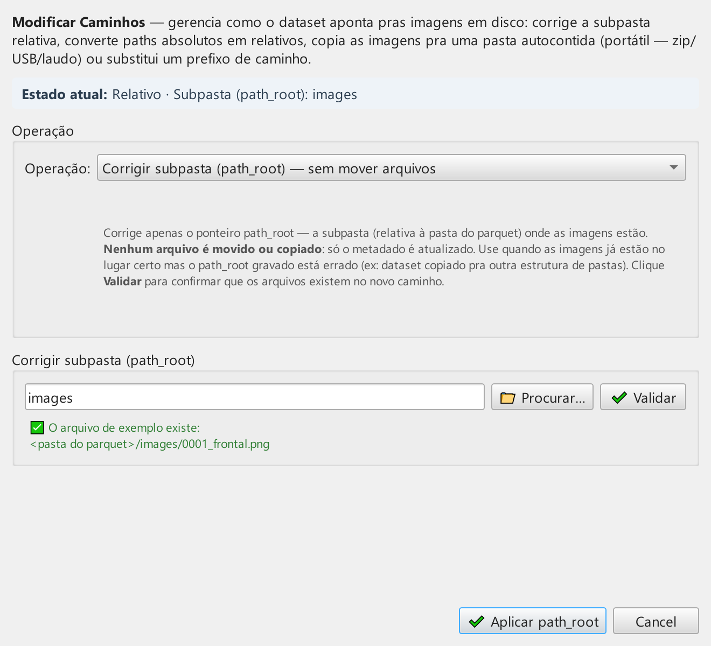

# 03 — Carregando e localizando

Este capítulo cobre dois fluxos complementares:

- **Carregar** um dataset `.parquet` já existente (criado por você
  anteriormente, recebido de um colega, ou copiado da biblioteca
  global).
- **Localizar** — corrigir os caminhos das imagens (`image_path`)
  quando eles apontam para um local que **não existe** na máquina
  atual. Esse é o problema clássico do *“abri o parquet aqui, mas as
  miniaturas aparecem vazias”*.

## Sumário do capítulo

1. [Abrindo um `.parquet`](#abrindo-um-parquet)
2. [Anatomia dos caminhos de imagem](#anatomia-dos-caminhos)
3. [Quando preciso usar *Localizar*?](#quando-preciso-usar-localizar)
4. [O diálogo *Localizar*](#o-diálogo-localizar)
5. [Modo 1 — REBASE_PREFIX (substituir prefixo)](#modo-1--rebase_prefix)
6. [Modo 2 — REWRITE_RELATIVE (caminhos relativos)](#modo-2--rewrite_relative)
7. [Modo 3 — COPY_ORIGINALS (empacotar pra portabilidade)](#modo-3--copy_originals)
8. [Estratégia de nomeação (NamingStrategy)](#estratégia-de-nomeação)
9. [`skip_existing` — idempotência](#skip_existing--idempotência)
10. [Cenários práticos com antes/depois](#cenários-práticos)
11. [Erros comuns e diagnóstico](#erros-comuns)
12. [O que **nunca** muda](#o-que-nunca-muda)

---

## Abrindo um `.parquet`

A operação básica para trabalhar com um dataset existente é o botão
📂 **Abrir** da aba *Arquivo*.

O diálogo nativo do SO abre no último diretório do pipeline/dataset
(quando definido) ou no diretório padrão do SO caso nenhum esteja
definido. Você pode navegar livremente; só são listados arquivos
`.parquet` (filtro `Parquet (*.parquet)`).

Selecionado o arquivo:

1. O FaceAudit dispara um *worker* assíncrono (`LoadDatasetWorker`)
   pra ler o parquet em thread separada — UI continua responsiva.
2. Ao concluir:
   - A tabela é populada com as linhas
   - O painel de detalhes mostra a primeira face (se houver)
   - A barra de status mostra uma linha compacta de badges
     (📂 nome | 🖼️ N Imagens | 👤 N IDs | 🧬 N FF · 📐 N OFIQ ·
     🎲 N SER-FIQ | …); o `path` e o hash do parquet aparecem no
     *tooltip*, não na linha principal
   - O *Audit Log* registra a operação `OPEN` com timestamp e SHA-256
3. Em caso de erro (parquet corrompido, formato inválido, falta de
   colunas obrigatórias), um diálogo `QMessageBox` mostra a mensagem.

> 💡 Você também pode abrir um dataset **a partir do Gerenciador de
> Estratégias** — o botão *"📂 Abrir no Gerenciador de Datasets"* num
> recurso do tipo `DATASET` chama `open_dataset_from_path()`
> diretamente, sem passar pelo seletor de arquivo.

## Anatomia dos caminhos

Cada linha do dataset tem uma coluna `image_path` apontando para o
arquivo de imagem **no disco**. Existem dois **modos de caminho**:

| `path_mode` | Como o `image_path` é interpretado | Exemplo |
|---|---|---|
| `ABSOLUTE` | Caminho cru, exatamente como está | `/Users/alice/imgs/foto_01.png` |
| `RELATIVE` | Resolvido em relação a `path_root` (atributo do dataset) | `path_root="images"`, `image_path="foto_01.png"` → `<pasta_parquet>/images/foto_01.png` |

Quando você abre uma imagem, o FaceAudit resolve o caminho
conforme o modo e tenta carregar o arquivo. Se não existe, o
thumbnail fica em branco (placeholder com ícone de “imagem
indisponível”).

> ⚠️ Os modos são **propriedade do dataset**, não da máquina — um
> parquet `RELATIVE` é portável por construção, basta carregar o
> `.parquet` junto com a pasta de imagens.

## Quando preciso usar *Localizar*?

A operação *Localizar* (botão 🗂 **Localizar** na aba *Dataset*) é
necessária em qualquer situação onde **os caminhos no parquet não
batem com a localização das imagens no disco atual**. Os três
cenários mais comuns:

| Situação | Sintoma | Modo recomendado |
|---|---|---|
| O parquet veio de outra máquina (colega, backup) | Miniaturas em branco; `image_path` aponta para `/Users/colega/...` ou `C:\Users\...` | **REBASE_PREFIX** |
| O parquet aponta para um caminho absoluto local que mudou de lugar | Você reorganizou pastas e mudou o local das imagens | **REBASE_PREFIX** ou **REWRITE_RELATIVE** |
| Você quer empacotar o dataset para arquivar ou transferir | Quer um zip autocontido com parquet + imagens | **COPY_ORIGINALS** |
| O parquet ficou com caminhos absolutos legados e você quer torná-lo portável | Funciona aqui, mas não em outra máquina | **REWRITE_RELATIVE** |

## O diálogo *Localizar*

Ao clicar em 🗂 **Localizar** abre-se o diálogo (640×580), com título
*Localizar Dataset — <nome>*:



| Seção | O que controla |
|---|---|
| **Texto explicativo** (topo) | Resumo do propósito da operação |
| **Modo** (*Operação*) | Combobox com **Copiar imagens originais** (padrão) / **Reescrever caminhos (sem cópia)** / **Atualizar prefixo de caminho (sem cópia)** |
| **Estratégia de nome** | *Habilitado* apenas em **Copiar imagens originais** (nos demais modos fica visível, mas em cinza) |
| **Prefixo antigo** | Visível apenas em **Atualizar prefixo de caminho**; auto-preenchido com `detect_path_prefix()` |
| **Pasta destino** | Sugere `<parquet_dir>/<nome>__localized/`; em **Atualizar prefixo** o rótulo muda para *Prefixo novo (pasta nesta máquina)* |
| **Pular arquivos que já existem** | *Habilitado* apenas em **Copiar imagens originais**; idempotência |

O combo **Modo** abre por padrão em **Copiar imagens originais** (o
primeiro item). A escolha do modo **dinamicamente reconfigura** quais
campos ficam visíveis ou ativos, e atualiza o texto de ajuda do
diálogo. O botão de confirmação exibe **🗂 Localizar** (não *OK*).

> ⚠️ Apenas o grupo **Prefixo antigo** é escondido/mostrado conforme
> o modo. **Estratégia de nome** e **Pular arquivos existentes**
> nunca somem — só são *habilitados/desabilitados* (aparecem em
> cinza fora do modo de cópia).

### Progresso e cancelamento

Ao confirmar em **🗂 Localizar**, a operação roda em um *worker*
assíncrono (`LocalizeDatasetWorker`) com um diálogo de progresso —
a UI continua responsiva. O progresso é reportado a cada 50 faces
(*throttle*) para não saturar o event loop em datasets grandes. O
diálogo permite **cancelar**: o cancelamento é cooperativo (o
serviço termina a face atual e a chamada em curso, mas o resultado
é descartado). Ao final, um resumo é exibido com as contagens de
copiadas/puladas/falhas.

### O que acontece depois (persistência)

Concluída a localização, o dataset **em memória** é substituído
pelo localizado — o arquivo em disco ainda **não** foi gravado. O
comportamento de salvamento depende do modo:

| Modo | `current_path` | Efeito no salvamento |
|---|---|---|
| **Atualizar prefixo** (REBASE_PREFIX) | 🔒 Preservado | *Salvar* sobrescreve o parquet original (só os paths mudaram); *Salvar Como* grava uma cópia |
| **Reescrever caminhos** / **Copiar imagens** | ✏️ Zerado | Força *Salvar Como* — as imagens foram relativizadas/copiadas e o original perde significado |

Em todos os casos o dataset fica marcado como *não salvo* (`*` após
o nome na barra de status) até você gravar.

> ⚠️ *Localizar* lida **exclusivamente** com gerenciamento de
> caminhos (path management). O antigo modo *COPY_ALIGNED* (que
> gerava faces alinhadas 112×112) foi **removido** deste diálogo —
> alinhar faces é transformação de **conteúdo**, não de caminho.
> Para alinhar, use o **Editor de Pipeline de Imagens** com
> *Origem = Face alinhada (112×112)* e zero steps.

## Modo 1 — REBASE_PREFIX

**O que faz:** Substitui um **prefixo de caminho** em todos os
`image_path` por outro. Operação puramente em texto — **nada é
copiado**.

**Quando usar:** O caso mais comum. Você recebeu um parquet com
caminhos tipo `/Users/colega/imgs/foto.jpg` e suas imagens estão em
`/Users/voce/dados/imgs/foto.jpg`. As pastas finais batem
exatamente — só o prefixo é diferente.

### Detecção automática do prefixo antigo

Quando você abre o diálogo, o sistema chama `detect_path_prefix()`
sobre o dataset:

1. Coleta todos os `image_path` não vazios
2. Normaliza separadores (`\` → `/`)
3. Valida que todos são absolutos
4. Acha o **maior prefixo comum** componente-a-componente
5. Retorna o prefixo (ou `None` se houver divergência na raiz, ou
   se algum caminho for relativo)

O campo **Prefixo Antigo** é pré-preenchido com esse valor. Você
pode editar livremente — útil quando os caminhos têm sub-prefixos
diferentes que você quer migrar separadamente.

### O que muda

| Item | Estado |
|---|---|
| `image_path` (no parquet) | ✏️ Atualizado: prefixo antigo trocado pelo novo |
| `path_mode` | 🔒 Permanece `ABSOLUTE` |
| Arquivos no disco | 🔒 Intactos — nada é movido ou copiado |
| Hashes, embeddings, identidades | 🔒 Inalterados |

### Validação

O serviço **verifica** que cada novo caminho realmente existe no
disco — qualquer caminho inexistente entra na lista de `failures`
do `LocalizationResult` e é reportado na UI.

## Modo 2 — REWRITE_RELATIVE

**O que faz:** Recalcula cada `image_path` como **relativo** à
*Pasta destino*. **Nada é copiado**.

**Quando usar:** As imagens já estão dentro da pasta destino e você
só quer converter o dataset de absoluto para relativo (tornando-o
portátil).

### O que muda

| Item | Estado |
|---|---|
| `image_path` | ✏️ Agora relativo (ex: `"celeb/alice.jpg"`) |
| `path_mode` | ✏️ Vira `RELATIVE` |
| `path_root` | ✏️ Aponta para a pasta destino |
| Arquivos no disco | 🔒 Intactos |

### Restrição importante

Se alguma imagem estiver **fora** da pasta destino, o caminho
relativo resultante teria `../../..` no início — quebra a
portabilidade. Nesse caso a face entra em `failures` e a UI exibe
um aviso sugerindo usar COPY_ORIGINALS ou mover o destino para um
ancestral comum.

## Modo 3 — COPY_ORIGINALS

**O que faz:** **Copia** os arquivos de imagem para uma subpasta
por dataset — `<pasta_destino>/<nome_do_dataset>_images/` — e gera um
novo parquet com caminhos relativos. Cria uma cópia autocontida do
dataset.

**Quando usar:** Empacotar o dataset para arquivamento em mídia
externa, transferência por USB/cloud, ou snapshot perícia
*pendrive paradigm*.

### O que muda

| Item | Estado |
|---|---|
| `image_path` | ✏️ Caminho relativo na nova estrutura |
| `path_mode` | ✏️ Vira `RELATIVE` |
| `path_root` | ✏️ `<nome_do_dataset>_images` |
| Arquivos no disco | ✏️ **Copiados** para `<destino>/<nome_do_dataset>_images/` |
| `file_name` | 🔒 Preservado (a menos que colisão force sufixo) |
| Hashes | 🔒 Inalterados (cópia byte-a-byte preserva conteúdo) |
| Tudo mais | 🔒 Inalterado |

> 💡 A subpasta leva o nome do dataset (`<nome>_images`) de propósito:
> assim você pode localizar **vários datasets na mesma pasta destino**
> sem misturar as imagens de um com as do outro.

> 💡 Após **Copiar imagens originais**, comprima `<pasta_destino>/`
> num zip e você tem um dataset **100 % portátil** — funciona em
> qualquer máquina com FaceAudit instalado.

## Estratégia de nomeação

Disponível **somente em COPY_ORIGINALS** — controla como os arquivos
copiados são nomeados:

| Estratégia | Como nomeia | Quando usar |
|---|---|---|
| **PRESERVE** *(padrão)* | Mantém o nome original. Em colisão (dois arquivos diferentes com mesmo nome), adiciona sufixo `_1`, `_2`, …. | Datasets pequenos a médios; melhor pra legibilidade |
| **HASH** | Renomeia para `<sha256[:16]>.<ext>` (ex: `a3f7e2c9b1d4f0ea.jpg`) | Datasets grandes com muitas colisões potenciais; uniqueness garantido por construção |
| **BY_IDENTITY** | Cria subpasta por identidade: `<identity>/<nome_original>` | Datasets com identidades bem definidas, quando você quer browse manual; sufixo `_N` em colisões dentro da pasta |

> ⚠️ A estratégia `BY_IDENTITY` sanitiza caracteres problemáticos —
> `/` e `\` viram `_` — antes de criar o nome da subpasta. Identidades
> com caracteres especiais podem ficar ligeiramente diferentes.

## `skip_existing` — idempotência

Disponível **somente em COPY_ORIGINALS** — quando marcado, o
operação fica idempotente:

| Estado do destino | Skip ON | Skip OFF |
|---|---|---|
| Não existe | Copia normalmente | Copia normalmente |
| Existe + **hash bate** | ✅ Pula (incrementa `n_skipped`) | ❌ Sobrescreve mesmo conteúdo |
| Existe + **hash difere** | ❌ Trata como colisão (gera nome novo) | ❌ Trata como colisão |

> 💡 **Sempre deixe ligado** em re-execuções — em datasets grandes
> economiza minutos ou horas (a verificação SHA-256 é muito mais
> rápida que a cópia).

## Cenários práticos

### Cenário A — Movendo um projeto de `/Users/alice` para `/Users/bob`

**Antes** (parquet recebido da Alice):

```
image_path = /Users/alice/data/celeb/alice_001.jpg
image_path = /Users/alice/data/celeb/bob_001.jpg
path_mode  = ABSOLUTE
```

**Ação:**

1. 🗂 **Localizar**
2. Modo: **Atualizar prefixo de caminho (sem cópia)** (REBASE_PREFIX)
3. Prefixo antigo: `/Users/alice/data/celeb` *(auto-detectado)*
4. Prefixo novo (pasta destino): `/Users/bob/projects/celeb` *(onde as imagens estão na sua máquina)*
5. **🗂 Localizar**

**Depois:**

```
image_path = /Users/bob/projects/celeb/alice_001.jpg
image_path = /Users/bob/projects/celeb/bob_001.jpg
path_mode  = ABSOLUTE  ← inalterado
```

Disco: nenhum arquivo tocado.

### Cenário B — Parquet do Windows para macOS

**Antes** (colega te mandou de Windows):

```
image_path = C:\Users\colega\datasets\faces\foto_01.jpg
image_path = C:\Users\colega\datasets\faces\foto_02.jpg
```

**Ação:**

1. 🗂 **Localizar**
2. Modo: **Atualizar prefixo de caminho (sem cópia)** (REBASE_PREFIX)
3. Prefixo antigo: `C:/Users/colega/datasets/faces` *(separadores normalizados)*
4. Prefixo novo (pasta destino): `/Users/voce/imagens_perito/2024/faces`
5. **🗂 Localizar**

### Cenário C — Empacotar dataset para arquivamento

**Antes:**

```
parquet  : /Users/me/projects/old_case/case_2024.parquet
images   : /Users/me/projects/old_case/imgs/*.jpg  (1500 arquivos)
image_path: /Users/me/projects/old_case/imgs/<filename>  (ABSOLUTE)
```

**Ação:**

1. 🗂 **Localizar**
2. Modo: **Copiar imagens originais**
3. Estratégia de nome: **Preservar nomes**
4. Pasta destino: `/Volumes/HD_Externo/arquivo_2024/case_2024/`
5. Pular arquivos existentes: ☑️
6. **🗂 Localizar**

**Depois** (supondo o dataset chamado `case_2024`):

```
parquet  : /Users/me/projects/old_case/case_2024.parquet  ← original intacto
novo parquet:
  Salvar Como → /Volumes/HD_Externo/arquivo_2024/case_2024/case_2024.parquet

imagens copiadas:
  /Volumes/HD_Externo/arquivo_2024/case_2024/case_2024_images/foto_01.jpg
  /Volumes/HD_Externo/arquivo_2024/case_2024/case_2024_images/foto_02.jpg
  ...

image_path: foto_01.jpg, foto_02.jpg, ...  (RELATIVE)
path_root : "case_2024_images"
```

Agora `/Volumes/HD_Externo/arquivo_2024/case_2024/` é uma pasta
**autocontida**: zipe, copie para outro disco, mande pro colega —
funciona em qualquer máquina com FaceAudit.

### Cenário D — Limpando caminhos absolutos legados

**Antes:**

```
parquet  : ~/projects/active/faces.parquet
images   : ~/projects/active/imgs/*  (já no lugar certo)
image_path: /home/user/projects/active/imgs/<file>  (ABSOLUTE)
```

**Ação:**

1. 🗂 **Localizar**
2. Modo: **Reescrever caminhos (sem cópia)** (REWRITE_RELATIVE)
3. Pasta destino: `~/projects/active/`
4. **🗂 Localizar**

**Depois:**

```
image_path: imgs/<file>     (RELATIVE)
path_root : "."
path_mode : RELATIVE
```

Agora você pode mover a pasta `active/` inteira pra qualquer lugar
e o dataset continua funcionando — sem cópia, sem renomear nada.

## Erros comuns

| Erro | Causa | Diagnóstico |
|---|---|---|
| `REBASE_PREFIX: pasta destino X não existe` | Você digitou um caminho inválido como prefixo novo | Confirme com Finder/Explorer que a pasta realmente existe |
| Muitas linhas em `failures` no resumo final | Imagens não foram encontradas no destino | Verifique se o prefixo novo + estrutura interna bate com o local real das imagens. Tire algumas amostras do parquet e tente abrir manualmente |
| `fora de target_dir (…); use COPY_ORIGINALS pra mover…` (REWRITE_RELATIVE) | Alguma imagem está em pasta-pai do destino | Mude o destino para um ancestral comum, ou use **Copiar imagens originais** |
| `n_skipped` enorme em COPY com skip OFF | Você tinha deixado skip ON antes — re-execução copiou tudo | Não é um problema; significa que a operação anterior foi parcial |
| Hashes diferem após COPY | **Não acontece** se a cópia foi byte-a-byte | Se acontecer, indica corrupção de disco; reporte como bug |

## O que **nunca** muda

Para tranquilidade forense — `Localizar` é **garantidamente
não-destrutivo** em relação ao conteúdo biométrico:

| Atributo | Garantia |
|---|---|
| `hash` (SHA-256 da imagem) | Imutável em todas as 3 modalidades |
| `identity` | Imutável |
| `embedding_v2`, `embedding_v4` | Imutáveis |
| `ff_info`, `ofiq_info`, `serfiq_info` | Imutáveis |
| `column_specs` (esquema do dataset) | Imutáveis |
| `name`, `description`, `is_aligned` | Imutáveis |
| Arquivos de imagem originais | Intactos em REBASE_PREFIX e REWRITE_RELATIVE; copiados (não movidos nem deletados) em COPY_ORIGINALS |

Toda operação *Localizar* é **registrada no Audit Log** com a
operação `COPY_IMAGES` (rotulada *"Localização (cópia/reescrita de
imagens)"* no log, emoji 🗂), o modo usado e as contagens
(`n_processed`, `n_copied`, `n_skipped`, `n_failed`) — preservando a
cadeia de custódia.

---

[← Capítulo 02b — Criando a partir de vídeo](02b_criando_dataset_de_video.md) · [Capítulo 04 — Navegando no dataset →](04_navegando_dataset.md)
