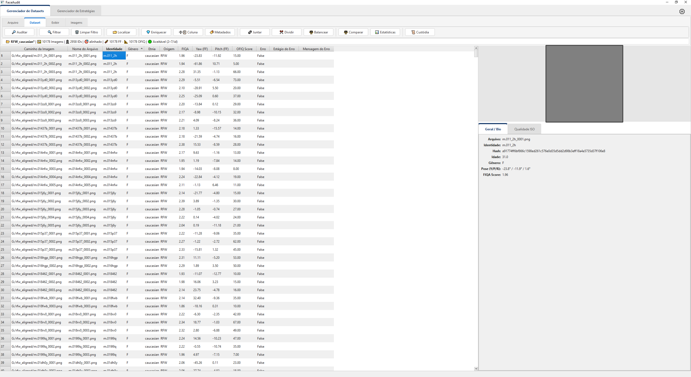
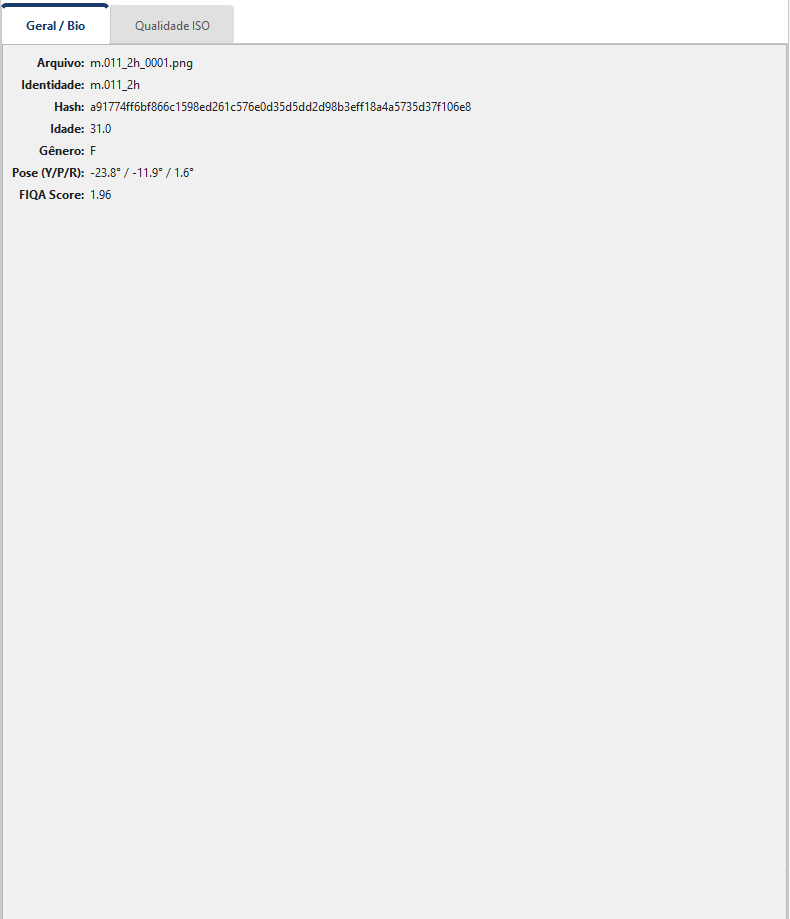
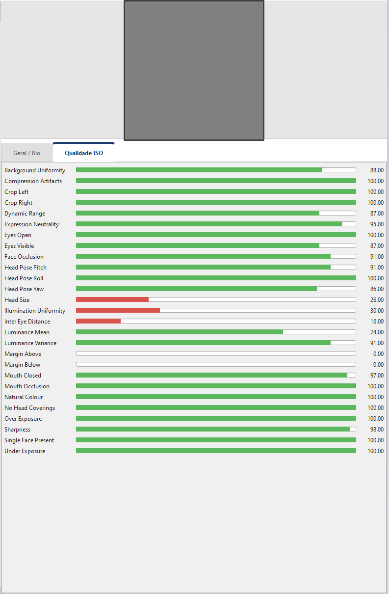

# 04 — Navegando no dataset

Este capítulo cobre o **uso cotidiano** do Gerenciador de Datasets
com um dataset já carregado — seja ele criado a partir de uma pasta
de imagens (capítulo 02) ou extraído de um **vídeo**
([capítulo 02b](02b_criando_dataset_de_video.md)). Aqui você aprende
a ler a tabela, editar células, inspecionar uma imagem, alternar para
a galeria e usar os menus de contexto.

## Sumário do capítulo

1. [O leiaute em três blocos](#o-leiaute-em-três-blocos)
2. [A tabela — anatomia e operações](#a-tabela)
3. [A barra de status](#a-barra-de-status)
4. [O painel de detalhes](#o-painel-de-detalhes)
5. [A galeria de thumbnails](#a-galeria-de-thumbnails)
6. [Menu de contexto da tabela](#menu-de-contexto-da-tabela)
7. [Menu de contexto da galeria](#menu-de-contexto-da-galeria)
8. [Propriedades da coluna (cabeçalho)](#propriedades-da-coluna)
9. [Navegação e edição por teclado](#navegação-e-edição-por-teclado)

---

## O leiaute em três blocos

Com um dataset carregado, a tela divide-se em três áreas:



1. **Ribbon** (topo): controles agrupados em 4 abas — `Arquivo`,
   `Dataset`, `Exibir`, `Imagens` (veja [capítulo 01](01_visao_geral.md)).
   A aba `Arquivo` é também a porta de entrada para as **duas fontes de
   dataset**: 🎬 **Dataset de Vídeo** e 📥 **Importar extração de vídeo**
   ficam ao lado de ➕ **Novo Dataset** e 📂 **Abrir**
   (veja [capítulo 02b](02b_criando_dataset_de_video.md)).
2. **Tabela** (esquerda, ~70% da largura): uma linha por imagem,
   com colunas configuráveis.
3. **Painel de detalhes** (direita, ~30%): preview da imagem
   selecionada + abas tabuladas com seus metadados.

O divisor entre tabela e detalhes é **arrastável** — clique e
arraste para redistribuir a largura. O painel de detalhes tem uma
**largura mínima** (260 px) e **não pode ser colapsado**: o divisor apenas
redistribui o espaço entre a tabela e os detalhes, sem nunca fazer
o painel direito desaparecer.

## A tabela

A tabela é onde você passa a maior parte do tempo. Algumas
características importantes:

### Esquema declarativo

Cada coluna tem um conjunto de atributos definidos no `column_specs`
do dataset:

| Atributo | O que controla |
|---|---|
| **Label** | Texto exibido no cabeçalho (pode diferir do nome técnico — ex: `Identidade` para a coluna `identity`) |
| **Role** | Papel da coluna: `IDENTITY`, `IMAGE_PATH`, `QUALITY`, `DEMOGRAPHIC`, `POSE`, `GEOMETRY`, `EMBEDDING`, `CAPTURE`, `CUSTOM`, etc. — afeta como o app trata a coluna |
| **Editable** | Se a célula pode ser editada na UI (algumas colunas como `embedding_v2` são read-only) |
| **Visible default** | Se a coluna aparece por padrão (você pode ligar/desligar via diálogo **Colunas** ou pelo submenu *Mostrar/Ocultar Colunas* do cabeçalho) |
| **Vocabulary** | Lista fechada de valores válidos (ex: `("M", "F", "Outro", "Desconhecido")` para `gender`) — a edição vira um combo box |
| **Aliases** | Nomes alternativos pra a coluna — usados pra carregar parquets antigos com esquemas diferentes |

### Colunas visíveis por padrão

Em um dataset criado pelo fluxo padrão (capítulo 02), as colunas
visíveis costumam ser (o rótulo à direita é o texto exibido no
cabeçalho):

| Coluna | Rótulo | Conteúdo |
|---|---|---|
| `image_path` | Caminho da Imagem | Caminho gravado no parquet (somente-leitura) |
| `file_name` | Nome do Arquivo | Nome do arquivo |
| `identity` | Identidade | Identidade (editável) |
| `gender` | Gênero | Gênero — combo `M / F / Outro / Desconhecido` |
| `ethnicity` | Etnia | Etnia — combo `Branca / Preta / Parda / Amarela / Indígena / Outra / Desconhecida` |
| `origin` | Origem | Procedência do arquivo (texto livre) |
| `yaw`, `pitch` | Yaw (FF), Pitch (FF) | Pose facial em graus (ForensicFace) |
| `fiqa_score` | FIQA | Score FIQA do ForensicFace |
| `ofiq_score` | OFIQ Score | Score OFIQ unificado |
| `serfiq_score` | SER-FIQ Score | Score SER-FIQ de robustez |
| `error`, `error_stage`, `error_message` | Erro, Estágio do Erro, Mensagem do Erro | Rastreamento de falhas — `error=True` marca a face; as outras duas detalham onde e por quê |
| `capture_datetime_raw` | Data/hora da captura (como gravada) | Só quando os metadados EXIF/XMP foram extraídos — as demais colunas de captura nascem ocultas |

> 💡 As três colunas de erro (`error` / `error_stage` / `error_message`)
> aparecem sempre, mas só têm conteúdo útil quando alguma face falhou na
> última criação/enriquecimento. Filtre por `error=True` na tabela para
> ver só as falhas.

Colunas como `embedding_v2`…`embedding_v6` e demais embeddings,
`roll` (FF), `det_score` (Det. Confidence), `ofiq_*_raw`, `ipd`,
`bbox`, `keypoints`, `hash` e as demais colunas de captura ficam
**ocultas por padrão** — você pode
ligá-las pelo diálogo **Colunas** (botão 📋 **Colunas** na ribbon
`Exibir`; ver [capítulo 06](06_filtros_e_estatisticas.md)) ou pelo
submenu **Mostrar/Ocultar Colunas** do menu de contexto do cabeçalho.

### Tooltips de miniatura

**Ao passar o mouse** sobre qualquer célula de uma linha, aparece um
tooltip mostrando **a miniatura da face** (até 200 px no lado maior;
quando a imagem não é encontrada, o tooltip mostra o caminho). Isso
permite varredura visual rápida sem precisar selecionar cada linha.
Cada miniatura é gerada sob demanda e guardada em memória até o
dataset trocar, então a primeira passagem por uma linha é ligeiramente
mais lenta.

### Ordenação

Clique no cabeçalho para ordenar por coluna. Clique de novo para
inverter. Funciona para colunas numéricas e ordenáveis (text,
booleans, números). Colunas com estruturas complexas (embeddings,
listas) não são ordenáveis e são silenciosamente ignoradas.

### Reordenar colunas

O cabeçalho aceita **arrastar-e-soltar**: clique num título de coluna
e arraste-o para a esquerda ou direita para reposicioná-lo. A nova
ordem é **persistida** no esquema do dataset (`column_specs`) e sobrevive
a salvar/reabrir.

### Edição inline

Clique-duplo numa célula para editar:

- Colunas **com vocabulário** (`gender`, `ethnicity`) abrem um *combo box*
  com os valores permitidos.
- As **demais** colunas editáveis abrem o **editor de texto** padrão do Qt.

Nem toda coluna é editável — colunas derivadas de ForensicFace/OFIQ/SER-FIQ
e embeddings são somente-leitura. Ao clicar-direito numa coluna não editável,
o menu de contexto mostra o item desabilitado `🔒 Coluna '…' não é editável`.

Pressione `Enter` para confirmar ou `Esc` para cancelar.

> 💡 Células com um valor **fora do vocabulário** definido para a coluna
> ganham um **fundo amarelo claro** — sinal visual de que o valor não
> pertence à lista fechada e provavelmente precisa de correção.

> ⚠️ As edições ficam **em memória** até você clicar 💾 **Salvar**.
> A barra de status mostra um `*` logo após o nome do dataset quando
> há mudanças não salvas.

## A barra de status

A barra fina logo abaixo do ribbon é a referência rápida do que
está carregado. Ela é uma linha compacta de **selos** (emoji + valor)
separados por `|`:

```
📂 Dataset_teste | 🖼️ 4 Imagens | 👤 4 IDs | 🧬 4 FF · 📐 4 OFIQ · 🎲 3 SER-FIQ | ⚖ ✅ Balanceado
```

Regras da linha:

- Um `*` logo após o nome (ex.: `📂 Dataset_teste*`) indica que há
  **alterações não salvas** (dataset "sujo").
- O selo 🎯 **alinhado** aparece apenas em datasets de faces alinhadas
  112×112 (a maioria mostra fotos originais e não exibe esse selo).
- Os selos de enriquecimento (🧬 FF, 📐 OFIQ, 🎲 SER-FIQ) e o selo de
  erro (⚠️ N erro(s)) só aparecem quando aplicáveis (contagem > 0).
- Quando um filtro está ativo, a linha ganha o sufixo **(Filtrado)** no
  final e o **botão Filtrar fica em amarelo** (status visual).

Ao passar o mouse, um tooltip rich-text detalha:

- **Path** do parquet e **Descrição** do dataset
- **Modo de path** e **Conteúdo** (faces alinhadas 112×112 vs. fotos originais)
- **Enriquecimento** com contagem e percentual por estágio:
  `FF n/N (x%), OFIQ n/N (x%), SER-FIQ n/N (x%)`
- **Balanceamento** (CV, ratio, min/max/média/mediana de amostras por ID)
- **Erros**, quando houver faces marcadas
- **Tamanho** e data de modificação do parquet, quando ele existe em disco

> 💡 O caminho completo aparece apenas no tooltip, nunca na linha
> principal. O SHA-256 do parquet fica registrado na cadeia de custódia
> (📜 **Custódia**).

## O painel de detalhes

Selecione uma linha na tabela e o painel direito popula-se:

### Topo: thumbnail

A miniatura da face selecionada, dimensionada pra caber no painel e
exibida com a orientação EXIF aplicada (a foto aparece de pé, como o
detector a viu).
Quando a imagem não existe no disco (caminho quebrado), aparece um
placeholder cinza com o texto **Imagem não encontrada** — use
*Modificar Caminhos* ([capítulo 03](03_carregando_e_localizando.md)) pra
corrigir. Sem nenhuma linha selecionada, o placeholder mostra
**Selecione uma face**.

### Aba *Geral / Bio*



| Campo | Origem |
|---|---|
| **Arquivo** | `file_name` |
| **Identidade** | `identity` |
| **Hash** | `hash` (SHA-256 da imagem), quando presente |
| **Idade** | `age_est` — estimativa do ForensicFace |
| **Gênero** | `gender_est` — estimativa do ForensicFace |
| **Pose (Y/P/R)** | `yaw` / `pitch` / `roll` em graus, quando há pose |
| **FIQA Score** | `fiqa_score`, quando calculado |
| **Detecção Score** | `det_score` — confiança da detecção, quando presente |

> ⚠️ O **Gênero** e a **Idade** mostrados nesta aba são **estimativas
> do ForensicFace** (`gender_est` / `age_est`), não os rótulos manuais
> `gender` / `ethnicity` da tabela. Para editar os rótulos manuais, use
> a tabela (edição inline) ou o menu de contexto.

### Aba *Qualidade ISO*



Mostra **exclusivamente** os indicadores **OFIQ** (colunas
`ofiq_*_scalar`) como **barras visuais** — FIQA aparece na aba
*Geral / Bio* e SER-FIQ não é renderizado neste painel.

As barras aparecem **em ordem alfabética**, uma por coluna
`ofiq_*_scalar` presente no dataset, com o nome derivado da coluna
(`ofiq_illumination_uniformity_scalar` → *Illumination Uniformity*).
Cobrem, entre outros, qualidade unificada, nitidez, uniformidade de
fundo e de iluminação, exposição (luminância, sub/superexposição, faixa
dinâmica), compressão, pose da cabeça, olhos abertos/visíveis, boca,
oclusão, expressão, cobertura da cabeça, distância entre os olhos,
tamanho da cabeça e margens do recorte.

Cada barra mostra **um único valor** — o score OFIQ *scalar* (0–100,
comparável entre métricas), formatado com duas casas decimais, com a
cor pela faixa do valor: ✅ verde (≥ 70) → ⚠️ laranja (40–70) →
❌ vermelho (< 40).

Quando o dataset ainda não tem métricas OFIQ, a aba exibe apenas o
texto **Dados OFIQ não calculados.**

> 💡 Use a aba *Qualidade ISO* para **investigar manualmente** por
> que uma imagem específica está com `error=True` ou foi rejeitada
> por um filtro de qualidade — os indicadores OFIQ mostram exatamente
> qual atributo está fraco.

### Aba *Metadados*

Árvore com **todas** as tags EXIF/XMP/IPTC lidas da foto original,
agrupadas por origem (EXIF, XMP, File, MakerNotes…; tags sem prefixo
caem em *Outros*), com colunas *Tag* e *Valor* e um campo *"Filtrar por
tag ou valor…"*. Um rodapé lembra que são **declarações do arquivo,
não medições** — metadado embutido pode ser editado ou forjado. A aba
só tem conteúdo quando o dataset foi criado ou enriquecido com
*Extrair EXIF/XMP da imagem* ([capítulo 02](02_criando_dataset.md#grupo-4)).

## A galeria de thumbnails

O botão 🖼 **Galeria** na ribbon *Exibir* alterna a vista da tabela
para uma **grade de miniaturas**. Útil para:

- Inspeção visual rápida de um dataset pequeno-a-médio
- Identificar pessoas (ou *outliers*) sem precisar de metadados
- Triagem visual antes de uma seleção/exclusão em massa

Limitações:
- Sem ordenação própria — a ordem é a do dataset; com filtro ativo, a
  galeria mostra só o recorte filtrado
- Performance cai com datasets grandes (> 10 mil imagens) — use
  a tabela com filtro nesses casos
- Edição inline (clique-duplo) não funciona na galeria — mas há um
  **menu de contexto** com ações de seleção em massa (veja abaixo)

Para voltar à tabela, clique no mesmo botão — em modo galeria ele
passa a se chamar ▦ **Tabela**.

### Menu de contexto da galeria

**Clique-direito** sobre uma miniatura (com uma ou mais selecionadas)
abre um menu de ações sobre a seleção. `N` é o número de miniaturas
selecionadas:

| Item | Quando fica ativo | Função |
|---|---|---|
| **⚖️ Comparar este par lado a lado…** | Apenas com **exatamente 2** selecionadas | Abre a janela de comparação lado a lado das duas faces. Com outra contagem, o item aparece esmaecido como `⚖️ Comparar par (selecione 2 — N)` |
| **✏️ Definir valor de coluna… (N)** | `N ≥ 1` | Edita em lote o valor de uma coluna para todas as faces selecionadas |
| **🧩 Criar dataset a partir da seleção… (N)** | `N ≥ 1` | Cria um novo dataset (subconjunto) apenas com as faces selecionadas |
| **🗑️ Remover do dataset (N)** | `N ≥ 1` | Remove as faces selecionadas do dataset — **não apaga os arquivos de imagem**. Mesmo fluxo do botão **Excluir Selecionados** |

> ⚠️ **Remover do dataset** é uma operação **não destrutiva** no disco:
> ela retira as faces da tabela do dataset, mas os arquivos de imagem
> originais permanecem. Antes de remover, o diálogo *Excluir registros do
> dataset* pede uma **justificativa obrigatória** (o botão *Excluir* só
> habilita com texto), que fica registrada na cadeia de
> custódia junto com a contagem e os identificadores das faces. A
> remoção só é persistida quando você clica 💾 **Salvar**. Com filtro
> ativo, as faces saem também do dataset de origem — *Limpar Filtro*
> não as traz de volta.

## Menu de contexto da tabela

**Clique-direito numa célula** abre o menu de contexto. `N` é o número
de registros (linhas) ou de células selecionadas, conforme o item:

| Item | Quando aparece | Função |
|---|---|---|
| **Selecionar Toda Coluna '…'** | Sempre | Seleciona verticalmente todas as células da coluna clicada |
| **🧩 Salvar seleção como novo dataset… (N)** | Sempre (ativo com `N ≥ 1` registros) | Grava os registros selecionados como dataset novo, sem trocar o que está aberto — mesmo fluxo de **Salvar Selecionados** |
| **🗑️ Excluir registros selecionados (N)** | Sempre (ativo com `N ≥ 1` registros) | Mesmo fluxo de **Excluir Selecionados** / *Remover do dataset* da galeria (com justificativa para a custódia) |
| **✏️ Definir Valor (N células)…** | Só em colunas **editáveis** | Aplica um mesmo valor a todas as células selecionadas |
| **🔄 Substituir (N células)…** | Só em colunas **editáveis** | Substitui um valor por outro nas células selecionadas |
| **🔒 Coluna '…' não é editável** | Em colunas **não editáveis** | Item desabilitado — só informa que a coluna é somente-leitura |
| **⚖️ Comparar este par lado a lado…** | Só com **exatamente 2 linhas** selecionadas | Abre a comparação lado a lado das duas faces. Com outra contagem, aparece esmaecido como `⚖️ Comparar par (selecione 2 linhas — N)` |

> 💡 **Comparar este par lado a lado** é totalmente funcional (não está
> em desenvolvimento): selecione exatamente **duas linhas** — clicando
> em qualquer célula de cada linha, com `Ctrl`/`Shift` — e a opção fica
> ativa. A mesma ação existe no menu de contexto da galeria.

## Propriedades da coluna

**Clique-direito no cabeçalho** abre o menu da coluna:

| Item | Função |
|---|---|
| **⚙️ Propriedades…** | Abre o diálogo de propriedades da coluna clicada |
| **🗑️ Remover Coluna** | Apaga a coluna do dataset (com confirmação; reforçada para colunas canônicas — FF/OFIQ/SER-FIQ/embedding). Colunas essenciais como Identidade e Caminho da Imagem ficam desabilitadas — sem elas o parquet não carrega) |
| **📋 Mostrar/Ocultar Colunas** | Submenu agrupado **por categoria** (Identificação Manual, ForensicFace, OFIQ, etc.), com um checkbox por coluna para ligar/desligar a visibilidade |

> ⚠️ **Remover Coluna** só é persistido ao **salvar** o dataset. Remover
> uma coluna canônica (vinda de ForensicFace/OFIQ/SER-FIQ ou um embedding)
> pode quebrar estratégias que dependam dela até serem reconfiguradas ou o
> dataset ser re-enriquecido.

O diálogo **Propriedades — <coluna>** mostra, no topo, informações
**somente-leitura** da coluna (**Nome**, **Role**, **Source**, **Tipo**,
**Categoria**) e, abaixo, os campos **editáveis**:

- **Rótulo**: texto exibido no cabeçalho *(sempre editável)*
- **Valor padrão**: valor usado quando uma linha não tem o campo
  *(editável apenas em colunas custom; canônicas exibem aviso)*
- **Vocabulário fechado**: lista de valores válidos, um por linha
  *(disponível em colunas custom ou nas demográficas que já têm
  vocabulário — transforma a edição em combo)*
- **Aliases (nomes legados)**: nomes alternativos aceitos ao ler
  parquets antigos com esquemas diferentes *(sempre editável)*

> ⚠️ O **Role**, o **Source** e o **Tipo** de uma coluna **não são
> editáveis** — são apenas exibidos para referência. Alterá-los quebraria
> contratos internos (ex.: trocar o role de `identity` derrubaria todos os
> splits por identidade).

Veja também o diálogo *Metadados* (botão 🏷️ **Metadados** na
ribbon *Dataset*) — edita o mesmo `column_specs` mas em escala
de dataset, com vista de todas as colunas lado a lado
([capítulo 07](07_operacoes_estruturais.md)).

## Navegação e edição por teclado

O Gerenciador de Datasets **não define atalhos de arquivo** (abrir,
salvar, fechar) — essas ações são acionadas pelos botões da ribbon
`Arquivo` (veja [capítulo 01](01_visao_geral.md) e
[capítulo 03](03_carregando_e_localizando.md)). O que funciona na tabela
é o **comportamento nativo do Qt**:

| Ação | Tecla |
|---|---|
| Editar a célula focada | `F2` ou clique-duplo |
| Confirmar a edição | `Enter` ou `Tab` |
| Cancelar a edição | `Esc` |
| Navegar entre linhas | `↑` / `↓` |
| Navegar entre colunas | `←` / `→` |
| Estender a seleção | `Shift` + setas, ou `Shift`/`Ctrl` + clique |

> 💡 O único atalho **próprio** do módulo é `Ctrl+Z` (**Desfazer**), e ele
> vale apenas dentro da janela de **Auditoria** (ver
> [capítulo 09](09_auditoria_forense.md)), não na tabela principal.

---

[← Capítulo 03 — Carregando e modificando caminhos](03_carregando_e_localizando.md) · [Capítulo 05 — Enriquecimento →](05_enriquecimento.md)
