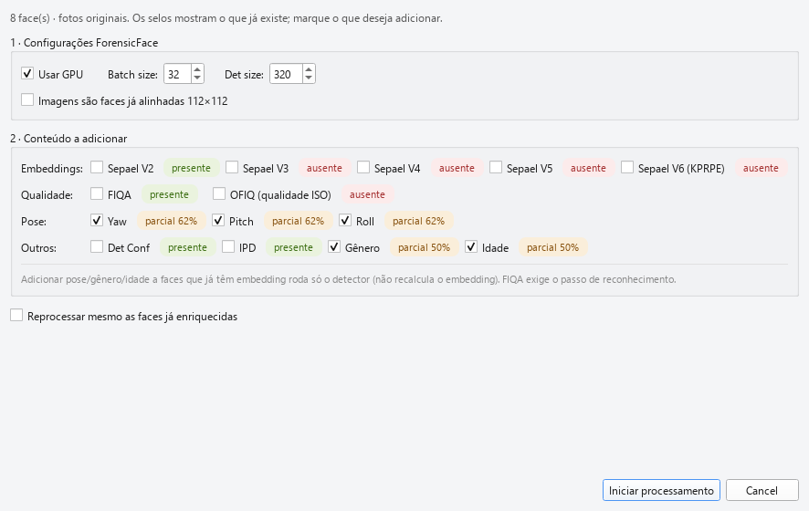

# 05 — Enriquecimento

**Enriquecer** = adicionar (ou recalcular) atributos biométricos de
um dataset *já existente*. Diferente do *Novo Dataset* (que parte de
imagens cruas), o Enriquecer trabalha sobre o parquet em memória —
ideal para:

- Completar um dataset parcialmente enriquecido (faltou rodar OFIQ
  ou SER-FIQ, por exemplo)
- Adicionar um **segundo embedding** (`embedding_v4` numa base que
  já tinha só `embedding_v2`)
- Retentar faces que falharam (`error=True`)
- Corrigir metadados errados (`is_aligned` marcado incorretamente)

## Sumário do capítulo

1. [Quando usar Enriquecer vs Novo Dataset](#quando-usar-enriquecer)
2. [O diálogo *Enriquecer* — visão geral](#o-diálogo-enriquecer)
3. [Análise automática inicial](#análise-automática-inicial)
4. [Opções por extractor](#opções-por-extractor)
5. [`is_aligned` — correção de metadados](#is_aligned--correção-de-metadados)
6. [Idempotência — `Reprocessar mesmo as faces já enriquecidas`](#idempotência)
7. [Cenários práticos](#cenários-práticos)
8. [O que muda no parquet](#o-que-muda-no-parquet)
9. [Cancelamento e progresso](#cancelamento-e-progresso)
10. [Erros e diagnóstico](#erros-e-diagnóstico)

---

## Quando usar Enriquecer

| Caso | Use… |
|---|---|
| Tenho uma pasta de imagens, quero criar um dataset | [Novo Dataset](02_criando_dataset.md) |
| Tenho um dataset, quero **adicionar** uma métrica que não está nele | **Enriquecer** |
| Tenho um dataset, quero **substituir** todas as métricas (porque mudei parâmetros) | **Enriquecer** com *Reprocessar* marcado |
| Algumas faces falharam, quero retentar só elas | **Enriquecer** sem *Reprocessar* |
| O parquet veio com `is_aligned` errado | **Enriquecer** (qualquer extractor; a flag é ajustada) |
| Quero corrigir caminhos de imagem | [Localizar](03_carregando_e_localizando.md), **não** Enriquecer |

## O diálogo *Enriquecer*

Ao clicar em 💎 **Enriquecer** abre-se o diálogo:



A estrutura é similar ao *Novo Dataset* — três blocos de extractor
com checkboxes + painéis avançados retráteis — mas **sem** a parte de
ingestão (pasta de origem, recursão, template). O dataset já está em
memória, então o pipeline só executa as fases *Transform* e *Load*.

| Bloco | Função |
|---|---|
| **Texto explicativo** (topo) | Resumo da operação e da análise automática |
| **Forensic Face** + avançadas | Embeddings + FIQA + pose + demografia |
| **OFIQ** | Métricas ISO/IEC 29794-5 |
| **SER-FIQ** + avançadas | Score de robustez |
| **Reprocessar mesmo as faces já enriquecidas** | Toggle global de idempotência |

## Análise automática inicial

**Quando o diálogo abre**, o controller varre todas as faces do
dataset e calcula a **cobertura atual** por extractor. Os indicadores
ao lado de cada extractor mostram:

| Indicador | Significado |
|---|---|
| ⚠️ **Ausente (0%)** *(vermelho)* | Nenhuma face tem esse extractor — recomendado executar |
| 🚧 **Parcial (X%)** *(laranja)* | Algumas faces têm, outras não — útil pra completar |
| ✅ **Completo (100%)** *(verde)* | Todas as faces já têm — provavelmente não precisa rodar |

O sistema **pré-marca automaticamente** os checkboxes de extractors
*Ausente* ou *Parcial*, e **deixa desmarcados** os *Completos*. Você
pode editar a sugestão livremente.

> 💡 Em datasets recém-criados pelo *Novo Dataset* com todos os
> extractors ligados, os três indicadores ficam verdes — o
> enriquecimento é supérfluo. Use o diálogo apenas para
> *adicionar coisas novas* (mais um modelo, ajuste de parâmetros).

## Opções por extractor

### Forensic Face — painel avançado

| Controle | Faixa | Padrão | Notas |
|---|---|---|---|
| ☑️ **`sepaelv2`** / ☑️ **`sepaelv4`** | — | só V2 marcado | Pode marcar ambos pra ter dois embeddings no mesmo parquet |
| **det_size** | 160–1280 (passo 32) | 320 | Ajuste se está reprocessando faces de baixa resolução |
| ☑️ **Modo completo** | — | Marcado | FIQA + gender + age + yaw/pitch/roll. Desmarque pra produzir dataset enxuto (só embedding) |
| ☑️ **Imagens são faces já alinhadas 112×112** | — | herdado do dataset | Veja a próxima seção |

> 💡 **Adicionar um modelo novo é o caso de uso mais comum.** Se seu
> parquet só tem `embedding_sepaelv2` e você quer adicionar
> `embedding_sepaelv4`:
> 1. Marque ✅ Forensic Face
> 2. Em avançadas, marque ✅ `sepaelv4` (e **desmarque** `sepaelv2`
>    — não precisa reextrair)
> 3. **Deixe** *Reprocessar* desmarcado
> 4. **OK** → o sistema só processa faces que ainda não têm `sepaelv4`

### OFIQ — sem opções avançadas

OFIQ é configurado uma vez no `config.json` (caminho do binário e da
pasta `data/`). No diálogo só há o checkbox de ligar/desligar.

### SER-FIQ — painel avançado

| Controle | Faixa | Padrão | Notas |
|---|---|---|---|
| **T (iterações)** | 1–100 | 10 | Mais iterações = score mais estável e mais lento |
| **Alpha** | 0.1–10.0 (passo 0.1) | 1.5 | Fator de escala. Mantenha em 1.5 a menos que esteja comparando com a literatura |

## `is_aligned` — correção de metadados

A checkbox **"Imagens são faces já alinhadas 112×112"** dentro do
painel avançado de Forensic Face é especial:

- **Pré-preenchida** com o valor atual de `dataset.is_aligned`
- Quando marcada, o ForensicFace usa `process_face_aligned()` —
  pula a etapa de detect+align (~50% mais rápido)
- O valor que você deixar **é persistido** na metadata do parquet
  ao final do enriquecimento

> 💡 Use a flag para **corrigir** datasets antigos que foram criados
> antes do FaceAudit ter esse atributo, ou que herdaram um valor
> errado de uma migração. Marque/desmarque conforme a realidade das
> imagens e rode qualquer enriquecimento — o flag é gravado.

> ⚠️ **Não marque** essa flag se as imagens **não** são crops
> alinhados 112×112 — o detect+align será pulado e o embedding sai
> ruim sem aviso (face descentralizada). Em caso de dúvida, abra
> uma imagem da pasta no visualizador do SO; se ela tem fundo,
> ombros, etc., **não** está alinhada.

## Idempotência

A checkbox **"Reprocessar mesmo as faces já enriquecidas"** (no
topo do diálogo, abaixo dos extractors) tem o seguinte
comportamento:

| Configuração | Comportamento |
|---|---|
| ☐ **Desmarcado** *(padrão)* | Cada extractor filtra as faces que **já têm** o resultado e processa só as que estão faltando. Faces com `error=True` mas com `*_info` populado **não são retentadas** |
| ☑️ **Marcado** | Reprocessa **todas as faces**, sobrescrevendo resultados anteriores. Use quando mudou parâmetros (det_size diferente, T diferente, etc.) |

### Idempotência por modelo (Forensic Face)

A filtragem do FF é mais granular: ele verifica não só se `ff_info`
existe, mas também se o **modelo específico** está populado:

```
Face tem ff_info com embedding_sepaelv2 mas não sepaelv4
+ usuário marcou sepaelv4 no diálogo
→ Face é incluída no processamento (FF preencherá só sepaelv4)
```

Isso significa: você pode rodar enriquecimento progressivamente
adicionando modelos, sem desperdiçar GPU re-extraindo o que já
tem.

### Retentar faces falhadas

A coluna `error=True` é **independente** da checagem de
idempotência. Faces marcadas como falhadas mas com `ff_info=None`
(ou outro extractor ausente) **são reprocessadas** mesmo com a
flag desmarcada — porque o teste é sobre o `*_info`, não sobre
`error`.

Faces marcadas como falhadas mas com `ff_info` parcialmente
populado (por exemplo, o ForensicFace gerou embedding mas falhou
na pose) só são reprocessadas com `Reprocessar` marcado.

## Cenários práticos

### Cenário A — Adicionar `embedding_v4` a um dataset com `embedding_v2`

```
Cobertura inicial (analisada pelo diálogo):
  Forensic Face: 🚧 Parcial (100% de sepaelv2, 0% de sepaelv4)
  OFIQ:          ✅ Completo
  SER-FIQ:       ✅ Completo
```

**Ações:**
1. ☑️ Forensic Face
2. Avançadas → ☐ `sepaelv2` (já tem), ☑️ `sepaelv4`
3. ☐ Reprocessar (padrão)
4. **OK**

**Resultado:** Todas as faces ganham `embedding_sepaelv4`, sem
reprocessar `sepaelv2`/OFIQ/SER-FIQ. Custo de GPU: ~1× o tempo de
extrair `sepaelv4`.

### Cenário B — Adicionar OFIQ a um dataset que só tem Forensic Face

```
Cobertura inicial:
  Forensic Face: ✅ Completo
  OFIQ:          ⚠️ Ausente (0%)
  SER-FIQ:       ⚠️ Ausente (0%)
```

**Ações:**
1. ☐ Forensic Face (já tem, não precisa)
2. ☑️ OFIQ
3. ☐ SER-FIQ (deixar pra depois ou nunca)
4. **OK**

**Resultado:** Cada face roda OFIQ; `ofiq_info` aparece nas
colunas. ~2s/face em CPU (single-threaded — o binário externo é
o gargalo).

### Cenário C — Retentar faces que falharam

```
Dataset com 1000 faces, das quais 47 estão com error=True
porque a detecção falhou em det_size=320.
```

**Ações:**
1. ☑️ Forensic Face
2. Avançadas → `det_size = 640` *(aumenta resolução)*
3. ☑️ **Reprocessar mesmo as faces já enriquecidas**
4. **OK**

**Resultado:** Todas as 1000 faces reprocessadas com det_size
maior. Algumas das 47 antes falhadas agora detectam corretamente.
A coluna `error` é recalculada — `error=True` permanece só nas
que ainda falharem.

> 💡 Alternativa mais rápida: filtre o dataset por `error=True`
> ([capítulo 06](06_filtros_e_estatisticas.md)), salve como
> dataset separado, rode Enriquecer nele, depois mescle de volta
> com *Juntar* ([capítulo 07](07_operacoes_estruturais.md)).

### Cenário D — Corrigir `is_aligned`

```
Dataset antigo marcou is_aligned=False, mas as imagens são
crops 112×112 — Forensic Face está rodando detect+align
desnecessariamente e os scores OFIQ estão ruins.
```

**Ações:**
1. ☑️ Forensic Face
2. Avançadas → ☑️ **Imagens são faces já alinhadas 112×112**
3. ☑️ Reprocessar
4. **OK**

**Resultado:** Os embeddings são recalculados pulando detect+align
(mais rápido e mais preciso pra crops). O atributo
`dataset.is_aligned=True` é persistido. Próxima abertura do parquet
já vem com a flag correta.

## O que muda no parquet

Após o enriquecimento, o parquet é **regravado no mesmo caminho**
(sobrescreve o arquivo original — não cria backup automático).

| Tipo de mudança | Detalhes |
|---|---|
| Colunas FF preenchidas/atualizadas | `embedding_v2`/`embedding_v4`, `fiqa_score`, `det_score`, `gender_est`, `age_est`, `yaw`/`pitch`/`roll`, `ipd`, `bbox`, `keypoints` |
| Colunas OFIQ preenchidas/atualizadas | ~40 colunas `ofiq_*` (scalar + raw) |
| Colunas SER-FIQ preenchidas/atualizadas | `serfiq_score`, `serfiq_t`, `serfiq_alpha` |
| Colunas de erro recalculadas | `error`, `error_stage`, `error_message` |
| Metadados do dataset | `is_aligned` persistido se houve override |

Identidades, gênero, etnia, origem, caminho, hash e qualquer
coluna *custom* **não** são tocadas pelo enriquecimento — ele só
atua nos slots biométricos.

> ⚠️ **Sem backup automático.** Se você está com receio (mudou
> parâmetros, dataset crítico, etc.), use **Salvar Como** *antes*
> de enriquecer pra ter cópia do estado anterior.

## Cancelamento e progresso

O enriquecimento roda num *worker* em thread separada. Um diálogo
de progresso mostra:

- **Etapa atual** (ex: "Forensic Face — face 234/1000")
- **Porcentagem** *(escala global: 0–100%)*
- **Botão Cancelar**

Ao **cancelar**, o sistema:
1. Sinaliza interrupção ao pipeline
2. Espera a face atual terminar (não corta no meio)
3. **Salva o parquet parcial** antes de abortar
4. Mostra mensagem informando que o resultado é parcial

Você pode retomar onde parou apenas rodando *Enriquecer* novamente
com a mesma configuração — a idempotência cobre o que já foi
processado.

## Erros e diagnóstico

| Sintoma | Causa provável | Solução |
|---|---|---|
| Botão **OK** não habilita | Nenhum extractor marcado | Marque pelo menos um |
| `Erro ao salvar pós-enriquecimento` | Parquet aberto em outro programa, ou disco read-only | Feche o arquivo em outro lugar; verifique permissões |
| `OFIQ não produziu resultado` | Binário OFIQ não acessível ou pasta `data/` ausente | Confira `config.json → ofiq.ofiq_exe_path` e `ofiq_data_path` |
| GPU OOM (Out of Memory) | det_size alto + sepaelv2+v4 simultâneos | Reduza pra um modelo só, baixe det_size, ou diminua `batch_size` em `config.json → ff` |
| `nenhum embedding gerado` em várias faces | Detecção falhou (rosto pequeno demais ou marcado como já alinhado erroneamente) | Aumente det_size, ou verifique `is_aligned` |
| `0/N faces — FALHA TOTAL` | Pipeline configurado errado (modelo wrong path, GPU off, etc.) | Cheque logs do worker no terminal — costuma ter detalhes |
| Dataset com `is_aligned` virou `True` sozinho | Você marcou a checkbox sem perceber | Re-rode o Enriquecer com a flag desmarcada e Reprocessar marcado |

---

[← Capítulo 04 — Navegando no dataset](04_navegando_dataset.md) · [Capítulo 06 — Filtros e estatísticas →](06_filtros_e_estatisticas.md)
