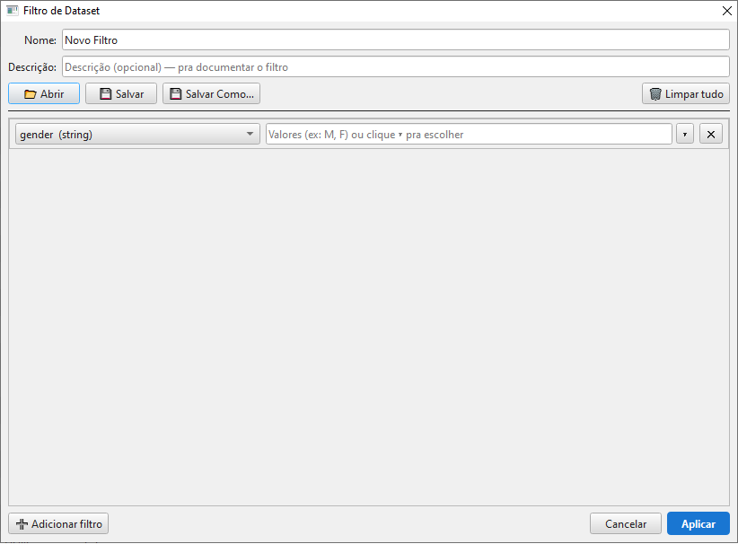
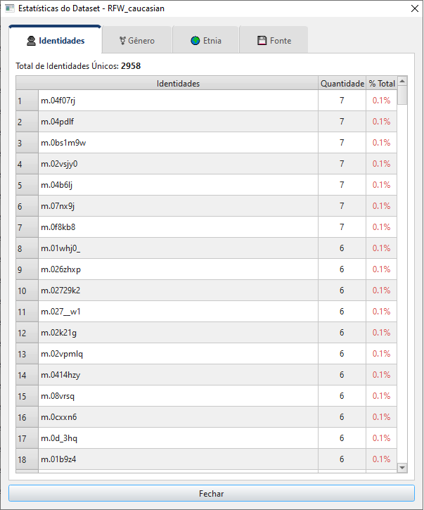
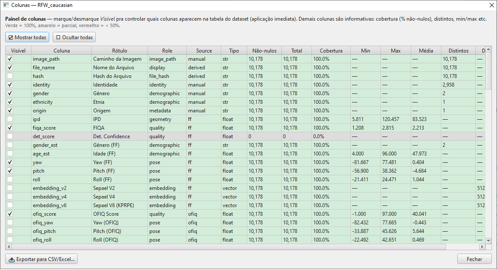

# 06 — Filtros e estatísticas

Este capítulo cobre as três ferramentas de **visualização e
seleção** do Gerenciador de Datasets:

- 🔍 **Filtrar** — selecionar um subconjunto via expressões
- 📊 **Estatísticas** — distribuições por gênero / etnia / origem / identidade
- 📋 **Colunas** (Schema Report) — cobertura de cada coluna, exportação

Nenhuma das três muda o conteúdo do dataset em disco — são
operações read-only. A única exceção é a **aplicação** do filtro,
que substitui em memória o dataset pela versão filtrada (ver
[Aplicação destrutiva vs visão](#aplicação-vs-visão)).

> 💡 Independentemente da origem do dataset (pasta de imagens ou
> extração de vídeo — ver [capítulo 02b](02b_criando_dataset_de_video.md)),
> essas três ferramentas operam da mesma forma sobre as colunas
> e metadados carregados.

## Sumário do capítulo

1. [O diálogo *Filtrar*](#o-diálogo-filtrar)
2. [Construindo expressões de filtro](#construindo-expressões-de-filtro)
3. [Salvando e carregando filtros](#salvando-e-carregando-filtros)
4. [Aplicação destrutiva vs visão temporária](#aplicação-vs-visão)
5. [O diálogo *Estatísticas*](#o-diálogo-estatísticas)
6. [O diálogo *Colunas* (Schema Report)](#o-diálogo-colunas)
7. [Exportação para CSV / Excel](#exportação)

---

## O diálogo *Filtrar*



O diálogo intitula-se **Filtro de Dataset** e é um **construtor de
condições**. Cada linha é uma restrição independente; o conjunto é
combinado por **AND** (todas precisam valer pra a face entrar no
resultado).

| Elemento | Função |
|---|---|
| **Nome** | Identificador do filtro (vira o nome do arquivo ao salvar) |
| **Descrição** | Texto livre — útil pra documentar o que o filtro faz |
| **Linhas de condição** | Uma por restrição: `coluna + critério` |
| **📂 Abrir / 💾 Salvar / 💾 Salvar Como…** | Persistência na biblioteca global (ver seção abaixo) |
| **🗑 Limpar tudo** | Remove **todas** as linhas de uma vez (pede confirmação) |
| **➕ Adicionar filtro** | Cria uma nova linha vazia |
| **Aplicar** (botão azul) | Aplica o filtro ao dataset atual |
| **Cancelar** | Descarta sem aplicar |
| **✕** (por linha) | Remove aquela condição |

## Construindo expressões de filtro

Cada linha de condição tem três componentes:

| Componente | Comportamento |
|---|---|
| **Coluna** | Combo populado a partir dos `column_specs` do dataset. Colunas com estruturas complexas (embeddings, listas) são omitidas |
| **Tipo** *(inferido)* | Numérico / String / Booleano — o widget de entrada muda conforme o tipo da coluna |
| **Critério** | Conforme o tipo da coluna |

### Colunas numéricas

A linha oferece **dois campos de texto separados**, e uma face
passa se casar com **qualquer** dos dois (OR entre valores e faixas):

- **Valores** (ex: `2.5, 3.0`) — lista de valores exatos separados
  por vírgula.
- **Faixas** (ex: `1.0:2.0, 3.0:5.0`) — lista de faixas inclusivas
  separadas por vírgula; cada faixa usa `:` entre mínimo e máximo.

| Campo | Sintaxe | Significado |
|---|---|---|
| Valores | `0.85` | Exato |
| Valores | `0.85, 0.90, 0.95` | Lista de valores exatos (OR entre eles) |
| Faixas | `0.5:1.0` | Faixa inclusiva |
| Faixas | `0.5:1.0, 1.5:2.0` | Múltiplas faixas (OR entre elas) |
| Faixas | `-inf:0.5` | "≤ 0.5" (faixa aberta à esquerda) |
| Faixas | `0.8:inf` | "≥ 0.8" (faixa aberta à direita) |

> ⚠️ Para faixas abertas, **use `inf` / `-inf` explícitos**. As
> formas abreviadas `:0.5` (lado esquerdo vazio) ou `0.8:` (lado
> direito vazio) **não funcionam** — o parser exige um número dos
> dois lados do `:` e descarta a faixa silenciosamente se um lado
> estiver em branco.

### Colunas de string

Aceitam **valores exatos** separados por vírgula:

| Sintaxe | Significado |
|---|---|
| `Male` | Exato |
| `Male, Female` | OR entre valores |
| Botão **▾** | Abre um seletor com todos os valores únicos da coluna no dataset (com checkboxes; **Marcar tudo** / **Desmarcar tudo**). Ao aceitar, preenche o campo com os valores marcados |

> 💡 O seletor de valores únicos é **desabilitado** quando a
> coluna tem mais de 500 valores distintos — evita travar a UI ao
> renderizar uma lista enorme. Nesse caso, digite manualmente
> ou use uma coluna mais agregada.

### Colunas booleanas

Apenas uma checkbox: marcado = filtrar onde `true`; desmarcado =
filtrar onde `false`. Para *"valor ausente"* (NaN), use uma
condição extra sobre coluna numérica.

### Validação

Quando você clica **Aplicar**:

| Situação | Resultado |
|---|---|
| Linha com coluna que **não existe** no dataset | Marcada em vermelho com ⚠; um aviso pergunta se você quer **continuar mesmo assim** — se sim, essas linhas são **ignoradas** na aplicação |
| Valor malformado (ex.: texto onde se espera número) | **Descartado silenciosamente** — não marca a linha nem bloqueia. Só os tokens válidos entram no filtro |
| Nenhuma linha preenchida | Equivalente a "sem filtro" — o filtro resultante casa todas as faces |

> ⚠️ Não há validação de "valor inválido para o tipo" que bloqueie
> a aplicação. Tokens malformados são simplesmente ignorados, então
> **confira o campo** — um valor digitado errado não gera erro, ele
> apenas não filtra nada. Já uma linha cuja coluna sumiu do dataset
> fica em vermelho e você decide se aplica ainda assim.

## Salvando e carregando filtros

Filtros são persistidos na **biblioteca global** configurada em
`paths.library` do `config.json`, na subpasta `filter_configs/`:

| Botão | Função |
|---|---|
| **💾 Salvar** | Salva sob o nome corrente em `<biblioteca>/filter_configs/<nome>.json` (sobrescreve se já existir). Se o filtro ainda não tem nome em disco, cai em **Salvar Como…** |
| **💾 Salvar Como…** | Pede um nome de arquivo (sem extensão) e salva na biblioteca global |
| **📂 Abrir** | Mostra uma **lista** dos filtros já salvos na biblioteca global pra você escolher um — não é um navegador de arquivos livre |

O formato é JSON contendo nome, descrição e a lista de condições.
Como vivem na biblioteca global, os filtros são **reutilizáveis
entre projetos e datasets** — por exemplo, um filtro "Boa
qualidade" com `fiqa_score` em `0.7:inf` **E** `ofiq_score` em
`70:inf` pode ser carregado em qualquer dataset que tenha essas
colunas.

> 💡 Se `paths.library` não estiver configurado, os botões caem
> num QFileDialog comum (salvar/abrir um `.json` avulso) como
> alternativa.

## Aplicação destrutiva vs visão

> ⚠️ **Importante:** o filtro do FaceAudit é **destrutivo por
> padrão.** Ao aceitar o diálogo, o dataset em memória passa a
> ser a versão filtrada — as faces excluídas **desaparecem da
> tabela**. Para recuperar, clique 🗑️ **Limpar Filtro** na ribbon
> *Dataset*, ou re-carregue o parquet original.

> 💡 **Padrão recomendado para forenses:**
> 1. **Salvar Como** o dataset *antes* de filtrar (cria uma cópia
>    intacta)
> 2. Aplique o filtro na cópia
> 3. **Salvar Como** o subset filtrado com nome descritivo (ex:
>    `meu_dataset__alta_qualidade.parquet`)
>
> Isso preserva o original para auditoria.

A barra de status reflete o filtro ativo com o sufixo **(Filtrado)**
ao final da linha de badges:

```
📂 meu_dataset | 🖼️ 123 Imagens | 👤 45 IDs | 📐 123 OFIQ (Filtrado)
```

O número de imagens/identidades passa a refletir o subset filtrado.
Detalhes como `path` e `hash` do parquet aparecem no **tooltip** da
barra, não na linha principal (ver [capítulo 04](04_navegando_dataset.md)).

O botão 🔍 **Filtrar** (ribbon *Dataset*) muda para **amarelo**
quando há filtro ativo, e o botão 🗑️ **Limpar Filtro** — desabilitado
por padrão — fica **habilitado**.

> 💡 Ao reabrir o diálogo **Filtrar** com um filtro já ativo, ele
> parte sempre do **dataset original completo** (não do subset já
> filtrado). Isso permite ajustar ou trocar os critérios sem
> "empilhar" filtros — cada aplicação recomeça do conjunto inteiro.

## O diálogo *Estatísticas*



Mostra **distribuições agregadas** em abas:

| Aba | Conteúdo |
|---|---|
| 👤 **Identidades** | Cada identidade + quantas amostras + % do total |
| ⚧️ **Gênero** | Male / Female / vazio + contagens |
| 🌍 **Etnia** | Cada etnia + contagens |
| 💾 **Fonte** *(origem)* | Cada `origin` + contagens |

Cada aba tem o **cabeçalho** com o número de valores únicos e uma
**tabela** ordenada por contagem decrescente:

| Categoria | Quantidade | % Total |
|---|---|---|
| `n000009` | 1 | 25.0% |
| `n000135` | 1 | 25.0% |
| `n000158` | 1 | 25.0% |
| `n000132` | 1 | 25.0% |

Valores com **menos de 1% do total** ficam destacados em **vermelho**
— indica subrepresentação que pode prejudicar análises.

> 💡 Datasets com poucos exemplos por identidade (singletons) são
> diagnosticados aqui *e* na aba de **Auditoria** ([capítulo 09](09_auditoria_forense.md))
> — o filtro de identidades singleton vira automaticamente um
> issue na auditoria.

O diálogo **respeita o filtro ativo** — se você está filtrando
faces com `fiqa_score` na faixa `0.7:inf`, as estatísticas se
aplicam ao subset filtrado.

### Tratamento de NaN

Valores ausentes (NaN) viram a categoria `N/A` na tabela —
visível como qualquer outra. Use isso pra detectar "buracos" no
preenchimento de metadados.

## O diálogo *Colunas*

Historicamente chamado de **Schema Report** (a janela hoje se
intitula **Colunas — <nome do dataset>**). Acessível na ribbon
*Exibir* pelo botão 📋 **Colunas**.



Lista **todas** as colunas do dataset (visíveis e ocultas), com
estatísticas de cobertura:

| Coluna | O que mostra |
|---|---|
| ☑️ **Visível** | Toggle de visibilidade na tabela principal — mudanças aplicam **imediatamente** e marcam o dataset como modificado (\*) |
| **Coluna** | Nome técnico (ex: `ofiq_sharpness_scalar`) |
| **Rótulo** | Nome amigável exibido no cabeçalho (ex: `Nitidez (OFIQ)`) |
| **Role** | Papel semântico: `identity`, `image_path`, `file_hash`, `embedding`, `quality`, `pose`, `geometry`, `demographic`, `display`, `metadata`, `custom` |
| **Source** | Origem: `manual`, `ff`, `ofiq`, `serfiq`, `derived`, `custom` |
| **Tipo** | `str`, `int`, `float`, `bool`, `vector` (embeddings), `list` |
| **Não-nulos** | Contagem de faces com valor preenchido |
| **Total** | Contagem total de faces |
| **Cobertura** | Porcentagem (com cor: 🟢 100%, 🟡 50–99%, 🔴 <50%, ⚪ 0%) |
| **Min / Max / Média** | Para colunas numéricas |
| **Distintos** | Contagem de valores únicos |
| **Dim** | Dimensão (para embeddings) |

### Controles em lote

Botões no topo:

| Botão | Função |
|---|---|
| ☑️ **Mostrar todas** | Marca todos os toggles de visibilidade |
| ☐ **Ocultar todas** | Desmarca todos |
| 📤 **Exportar para CSV/Excel…** | Abre o diálogo de exportação (ver seção abaixo) |
| **Fechar** | Fecha o diálogo |

A visibilidade é **persistida** no `column_specs` do dataset
(atributo `visible_default`) e sobrevive ao save/reload. Cada toggle
marca o dataset como **modificado** — lembre de **Salvar** para
gravar a mudança de visibilidade no parquet.

## Exportação

O botão 📤 **Exportar para CSV/Excel…** abre o diálogo **Exportar
Dataset**:

| Opção | Comportamento |
|---|---|
| **Colunas a exportar** | Uma **lista com checkbox por coluna**. Por padrão vêm marcadas as colunas visíveis, com os **embeddings desmarcados** (ficariam strings gigantes ilegíveis no CSV). Colunas de embedding são sinalizadas com `⚠ embedding (gigante em CSV)` |
| **Todas / Nenhuma / Apenas visíveis / Sem embeddings** | Botões auxiliares que marcam/desmarcam em lote a lista de colunas |
| **Formato** | CSV (`.csv`) ou Excel (`.xlsx`) |
| **Delimitador** *(só CSV)* | **Vírgula** `,` (default), **Ponto-e-vírgula** `;`, **Tab** ou **Pipe** `\|` |
| **Exportar…** | Abre o seletor de arquivo para salvar |

Não há opção de codificação/BOM — o CSV é gravado no encoding
padrão do pandas (UTF-8).

> ⚠️ Se você quiser abrir o CSV no Excel brasileiro sem quebrar as
> colunas, escolha o delimitador **Ponto-e-vírgula** (`;`) — o
> default é vírgula, adequado para importar em ferramentas que
> esperam CSV padrão.

A exportação inclui **apenas as faces atualmente carregadas** —
se há filtro ativo, ela reflete o subset filtrado, mesma lógica das
estatísticas. Cada exportação bem-sucedida é registrada na **cadeia
de custódia** (evento `EXPORT` no Audit Log — ver
[capítulo 09](09_auditoria_forense.md)) com formato, nº de linhas,
colunas e caminho.

> 💡 Use a exportação CSV pra:
> - Levar dados pro Excel/Google Sheets pra cruzar com outras
>   planilhas (planilhas de caso, listas de evidência)
> - Gerar relatórios externos (laudos)
> - Backup do esquema + metadados (sem embeddings) num formato
>   universalmente legível

---

[← Capítulo 05 — Enriquecimento](05_enriquecimento.md) · [Capítulo 07 — Operações estruturais →](07_operacoes_estruturais.md)
