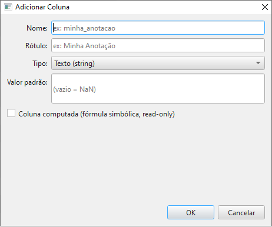
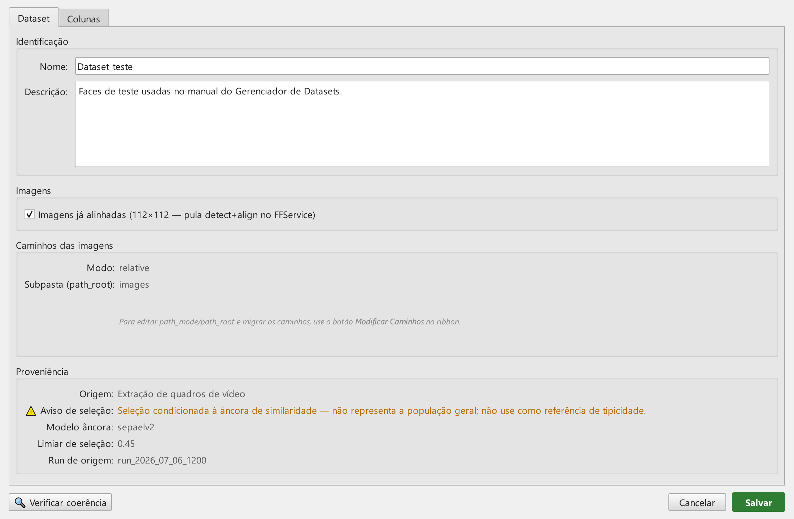
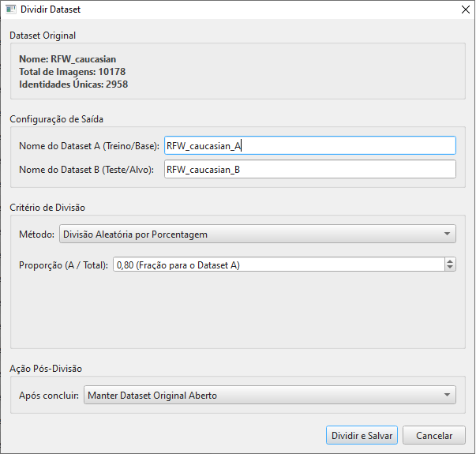
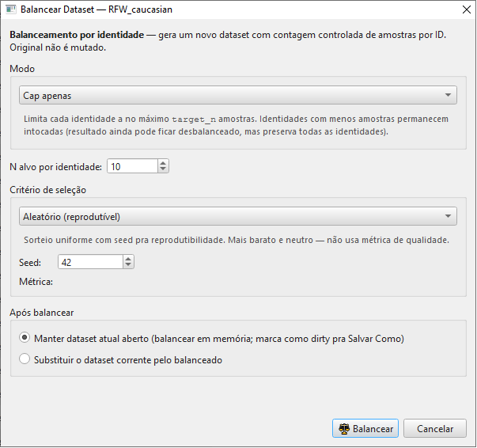

# 07 — Operações estruturais

Este capítulo cobre operações que **modificam a estrutura** do
dataset (esquema, linhas, conjuntos):

- ➕📋 **Adicionar Coluna** — colunas customizadas (incluindo
  *computed*)
- 🏷️ **Metadados** — editor de esquema completo (nome, descrição,
  todas as colunas)
- 🔗 **Juntar** — concatenar dois datasets
- ✂️ **Dividir** — separar em dois datasets
- ⚖ **Balancear** — uniformizar amostras por identidade
- ⚖️ **Comparar** — análise lado-a-lado de dois datasets

## Sumário do capítulo

1. [Adicionar Coluna](#adicionar-coluna)
2. [Editor de Metadados](#editor-de-metadados)
3. [Juntar (merge)](#juntar)
4. [Dividir (split)](#dividir)
5. [Balancear](#balancear)
6. [Comparar dois datasets](#comparar)

---

## Adicionar Coluna



Cria uma **coluna customizada** (`role=CUSTOM`, `source=CUSTOM`) no
dataset atual. Útil para anotações livres durante revisão visual,
pareceres, *flags* customizadas.

### Campos

| Campo | Tipo | Validação | Notas |
|---|---|---|---|
| **Name** | Texto | Snake_case obrigatório (letras/números/`_`); não pode colidir com coluna existente | Nome técnico — não exibido no cabeçalho |
| **Label** | Texto | Opcional (default = name) | Exibido no cabeçalho |
| **Type** | Combo: `str` / `float` / `int` / `bool` | — | Define o widget de edição inline |
| **Default value** | Conforme tipo | Opcional (vazio = NaN) | Aplicado a todas as linhas existentes |
| ☑️ **Coluna computada** | Boolean | — | Quando marcado, mostra textarea de expressão |
| **Expressão** | Texto Python-like | Sintaxe validada no OK | Veja abaixo |

### Coluna computada

Quando você marca **Coluna computada**, em vez de um valor
constante a coluna recebe uma **expressão** avaliada para cada
linha:

```python
fiqa_score > 0.8 and ofiq_score > 70
```

A expressão tem acesso aos valores de **outras colunas** do
dataset (use os **nomes técnicos** das colunas como variáveis).
Suporta operadores aritméticos, comparações, lógicos, o ternário
`a if b else c`, e um conjunto de funções seguras:

```
abs, min, max, round, len, str, int, float, bool,
sqrt, log, exp, floor, ceil
```

> ⚠️ **Validação no OK**: a fórmula é **analisada sintaticamente**
> (parse do AST) e só se verifica que os nós e as funções usados
> estão na lista permitida. A expressão **não** é testada numa face
> de exemplo, e **referência a coluna inexistente NÃO bloqueia a
> criação** — ela só falha em *runtime*, linha a linha, exibindo um
> valor de erro na célula daquela linha.

> ⚠️ **Pré-condição de esquema**: se o dataset foi carregado de um
> parquet **legado sem `column_specs`** na metadata, o botão é
> bloqueado com o aviso *"Schema legado"* pedindo para **Salvar**
> primeiro (isso reescreve o parquet no formato novo). Só depois de
> salvar você consegue adicionar colunas customizadas.

### Resultado

A nova coluna aparece imediatamente na tabela, **editável** (a
menos que `computed`, que é read-only). Não esqueça de **Salvar**
o dataset para persistir.

> 💡 A criação de coluna é registrada no **Audit Log** forense
> (operação `ADD_COLUMN`), alimentando a cadeia de custódia — veja o
> [capítulo 09](09_auditoria_forense.md).

## Editor de Metadados



O **hub central** para editar tudo sobre o esquema. Acessível pelo
botão 🏷️ **Metadados** da ribbon *Dataset*.

### Aba *Dataset*

Edição dos atributos globais:

| Campo | Editável? | Notas |
|---|---|---|
| **Nome** | 🔒 Read-only | Pra mudar, use *Salvar Como* com novo nome |
| **Descrição** | ✏️ Sim | Texto livre, salvo no metadado |
| ☑️ **is_aligned** | ✏️ Sim | Override manual *(também acessível via Enriquecer)* |
| **path_mode** / **path_root** | 🔒 Read-only | Pra mudar/migrar, use *Modificar Caminhos* ([capítulo 03](03_carregando_e_localizando.md)) |

> ℹ️ **Proveniência de datasets de vídeo é exibida (read-only).**
> Datasets criados por extração de vídeo (veja o
> [capítulo 02b](02b_criando_dataset_de_video.md)) carregam metadados
> de proveniência estruturada — `dataset_origin_type`,
> `selection_warning` (aviso de viés de seleção), `source_run_id`,
> `selection_anchor_model` e `selection_threshold`. Quando presentes,
> o Editor de Metadados os mostra num grupo **Proveniência** somente-
> leitura na aba *Dataset* (com o aviso de seleção em destaque âmbar).
> Não são editáveis por aqui — viajam com o parquet.

### Aba *Colunas*

Layout split-pane:

| Lado | Conteúdo |
|---|---|
| **Esquerda** | Lista de todas as colunas (tabela) — Name, Label, Role, Source, Type |
| **Direita** | Formulário scrollable com todas as propriedades da coluna selecionada |

Ao clicar numa coluna à esquerda, o formulário direito carrega
seus atributos. Edições propagam imediatamente para um
*snapshot* em memória; só são persistidas ao clicar **Salvar**.

### Campos da coluna no formulário direito

#### Universais (aparecem para qualquer role)

- **Label** — sempre editável
- **Descrição** — texto livre
- **Categoria** — agrupamento visual (ex: "Demografia", "Qualidade")
- **Editable** — toggle se a célula aceita edição inline
- **Visible default** — toggle de visibilidade-padrão
- **Aliases** — lista de nomes alternativos (compatibilidade com parquets de esquema antigo)

#### Específicos por role

| Role | Campos extras |
|---|---|
| **QUALITY** | `direction` (`HIGHER_IS_BETTER` / `LOWER_IS_BETTER`), `subtype`, `scale`, `metric` |
| **POSE** | `axis` — combo `Yaw`/`Pitch`/`Roll` (rótulo *Eixo (Pose)*); `unit` — campo de **texto livre** (*Unidade (Pose)*, placeholder `deg`), não um combo |
| **EMBEDDING** | `dim` (dimensão do vetor), `model_name` |
| **DEMOGRAPHIC** | `is_estimate` (toggle entre valor anotado pelo humano vs estimado pelo modelo) |
| **STR** *(qualquer role)* | **Vocabulary** — lista de valores válidos (combo box na edição). Política tolerante: valores fora do vocabulary são aceitos mas flageados visualmente |
| **CUSTOM** *(apenas)* | `role`, `dtype`, `default_value` (todos editáveis) |

### Restrições importantes

- **Colunas canônicas** (qualquer não-CUSTOM) **não permitem**
  mudar `role`, `dtype`, `source` ou `default_value`. Edição
  limitada a label, descrição, vocabulary, aliases, visibilidade.
- **Singletons** (`IDENTITY`, `IMAGE_PATH`, `FILE_HASH`) **não
  permitem** trocar a role nem ter `dtype` editado — papéis
  fundamentais do esquema.

### Botão 🔍 *Verificar coerência*

Lista quantos valores estão **fora do vocabulário** em cada coluna.
A verificação cobre **apenas colunas do tipo `str` com vocabulário
definido** — para cada uma, conta os valores que não constam do
vocabulário declarado. A política é **tolerante**: valores
fora-de-vocab continuam aceitos, só ficam flagados visualmente na
tabela. Útil após importar/mesclar datasets de origens diferentes.

> ⚠️ Em datasets grandes (> 10 mil faces), a verificação pode
> demorar alguns segundos. O cursor vira *waiting*.

## Juntar

A operação **Juntar** (botão 🔗 da ribbon *Dataset*) **não tem
diálogo próprio** — ela:

1. Abre um `QFileDialog` pedindo para você selecionar o **outro
   parquet** a ser mesclado com o dataset atual
2. Faz a concatenação **em memória** — o resultado vira o novo
   dataset corrente
3. Marca como modificado (você precisa **Salvar Como** pra persistir)

### Como a concatenação trata diferenças de esquema

A junção é uma **concatenação simples de listas de faces** (o
resultado é `faces de A + faces de B`). **Não** há reconciliação de
esquema tipada — nada de *upcast* `int→float`/`bool→int` nem
verificação de compatibilidade no momento da junção.

| Situação | Resultado |
|---|---|
| Mesmas colunas em A e B | Concatena normalmente |
| A tem coluna que B não tem | Ao montar a tabela, as linhas de B ficam **vazias/NaN** nessa coluna |
| B tem coluna que A não tem | Idem — as linhas de A ficam **vazias/NaN** |
| Mesma coluna com tipos diferentes | Sem tratamento explícito na junção; as diferenças aparecem só quando a tabela/parquet é montado |

> 💡 Após Juntar, use o **Editor de Metadados → 🔍 Verificar
> coerência** pra detectar valores fora de vocabulário, e o **Editor
> de Metadados** pra alinhar labels/roles se necessário.

### O que NÃO acontece

- **Linhas duplicadas** não são deduplicadas automaticamente. Se A
  e B têm a mesma face (mesmo `hash`), ela aparece duas vezes no
  resultado. Use a **Auditoria** ([capítulo 09](09_auditoria_forense.md))
  pra detectar e remover duplicatas exatas se necessário.
- **`column_specs`** de **ambos** A e B são **descartados** — o
  dataset resultante nasce sem esquema explícito e é reconstruído a
  partir do catálogo de colunas ao **Salvar**.
- **Proveniência não é propagada.** `path_mode`, `is_aligned` e a
  proveniência de origem (inclusive de datasets de vídeo) do
  original **não** viajam para o resultado da junção.
- Arquivos originais **não** são tocados; nenhum dos dois parquets
  de origem é alterado.

## Dividir



Particiona o dataset atual em **dois novos parquets**.

### Modos

Os dois modos aparecem no combo **Método** do diálogo:

| Modo (rótulo na tela) | Como divide |
|---|---|
| **Divisão Aleatória por Porcentagem** | Divisão aleatória **por identidade** (*identity-disjoint*): cada identidade vai **inteira** para A **ou** para B — nunca é fatiada entre os dois. A fração escolhida controla a proporção de **identidades** que vão para A |
| **Seleção Manual de Identidades** | Você seleciona quais identidades vão pra B (duas listas + botões); restante vai pra A |

> ⚠️ **Ambos os modos são identity-disjoint** — não só o manual. Em
> nenhum deles uma mesma pessoa aparece nos dois lados, o que
> **evita vazamento de identidade** (*data leakage*) entre treino e
> calibração/teste.

### Campos

| Campo | Notas |
|---|---|
| **Nome do Dataset A** (*Treino/Base*) | Stem do parquet do lado A (sem `.parquet`) |
| **Nome do Dataset B** (*Teste/Alvo*) | Stem do parquet do lado B |
| **Proporção (A / Total)** *(modo porcentagem)* | `QDoubleSpinBox` de **fração** de 0,05 a 0,95 (passo 0,05), **default 0,80**, com sufixo *(Fração para o Dataset A)*. É fração, não porcentagem |
| **Listas A / B** *(modo manual)* | Selecione uma ou mais identidades e use os botões **`>>`** (mover para B) / **`<<`** (mover para A), ou **duplo-clique** num item para movê-lo. Não há *drag-and-drop* |
| **Após concluir** | `Manter Dataset Original Aberto` / `Carregar Dataset A no visualizador` / `Carregar Dataset B no visualizador` |

O botão de confirmação é rotulado **Dividir e Salvar**.

### Saída

Os dois parquets são gravados **em disco** (na pasta de trabalho do
dataset, `pipeline.storage_path`), com os nomes informados. O
dataset **atual não é modificado** — só lido. Conforme a opção
*Após concluir*, o lado A ou B pode ser aberto no visualizador; em
*Manter Dataset Original Aberto*, nada é recarregado na tela (os
parquets ficam salvos, mas a visualização continua no original).

## Balancear



Uniformiza o **número de amostras por identidade**. Importante
porque algoritmos de score (PLDA, regressão logística) assumem
classes balanceadas — desbalanceamento severo distorce o LR.

### Modo de balanceamento

| Modo (rótulo na tela) | O que faz |
|---|---|
| **Cap apenas** (`CAP_ONLY`) | Para cada identidade, mantém no máximo `target_n` amostras. Identidades com **menos** que `target_n` ficam intactas (o resultado ainda pode ficar desbalanceado, mas preserva todas as identidades) |
| **Floor + Cap** (`FLOOR_AND_CAP`) | Descarta identidades com **menos** que `target_n` amostras (floor); aplica cap nas demais |
| **Auto-min (todas iguais ao mínimo)** (`AUTO_MIN_BALANCE`) | Ignora `target_n`; usa `N` = a menor contagem observada entre as identidades. Garante balanceamento perfeito ao custo de descartar muitos dados se houver identidade muito subrepresentada |

### Critério de seleção

Quando precisa **descartar** amostras de uma identidade (porque tem
mais que `target_n`), o critério decide quais ficam:

| Critério (rótulo na tela) | Como escolhe |
|---|---|
| **Aleatório (reprodutível)** (`RANDOM`) | Sorteio uniforme (com `seed` reproduzível). Não usa métrica de qualidade |
| **Por qualidade (top-N)** (`BY_QUALITY`) | Ordena por `quality_metric` (maior = melhor) e mantém as `target_n` melhores por identidade. Empates desfeitos por hash determinístico |

> 💡 `Por qualidade` é o padrão recomendado pra forense — descartar
> aleatoriamente pode tirar fotos boas e manter fotos ruins.

### Campos

| Campo | Notas |
|---|---|
| **Modo** | Os 3 modos acima |
| **N alvo por identidade** (`target_n`) | Spinner 1–100 000, **default 10**. Visível em *Cap apenas* e *Floor + Cap*; oculto em *Auto-min* |
| **Critério de seleção** | *Aleatório (reprodutível)* ou *Por qualidade (top-N)* |
| **Seed** *(Aleatório)* | Spinner inteiro. Default 42 |
| **Métrica** *(Por qualidade)* | Combo: `FIQA (ForensicFace)` / `OFIQ (ISO unified)` / `SER-FIQ (robustez)` / `Norma do embedding (AdaFace)` |
| **Após balancear** | Rádio: `Manter dataset atual aberto` (default) ou `Substituir o dataset corrente pelo balanceado` |

O botão de confirmação é rotulado **⚖ Balancear**.

### Saída

> ⚠️ **O balanceamento NUNCA grava um parquet automaticamente** — em
> qualquer modo é preciso usar **Salvar / Salvar Como** depois.

O comportamento depende da opção *Após balancear*:

- **Manter dataset atual aberto** — apenas **simula** o
  balanceamento e mostra um resumo do impacto num aviso
  (*"Pré-visualização de balanceamento"* / *"Balanceamento simulado
  (não aplicado ao dataset corrente)"*). O resultado é **descartado**:
  nada é criado, nada é aberto, o dataset na tela não muda. Serve
  para inspecionar o efeito antes de decidir.
- **Substituir o dataset corrente pelo balanceado** — troca o
  dataset **em memória** pelo resultado e marca a tela como
  **modificada** (dirty). Nesse ponto, use **Salvar Como** para
  gravar como um novo parquet (o original em disco continua
  intacto).

## Comparar

A operação **Comparar** abre um diálogo lado-a-lado mostrando
diferenças entre o **dataset atual** e outro `.parquet` que você
selecione.

O título da janela vira **Comparação: {A} vs {B}**.

### Estrutura do diálogo

Há uma aba fixa mais **abas dinâmicas por coluna categórica**:

| Aba | Conteúdo |
|---|---|
| **📋 Resumo Geral** *(fixa)* | Três caixas — o dataset A, **Interseção (Comum)** e o dataset B — cada uma com contagem de imagens (🖼️) e identidades (👤); mais uma seção **Detalhes Técnicos (Estrutura)** listando *Colunas em comum* e *Ausentes em {B}* |
| **Gênero / Etnia / Origem** *(dinâmicas)* | Uma aba por coluna categórica: tabela com `Categoria` + contagem em A + contagem em B + `Diferença` |
| *(colunas custom)* | Qualquer coluna categórica customizada de baixa cardinalidade vira **automaticamente** uma aba de comparação, com a mesma tabela |

> ℹ️ Não existem abas separadas de "Identidades" nem de "Colunas" —
> a interseção de identidades já aparece nas caixas do **Resumo
> Geral**, e a comparação de colunas fica nos *Detalhes Técnicos*
> (colunas em comum e colunas ausentes em B).

A coluna **Diferença** mostra o delta **B − A** com sinal (ex.:
`+5`, `-3`, `0`) e é colorida conforme esse sinal:

- 🟢 **verde** — valor **maior em B** (B > A)
- 🔴 **vermelho** — valor **menor em B** (B < A)
- ⚪ **cinza** — igual nos dois

> ⚠️ Atenção à convenção: a cor reflete a variação **em relação a
> B**, não "A maior que B". Verde significa que B tem mais itens
> naquela categoria do que A.

### Casos de uso

- **Antes e depois** de uma operação destrutiva (filtro, balance)
  — abra o original + o resultado e compare quantitativamente
- **Validar splits** — depois de Dividir, abra A e B e confira
  que a divisão foi como esperado
- **Auditar merge** — depois de Juntar, abra o resultado contra
  um dos originais pra ver o delta

> 💡 Comparar é **read-only** — nenhum dos dois datasets é tocado.
> Você pode fechá-lo sem efeitos colaterais.

---

[← Capítulo 06 — Filtros e estatísticas](06_filtros_e_estatisticas.md) · [Capítulo 08 — Pipeline de imagens →](08_pipeline_de_imagens.md)
