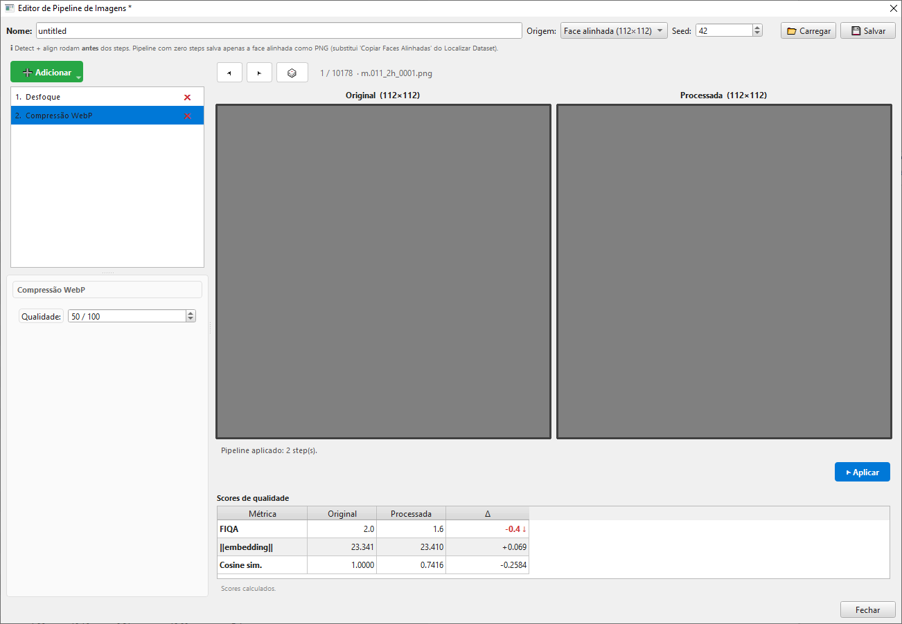
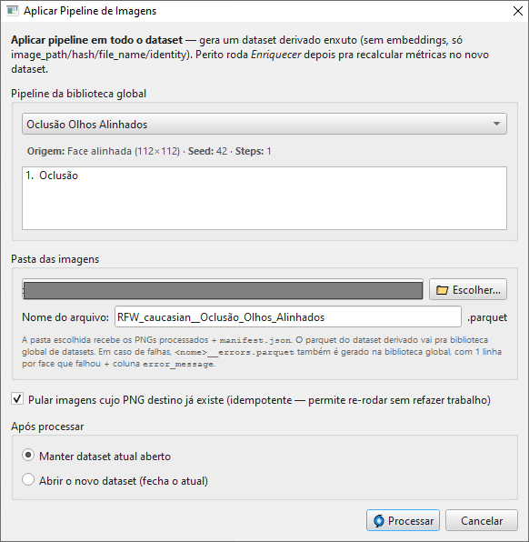

# 08 — Pipeline de imagens

A aba **Imagens** do ribbon expõe dois botões que trabalham juntos:

- 🎨 **Editor** — monta um *pipeline* de transformações de imagem
  interativamente, com pré-visualização e métricas de qualidade
- 🌀 **Processar** — aplica um pipeline salvo a todo o dataset,
  gerando um **novo dataset** com as imagens transformadas

A motivação forense: simular **degradações realistas** (compressão
de mensageiro, oclusão, blur de zoom digital, etc.) sobre um
dataset de referência e verificar como o sistema de comparação
biométrica se comporta.

## Sumário do capítulo

1. [Conceito de *pipeline de imagens*](#conceito)
2. [O Editor — leiaute em três painéis](#o-editor)
3. [Os 5 tipos de step](#os-5-tipos-de-step)
4. [Configuração detalhada de cada step](#configuração-detalhada)
5. [Métricas de qualidade ao vivo](#métricas-ao-vivo)
6. [Salvando e carregando pipelines](#salvando-e-carregando)
7. [O diálogo *Processar*](#o-diálogo-processar)
8. [O dataset de saída](#o-dataset-de-saída)
9. [Casos de uso forense](#casos-de-uso-forense)

---

## Conceito

Um **pipeline de imagens** é uma sequência ordenada de
**transformações** aplicadas a cada imagem do dataset. Exemplos:

- `Blur(σ=2) → JPEG(qual=60)` — simula uma foto desfocada
  comprimida pelo WhatsApp
- `Crop(face_detected, padding=0.2) → JPEG(qual=85)` — recorta
  só a face e comprime
- `Occlusion(rectangle, 30%) → JPEG(qual=70)` — simula uma
  evidência parcialmente bloqueada

> 💡 Pipelines são **reutilizáveis** — você salva como `.json` na
> biblioteca global, e qualquer dataset pode ser processado por
> qualquer pipeline. Esse é o objeto declarativo equivalente ao
> *StrategyDefinition* do Gerenciador de Estratégias, mas para
> processamento de imagens.

## O Editor



O diálogo tem **três painéis principais**:

### Painel esquerdo — Lista de steps (split vertical 35%)

| Sub-área | Função |
|---|---|
| **Topo — Lista** | Steps na ordem de aplicação. Cada linha mostra `Nº.  Rótulo` (ex.: `1.  Desfoque`). Drag-drop pra reordenar. Botão ✕ vermelho remove |
| **Base — Configuração** | Formulário dinâmico que reage ao step selecionado — campos variam conforme o tipo |

Botão verde **➕ Adicionar** no topo abre um menu com os 5 tipos
disponíveis.

### Painel direito superior — Image Compare (65%)

| Elemento | Função |
|---|---|
| **Imagem original** (480×480 esquerda) | Imagem de entrada, sem transformação |
| **Imagem processada** (480×480 direita) | Resultado após aplicar o pipeline atual |
| ◀ ▶ 🎲 | Navegação entre faces do dataset (anterior / próxima / aleatória) |
| Status label | `17 / 234  · foto_05.png` (índice atual / total · nome do arquivo) |
| **▶ Aplicar** | Reaplica o pipeline na face atual (após alterar steps/parâmetros) |

### Painel direito inferior — Scores de qualidade


Tabela 3×4 (**Scores de qualidade**) que se preenche após cada
*Aplicar*:

| Métrica | Original | Processada | Δ |
|---|---|---|---|
| FIQA | 0.8 | 0.6 | -0.2 ↓ *(vermelho)* |
| ‖embedding‖ | 22.400 | 19.800 | -2.600 |
| Cosine sim. | 1.0000 | 0.9100 | -0.0900 |

Apenas o **delta do FIQA** ganha cor: 🔴 vermelho + seta ↓ quando o
FIQA cai mais de 0.1 (degradação), 🟢 verde + seta ↑ quando sobe mais
de 0.1; variações pequenas ficam sem cor. Os deltas de ‖embedding‖ e
Cosine sim. são **informativos** — mostrados sem cor. O cálculo roda
num *worker* separado pra não travar a UI.

### Topo — controles globais

| Controle | Função |
|---|---|
| **Nome** | Identificador do pipeline (vira o stem do JSON salvo) |
| **Origem** | Fonte que alimenta o pipeline: **Imagem original** (foto inteira, com fundo e pose variada) ou **Face alinhada (112×112)** (o ForensicFace detecta e alinha a face **antes** de qualquer step rodar) |
| **Seed** | Inteiro pra steps aleatórios (`Oclusão` com posição aleatória, etc.) — torna o pipeline reproduzível |
| **📂 Carregar** | Carrega um pipeline salvo da biblioteca global (substitui o pipeline em memória; mudanças não salvas são descartadas após confirmação) |
| **💾 Salvar** | Pergunta o ID do pipeline (default = nome atual) e grava em `<biblioteca>/image_pipelines/<id>.json`; se já existir um pipeline com esse ID, pergunta se quer sobrescrever |

> 💡 **Truque**: selecione **Origem = Face alinhada (112×112)** e deixe o
> pipeline **sem nenhum step**. O *Processar* então produz um dataset
> contendo apenas as faces alinhadas 112×112 como PNG — é o substituto do
> antigo *Copiar Faces Alinhadas* do diálogo *Modificar Caminhos*. O dataset
> derivado é marcado como `is_aligned=True`, de modo que um **Enriquecer**
> posterior ([capítulo 05](05_enriquecimento.md)) não re-detecta a face
> dentro do crop já alinhado.

> ⚠️ **Salvar/Carregar exigem biblioteca global.** Se `paths.library` não
> estiver configurado, os dois botões ficam desabilitados com um tooltip
> explicativo. O título da janela mostra um `*` enquanto houver mudanças
> não salvas, e fechar o editor com pendências pede confirmação.

## Os 5 tipos de step

Os steps aparecem na lista e no menu **➕ Adicionar** com os rótulos
em português abaixo. Os nomes em maiúsculas (`BLUR`, `JPEG`, …) são os
identificadores internos usados no JSON — a UI não exibe ícones por
tipo de step.

| Rótulo na UI | Tipo interno | O que faz |
|---|---|---|
| **Desfoque** | `BLUR` | Aplica filtro Gaussiano. Simula desfoque por movimento, falha de foco, ou degradação de zoom |
| **Compressão JPEG** | `JPEG` | Codifica + decodifica em JPEG. Simula compressão de mensageiros, e-mail, redes sociais |
| **Compressão WebP** | `WEBP` | Como JPEG mas no formato WebP (compressão moderna, melhor qualidade pelo mesmo bitrate) |
| **Recorte** | `CROP` | Recorta a imagem. Modos centralizado (fixo) ou detectado por face (com padding) |
| **Oclusão** | `OCCLUSION` | Adiciona oclusão (máscara desenhada à mão, retângulo preto ou círculo preto). Simula obstruções parciais |

> 💡 Os 5 cobrem os cenários mais comuns de degradação realista.
> A intenção do MVP é cobrir o caso pericial *"reproduza no
> dataset de referência o que aconteceu na evidência"* — se a foto
> do caso veio do WhatsApp, comprima a referência com JPEG; se a
> identificação só mostra parte do rosto, oclua a referência.

## Configuração detalhada

> 💡 A coluna **Padrão** lista o valor de esquema (usado quando o
> config é carregado de JSON). Ao **adicionar** um step novo no editor,
> alguns campos vêm pré-preenchidos com valores mais visíveis: Desfoque
> abre com kernel **7** e sigma **2.0**; Compressão JPEG e WebP abrem
> com qualidade **50**. Isso é só o valor inicial do formulário — você
> ajusta livremente.

### Desfoque (BLUR) — Borrão Gaussiano

| Campo (rótulo na UI) | Faixa | Padrão | Notas |
|---|---|---|---|
| **Tipo** | Combo (só Gaussiano no MVP) | Gaussiano | Outros tipos (motion blur, defocus) podem vir em versões futuras |
| **Kernel** | Ímpar entre 1 e 99 | 5 | Tamanho do kernel; quanto maior, mais alcance |
| **Sigma** | 0.1 – 50.0 | 1.0 | Desvio padrão da gaussiana; quanto maior, mais borrão |

### Compressão JPEG (JPEG)

| Campo (rótulo na UI) | Faixa | Padrão | Notas |
|---|---|---|---|
| **Qualidade** | 1 – 100 | 85 | Qualidade JPEG. Valores baixos mostram artefatos pesados; > 95 são quase imperceptíveis |

### Compressão WebP (WEBP)

| Campo (rótulo na UI) | Faixa | Padrão | Notas |
|---|---|---|---|
| **Qualidade** | 1 – 100 | 80 | WebP geralmente preserva melhor que JPEG no mesmo valor |

### Recorte (CROP)

| Campo (rótulo na UI) | Faixa | Padrão | Notas |
|---|---|---|---|
| **Modo** | `CENTERED` / `FACE_DETECTED` | CENTERED | |
| *(CENTERED)* **Largura** | 8 – 4096 | 224 | Largura do recorte em px |
| *(CENTERED)* **Altura** | 8 – 4096 | 224 | Altura do recorte em px |
| *(FACE_DETECTED)* **Padding face** | ≥ 0.0 | 0.0 | Fração do bbox detectado a adicionar como margem (0.2 = 20% além) |

> 💡 No modo `FACE_DETECTED`, o ForensicFace é chamado pra detectar
> a maior face, e o recorte é feito em volta do bbox dela (com
> padding opcional). Útil pra **extrair só a face** preservando a
> pose original. Esse modo exige o FFService disponível.

### Oclusão (OCCLUSION)

O tipo **default é Máscara desenhada** (`MASK_FACE`), que esconde os
campos de posição/dimensão e usa apenas a máscara que você desenha. Os
tipos geométricos (retângulo e círculo) usam posição + dimensões.

| Campo (rótulo na UI) | Faixa | Padrão | Notas |
|---|---|---|---|
| **Tipo** | Máscara desenhada / Retângulo preto / Círculo preto | Máscara desenhada | |
| **Posição** | Centralizada / Aleatória / Sobre os olhos / Sobre a boca | Centralizada | Oferecida por **Retângulo preto** e **Círculo preto**; oculta em Máscara desenhada. Sobre os olhos / Sobre a boca exigem FFService (landmarks) |
| *(Retângulo)* **Largura** | 0.01 – 1.0 | 0.5 | Fração da largura da imagem ocluída |
| *(Retângulo)* **Altura** | 0.01 – 1.0 | 0.5 | Fração da altura da imagem ocluída |
| *(Círculo)* **Raio** | 0.01 – 0.50 | 0.10 | Raio como fração do menor lado |
| *(Máscara)* **Máscara** | Formas desenhadas | (vazio) | Botão **🎨 Desenhar máscara…** abre o canvas |

> 💡 **Máscara desenhada** é o modo mais flexível — o botão
> **🎨 Desenhar máscara…** abre um canvas onde você desenha
> **polígonos, retângulos e elipses** sobre a imagem do preview. As
> coordenadas são salvas em `[0..1]` (normalizadas), então a mesma
> máscara se aplica a imagens de tamanhos diferentes. Útil pra simular
> obstruções específicas (faixa de evidência, perda de resolução em
> região específica). Com uma ou mais formas, o botão passa a mostrar
> **🎨 Editar (N shapes)…**.

> ⚠️ **Sobre os olhos** e **Sobre a boca** (e o modo **Origem = Face
> alinhada** / recorte `FACE_DETECTED`) dependem do **FFService**. Sem
> ele, o preview mostra um erro explícito no lugar da imagem processada.

## Métricas ao vivo

O painel inferior direito (**Scores de qualidade**) está **sempre
visível** sob o preview — não há como ligá-lo ou desligá-lo. Ele fica
vazio (`—`) para um pipeline sem steps e se preenche assim que você
clica **▶ Aplicar**:

| Métrica | O que indica |
|---|---|
| **FIQA** | Score de qualidade da face. Cair mais de 0.1 indica degradação que afeta reconhecimento (único delta colorido) |
| **‖embedding‖** | Magnitude do vetor de embedding. Valores muito baixos indicam *embedding collapse* (a transformação destruiu informação demais) |
| **Cosine sim.** | Cosseno entre embeddings de original e processada. 1.0 = idêntico; valores baixos significam que o pipeline mudou muito a "assinatura" biométrica |

Quando a face não é detectada na imagem processada, a linha de status
do painel avisa (`⚠ face destruída pelo pipeline (ou não detectada)`).

### Recomputação

As métricas são recalculadas **somente quando você clica ▶ Aplicar**.
Mudar steps/parâmetros não dispara recálculo automático — você
controla o momento (evita cálculos desnecessários durante
edição).

O cálculo roda num *worker* assíncrono. A UI continua responsiva
durante o cálculo; enquanto ele roda, as células mostram `…` e a linha
de status exibe *"Calculando scores…"*.

## Salvando e carregando

Pipelines são salvos como JSON em
`<paths.library>/image_pipelines/`. Cada step é serializado **plano**
(sem objeto `config` aninhado): a chave `step_type` guarda o tipo em
minúsculas e os parâmetros ficam no mesmo nível. O pipeline também
grava `description` e `input_source`:

```json
{
  "name": "whatsapp_simulation",
  "description": "",
  "input_source": "original",
  "seed": 42,
  "steps": [
    {"step_type": "blur", "kind": "gaussian", "kernel_size": 5, "sigma": 1.5},
    {"step_type": "jpeg", "quality": 65}
  ]
}
```

Use o botão **📂 Carregar** para carregar; **💾 Salvar** para
persistir. Pipelines aparecem automaticamente no dropdown do
diálogo *Processar*.

## O diálogo *Processar*



Aplica um pipeline **a todas as imagens do dataset** num batch
único. Não tem preview — é "rode e espere".

### Campos

| Campo | Notas |
|---|---|
| **Pipeline** | Combo listando os nomes (stems dos `*.json` de `image_pipelines/`). Um rótulo abaixo mostra **Origem · Seed · Steps · Descrição** do pipeline selecionado |
| **Pasta das imagens** (**📁 Escolher…**) | Onde os PNGs de saída serão escritos. Default sugerido: `<parquet_dir>/<dataset>__<pipeline>/` |
| **Nome do arquivo** | Stem do parquet de saída. Default: `<dataset>__<pipeline>` |
| ☑️ **Pular imagens cujo PNG destino já existe** | Idempotente: pula quando o PNG de destino **já existe** (por existência do arquivo, não por comparação de hash). Default ON |
| **Após processar** | Radio: `Manter dataset atual aberto` (default) ou `Abrir o novo dataset (fecha o atual)` |

O botão de confirmação exibe **🌀 Processar**.

### Execução

Worker em thread separada. Diálogo de progresso mostra:
- Mensagem por face no formato `[47/234] …/foto_05.png` (throttle a cada 25 faces)
- Botão Cancelar

Cada face do dataset original é:
1. Lida do disco (`cv2.imdecode` com suporte a paths Unicode no Windows)
2. Passada pelo pipeline declarado
3. Escrita como **PNG lossless** na pasta destino

> ⚠️ **Cancelar não interrompe o lote no meio.** Não há ponto de
> cancelamento granular dentro do laço por face: o lote atual roda até
> o fim e o resultado é simplesmente **descartado**. Cancelar evita
> abrir/registrar o dataset derivado, mas os PNGs já gravados
> permanecem no disco.

## O dataset de saída

A operação cria um **novo dataset** (não modifica o atual). Os PNGs
**preservam o nome do arquivo de origem** (com extensão trocada para
`.png`), desambiguados por sufixos `_1`, `_2` em caso de colisão:

```
<pasta_das_imagens>/
├── foto_05.png             ← imagem processada (sempre PNG lossless; nome preservado)
├── retrato_frontal.png
├── ...
└── manifest.json           ← âncora forense (config do pipeline + contagens)

<biblioteca_global_de_datasets>/
├── <dataset>__<pipeline>.parquet
└── <dataset>__<pipeline>__errors.parquet   ← (só se houver falhas)
```

> ℹ️ As **imagens** vão para a pasta que você escolheu; o **parquet do
> dataset derivado** (e o parquet de erros, se houver) vão para a
> biblioteca global de datasets — mesma separação do fluxo "Novo
> Dataset com Alinhamento".

### Estrutura do parquet de saída

O dataset derivado é **enxuto**, mas preserva a demografia da fonte:

| Coluna | Conteúdo |
|---|---|
| `image_path` | Caminho absoluto pra o PNG processado |
| `hash` | SHA-256 do PNG novo |
| `file_name` | Nome do PNG |
| `identity` | Preservado do dataset original |
| `origin` / `ethnicity` / `gender` | Preservados do dataset original |

> ⚠️ **São descartados apenas os campos pesados** — embeddings,
> `ff_info`/`ofiq_info`/`serfiq_info`, pose e qualidade. Identidade e
> demografia (origem, etnia, gênero) **são preservadas**. Se você
> quiser embeddings e métricas de qualidade no dataset processado, rode
> **Enriquecer** ([capítulo 05](05_enriquecimento.md)) depois.

### Manifesto e parquet de erros

O `manifest.json` (ao lado dos PNGs) é a âncora forense da execução.
Registra: nome/seed/origem do pipeline, tipos e número de steps,
contagens (processadas / concluídas / puladas / falhas), timestamp de
início, duração, dataset-fonte, operador e o **config completo do
pipeline**. Ele **não** contém hashes por imagem — o SHA-256 de cada
PNG vive na coluna `hash` do parquet derivado.

Quando alguma face falha, é gravado `<nome>__errors.parquet` (na
biblioteca global), com uma linha por falha e as colunas
`image_path` / `identity` / `file_name` / `hash` + `error_message` (a
razão da falha). Os paths apontam para a **imagem-fonte** (o PNG não
chegou a ser gerado). Você pode abrir esse arquivo como um dataset
normal para inspecionar, filtrar e gerar uma lista de reanálise.

### Por que sempre PNG?

PNG é **lossless** — preserva exatamente o que o pipeline produziu.
Se o último step do pipeline foi JPEG(85), o PNG final contém os
artefatos do JPEG (que são reais e visíveis), mas o arquivo em si
não adiciona nenhuma perda extra. Garante reprodutibilidade exata.

### Determinismo

O *seed* do pipeline + o `image_path` da face de entrada formam
o seed efetivo para steps aleatórios (como **Oclusão** com posição
**Aleatória**). Steps determinísticos (Desfoque, JPEG, WebP, Recorte)
produzem sempre o mesmo resultado.

> ⚠️ **Ressalva para steps aleatórios.** O RNG por imagem é derivado
> via `hash()` embutido do Python, que é *salted* por processo
> (a menos que `PYTHONHASHSEED` esteja fixado). Na prática: dentro de
> **uma mesma execução** o resultado é reprodutível; entre **execuções
> distintas** do app, a posição de uma oclusão **Aleatória** pode
> variar. Para reprodutibilidade bit a bit entre execuções, prefira
> posições fixas (Centralizada / Sobre os olhos / Sobre a boca) ou uma
> máscara desenhada. Steps não-aleatórios são sempre bit a bit.

## Casos de uso forense

### Caso A — Simular degradação WhatsApp

Você tem fotos de boa qualidade do investigado e a evidência
veio do WhatsApp (resolução reduzida + recomprimida). Para
comparar embeddings em pé de igualdade:

```
Pipeline "whatsapp_typical":
  1. Recorte  modo=CENTERED (640 × 640)  ← simula crop pra caber no app
  2. Compressão JPEG  qualidade=60       ← compressão padrão do WhatsApp
```

Rode esse pipeline no dataset de referência. Agora ambos os
lados estão na mesma "escala de degradação" para a comparação.

> ⚠️ O modo `CENTERED` **não** faz padding automático: se a imagem for
> menor que o alvo (640 × 640 aqui), o step falha para aquela face (a
> falha vai para `<nome>__errors.parquet`). Ajuste o alvo à resolução
> das suas imagens.

### Caso B — Foco em região da face

A evidência mostra o rosto com a parte inferior coberta (ex.: máscara
facial). Para ocluir a região da boca, use posição **Sobre a boca**
(`MOUTH`) — que exige o FFService para localizar os landmarks:

```
Pipeline "mask_lower_face":
  1. Oclusão  tipo=Retângulo preto, posição=Sobre a boca,
              largura=0.6, altura=0.3
```

> 💡 Para um recorte exato da região a esconder, use o tipo **Máscara
> desenhada** e trace o polígono da faixa inferior do rosto no canvas —
> mais preciso que uma barra retangular e não depende de detecção de
> landmarks. Não existe posição `BOTTOM`/`TOP`: as posições geométricas
> disponíveis são Centralizada, Aleatória, Sobre os olhos e Sobre a boca.

### Caso C — Investigar robustez do pipeline biométrico

Cenário de pesquisa: quero quantificar a queda de FIQA quando a
qualidade JPEG cai de 90 para 30. Crio 7 pipelines
(`jpeg_q90`, `jpeg_q80`, …, `jpeg_q30`), processo o mesmo
dataset com cada um, e gero 7 novos parquets. Junto via **Juntar**
([capítulo 07](07_operacoes_estruturais.md)) e analiso o efeito
em **Estatísticas** + **Auditoria**.

### Caso D — Anonimização para divulgação científica

Aplicar oclusões nos olhos pra disseminar o dataset sem expor
identidades:

```
Pipeline "anonymize_eyes":
  1. Oclusão  tipo=Círculo preto, posição=Sobre os olhos, raio=0.15
```

(Posição **Sobre os olhos** exige o FFService para localizar os
landmarks.)

> ⚠️ Anonimização por oclusão é uma técnica básica — não é
> garantia contra re-identificação automatizada. Use com critério.

---

[← Capítulo 07 — Operações estruturais](07_operacoes_estruturais.md) · [Capítulo 09 — Auditoria forense →](09_auditoria_forense.md)
