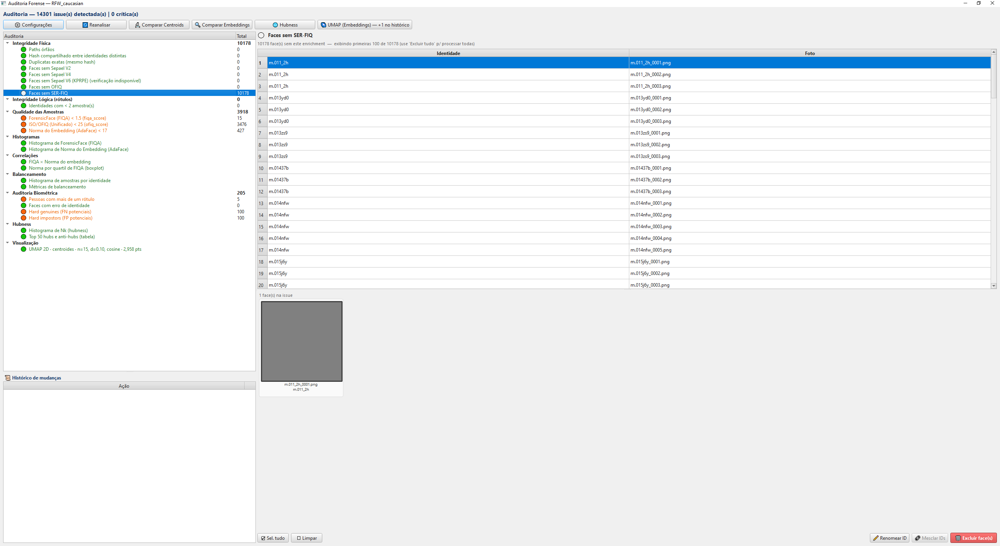
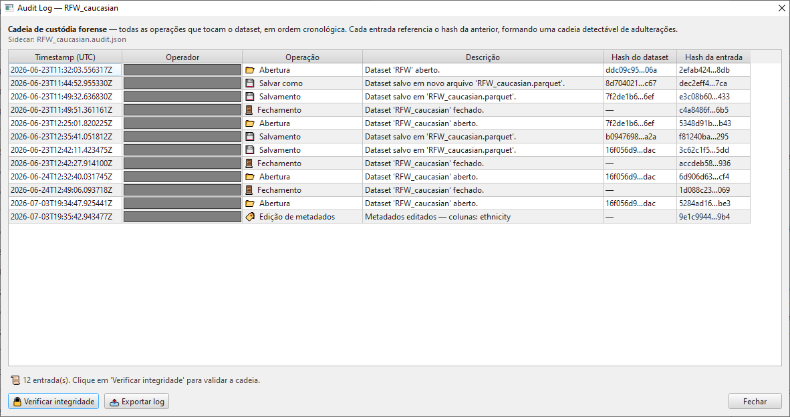

# 09 — Auditoria forense

A **Auditoria** é a área mais sofisticada do Gerenciador de
Datasets — uma suíte de verificações de integridade biométrica
e análise topológica voltada para o **uso forense** dos
embeddings.

A motivação: antes de usar um dataset em cálculo de razão de
verossimilhança, é necessário garantir que ele está livre de
contaminações (mesma foto em duas identidades, identidades
mescladas, fotos órfãs, *singletons*, etc.) e entender a
**geometria** do espaço de embeddings (clusters, hubs, outliers).

Este capítulo cobre dois diálogos relacionados:

- 🔎 **Auditar** (ribbon *Dataset*) — análise completa
- 📜 **Custódia** (ribbon *Dataset*) — log forense de operações

## Sumário do capítulo

1. [O conceito de *AuditIssue*](#o-conceito-de-auditissue)
2. [Leiaute do diálogo Auditar](#leiaute-do-diálogo-auditar)
3. [Categorias de issues](#categorias-de-issues)
4. [Ações sobre issues selecionados](#ações-sobre-issues-selecionados)
5. [Visualizações analíticas](#visualizações-analíticas)
6. [Hubness — análise topológica](#hubness--análise-topológica)
7. [Auditoria de identidades (heavy)](#auditoria-de-identidades)
8. [UMAP — projeção 2D](#umap--projeção-2d)
9. [Undo/redo](#undoredo)
10. [O diálogo *Custódia* (Audit Log)](#o-diálogo-custódia)

---

## O conceito de *AuditIssue*

Um **AuditIssue** é um achado da análise — uma violação detectada
ou uma observação relevante. Cada issue tem:

| Atributo | Conteúdo |
|---|---|
| **Categoria** | Grupo (Integridade Física, Lógica de Rótulos, Qualidade, Biométrica, Hubness, etc.) |
| **Tipo** | Sub-tipo específico (Caminhos órfãos, Conflitos de hash, etc.) |
| **Severidade** | 🔴 CRÍTICO / 🟠 AVISO / ⚪ INFO |
| **Locators** | Lista de faces afetadas (paths ou índices) |
| **Detalhes** | Informações adicionais (identidades envolvidas, threshold violado) |

A auditoria é **dividida em duas passagens**:

- **Quick audit** (O(N)) — rodada automaticamente ao abrir o
  diálogo, segundos
- **Heavy audit** (O(N²)) — chamada explícita via botões **🔍
  Comparar Embeddings**, **🔬 Comparar Centroids** ou **🌐
  Hubness**, minutos em datasets grandes

## Leiaute do diálogo Auditar

Três áreas principais:

### Painel esquerdo — Tree de findings

Hierárquica, agrupada por categoria. Cada categoria mostra seu
contador (`Integridade Física (3)`). Categorias são colapsáveis.

Selecionar um issue popula o painel central.

### Painel central — Detalhes do issue

| Sub-área | Função |
|---|---|
| **Topo — Resumo** | Texto descritivo + badge de severidade |
| **Meio — Tabela de issues** | Uma linha por locator (identity / file_name / metadados) |
| **Carrossel inferior — Preview** | Thumbnails das faces afetadas. Suporta Ctrl+Click (multi-select) e Shift+Click (range) |

Faces deletadas (ações já executadas) aparecem com fundo
**vermelho**; faces renomeadas/mescladas com fundo **laranja**.

### Painel direito — Visualizações

A visualização **não** é uma aba clicável: é um painel que **troca
automaticamente** conforme a auditoria que você seleciona na árvore à
esquerda (internamente um `QStackedWidget`, não um `QTabWidget`). Você
não alterna abas manualmente — a página muda com o achado.

| Página | Quando aparece |
|---|---|
| **Detalhes** | Padrão — tabela de locators + preview |
| **Histograma** | Achados envolvendo distribuições de qualidade (FIQA, OFIQ, embedding norm) |
| **Scatter** | Achados de correlação entre métricas |
| **Boxplot** | Estratificação por pose ou identidade |
| **Balance Metrics** | Achados de distribuição por identidade |
| **Hubness Tables** | Achado de hubness (top hubs / anti-hubs) |
| **UMAP** | Após rodar 🌌 UMAP (Embeddings) |

### Toolbar superior — Botões de ação

Os botões ficam numa **toolbar no topo** do diálogo (não num rodapé):

| Botão | Função |
|---|---|
| **⚙ Configurações** | Ajusta os thresholds das auditorias (FIQA, mín. amostras/ID, duplicatas, mixed) |
| **🔄 Reanalisar** | Reexecuta as auditorias rápidas O(N) (útil após edição manual no dataset) |
| **🔬 Comparar Centroids** | Detecta duplicate/mixed identities via centróides de embedding |
| **🔍 Comparar Embeddings** | Roda hard mining O(N²) — pares de mesma ID com baixa similaridade + pares de IDs distintas com alta |
| **🌐 Hubness** | KNN exaustivo O(N²·D) que computa o `Nk` de cada face |
| **🌌 UMAP (Embeddings)** | Projeção 2D/3D do espaço de embeddings |

## Categorias de issues

### 1. Integridade Física

| Issue | O que detecta | Por que importa | Severidade |
|---|---|---|---|
| **Orphan Paths** | `image_path` que não existe no disco (ou está vazio) | Quebra a inspeção visual; indica perda de arquivo (deleção acidental, ingest mal-sucedido). Bloqueia hash recomputation | 🔴 CRÍTICO |
| **Hash Conflicts** | Mesmo SHA-256 sob **duas identidades** diferentes | Indica contaminação — a mesma foto está rotulada como duas pessoas. **Fatal pra LR** — viola a premissa de mapeamento 1:1 foto→identidade | 🔴 CRÍTICO |
| **Exact Duplicates** | Múltiplas linhas com hash idêntico | Inflaciona contagens artificialmente; testes estatísticos pressupõem independência. Pode ser intencional (augmentation) ou bug de ingest | 🟠 AVISO |
| **Missing Embeddings** | Faces sem vetor de embedding (segundo o schema) | Sem embedding, mining/hubness/scores falham. Indica falha no extractor | 🔴 CRÍTICO |

### 2. Lógica de Rótulos

| Issue | O que detecta | Por que importa | Severidade |
|---|---|---|---|
| **Singleton Identities** | Identidades com < `min_samples` amostras (default 2) | Não dá pra fazer LR within-identity (sem variância); quebra premissas de balanceamento de classes | 🟠 AVISO |

### 3. Qualidade

| Issue | O que detecta |
|---|---|
| **Low FIQA** | Faces abaixo de um threshold de FIQA |
| **Low OFIQ** | Faces com OFIQ unificado baixo |
| **Low SER-FIQ** | Robustez baixa |
| **Low embedding norm** | Magnitude do embedding atipicamente baixa — embedding "fraco" |

Severidade `🟠 AVISO` ou `⚪ INFO` conforme o threshold. Não
são bloqueadores — servem como sinal pra revisão manual.

> ⚠️ **SER-FIQ só aparece em datasets legados.** A coleta de
> SER-FIQ foi removida da interface de criação/enriquecimento, então
> datasets novos não têm a coluna `serfiq_score` e a auditoria
> **Low SER-FIQ** não surge para eles. As métricas de qualidade
> auditáveis são descobertas pelas colunas presentes no dataset —
> tipicamente FIQA, OFIQ e norma de embedding.

### 4. Biométrica (heavy, O(N²))

| Issue | O que detecta | Por que importa | Severidade |
|---|---|---|---|
| **Duplicate Identities** | Pares de **identidades diferentes** cujo centróide de embedding tem similaridade ≥ threshold (default cos ≥ 0.35, ajustável em ⚙ Configurações → duplicatas) | Sugere que duas labels são a mesma pessoa (data entry, alias) | 🟠 AVISO |
| **Mixed Identities** | **Faces** cujo cosseno contra o centróide *leave-one-out* das demais faces do mesmo ID cai abaixo do threshold (default cos < 0.20) | Cada face fora do padrão indica provável rótulo errado — face de outra pessoa marcada com esta identidade | 🟠 AVISO |

> 💡 **Mixed Identities é por face, não por identidade.** Para cada
> face X de um ID com ≥ N amostras (default 3), o auditor calcula o
> centróide das *outras* faces do mesmo ID (excluindo X) e mede o
> cosseno X vs esse centróide. Se X entrasse no cálculo, ela puxaria a
> média na própria direção e mascararia o outlier — por isso o
> *leave-one-out*. Cada face abaixo do threshold vira uma issue própria
> (uma linha na tabela), ordenada das mais discrepantes para as menos.

### 5. Hubness (informativa, O(N²·D))

A análise de **Hubness** **não** gera issues acionáveis — a categoria
é puramente **informativa** (a coluna "Total" da árvore fica em
branco para ela). Ela produz dois achados sem locators:

| Achado | O que mostra |
|---|---|
| **Histograma de `Nk`** | Distribuição do `Nk` (quantas vezes cada face aparece na vizinhança k-NN de outras) |
| **Tabela de hubs/anti-hubs** | Top 50 faces com `Nk` **alto** (hubs) e top 50 com `Nk` **baixo** (anti-hubs, isoladas) |

Veja [seção dedicada abaixo](#hubness--análise-topológica).

### 6. Visualizações

Não geram issues por si só — apenas renderizam os gráficos para
inspeção manual. O painel direito troca automaticamente para a
visualização correspondente quando você seleciona o achado na árvore.

## Ações sobre issues selecionados

Abaixo do preview há uma **barra de ações em lote**. À esquerda ficam
os controles de seleção; à direita, as ações que **aplicam mutações**
ao dataset:

| Botão | Função |
|---|---|
| **☑ Sel. tudo** | Seleciona tudo (todas as imagens do preview em auditorias par-a-par, ou todas as linhas da tabela) |
| **☐ Limpar** | Limpa a seleção corrente |
| **✏️ Renomear ID** | Renomeia em lote todas as faces com a identidade selecionada (habilitado quando a seleção tem uma única identidade) |
| **🔗 Mesclar IDs** | Funde duas ou mais identidades numa só (habilitado quando há 2+ identidades distintas na seleção) |
| **🗑 Excluir face(s)** | Remove as faces selecionadas do dataset |

A barra some quando o painel direito troca para uma visualização sem
ações aplicáveis (histograma, scatter, etc.).

### Deletar faces

Remove as faces selecionadas do dataset (mutação em memória; só
persiste no save).

| Aspecto | Comportamento |
|---|---|
| Seleção | Ctrl+Click / Shift+Click no carrossel ou na tabela |
| Estado visual | Faces deletadas marcadas em vermelho — clique fica desabilitado |
| Undo | Disponível via histórico (ver seção abaixo) |
| Persistência | Mudança fica em memória; **Salvar** para persistir |

### Renomear identidade

Renomeia em massa **todas as faces** com a identidade do issue
(não só as selecionadas). Use quando você descobriu que "Alice"
e "Alice S." são a mesma pessoa e quer unificar.

| Aspecto | Comportamento |
|---|---|
| Escopo | Identidade inteira, não apenas locators selecionados |
| UX | Diálogo pede novo nome |
| Visual | Faces marcadas em laranja com legenda `✎ ID: old → new` |

### Mesclar identidades

Combinação de N identidades em uma. Você seleciona faces de 2+
identidades, escolhe qual delas vira o alvo (no diálogo).

| Aspecto | Comportamento |
|---|---|
| UX | Lista as identidades candidatas, ordenadas por número de amostras (sugere a maior como alvo) |
| Efeito | Todas as faces dos lados não-alvos ganham a identidade do alvo |
| Undo | Disponível |

## Visualizações analíticas

As 5 abas de visualização do painel direito:

### Histograma

| Eixo / elemento | Conteúdo |
|---|---|
| **X** | Valor da métrica (FIQA, OFIQ, embedding norm, etc.) |
| **Y** | Contagem de faces |
| **Visual** | Barras + KDE leve por cima |
| **Bonus** | Carrossel abaixo mostrando top-10 faces na cauda esquerda (pior qualidade) e direita (melhor) — facilita inspeção forense direta |

Insight: forma da distribuição (bimodal → subpopulações?),
caudas (outliers a investigar).

### Scatter (Correlação)

| Eixo | Conteúdo |
|---|---|
| **X** | Primeira métrica |
| **Y** | Segunda métrica |
| **Visual** | Pontos pequenos (`α=0.45`) se N < 5k; hexbin density heatmap se N ≥ 5k |
| **Overlay** | Linha de regressão OLS + Pearson r na legenda |
| **Grid** | Linhas em thresholds dividindo 4 quadrantes (com contagem em cada) |

Insight: dependência (alto r) ou ortogonalidade entre as métricas.

### Boxplot estratificado

| Eixo | Conteúdo |
|---|---|
| **X** | Bins (quartis, ranges de pose, etc.) |
| **Y** | Métrica |
| **Visual** | Box por grupo: mediana, Q1/Q3, whiskers, outliers |
| **Overlay** | Linha conectando medianas |

Insight: tendência monotônica (linha desce → correlação
confirmada) vs flat (correlação era artefato).

### UMAP Scatter

Projeção 2D do espaço de embeddings via UMAP. Cada ponto = uma
face.

| Elemento | Função |
|---|---|
| **Eixos** | `umap_x` / `umap_y` |
| **Cor** | Selecionável via dropdown: identidade (top 20 + "others" em cinza), gênero, source, pose (yaw), FIQA, norm |
| **Interação** | No modo **por identidade (centroides)**, clique num ponto → painel lookalike abre à direita mostrando k-NN por cosine (o modo por face não habilita o clique) |

Insight: geometria dos embeddings — clusters por identidade,
espalhamento, outliers topologicamente isolados.

### Hubness Tables

Duas tabelas lado-a-lado:

| Tabela | Conteúdo |
|---|---|
| **Top Hubs** | Top 50 faces com Nk **alto** |
| **Top Anti-hubs** | Top 50 faces com Nk **baixo** (zero ou perto) |

Colunas: Identity, Photo, FIQA, embedding norm, Nk, total de
faces da identidade.

Clique numa linha → preview da imagem no painel inferior.

## Hubness — análise topológica

**Hubness** (Nk) é a contagem de quantas vezes uma face aparece
na vizinhança k-NN das demais (k=20 por padrão). Um **hub** é
uma face que é "vizinho próximo" de muitas outras.

### Por que importa pra forense

| Tipo | Risco |
|---|---|
| **Hub** | Face genericamente parecida com muitos. Em LR, pode gerar **falsos positivos** porque match com hub é estatisticamente esperado mesmo entre não-mated. Hipotese de independência dos embeddings quebra |
| **Anti-hub** | Face topologicamente isolada. Indica feature atípica (pose extrema, oclusão, qualidade ruim, mislabel). Embedding pouco confiável |

### O que fazer

A análise é **informativa** (não gera issues acionáveis na árvore) —
produz o histograma de `Nk` e a tabela top-50 de hubs/anti-hubs.
Caminhos recomendados:

- **Hubs**: investigar manualmente; possivelmente excluir os mais
  extremos do conjunto de **calibração** (para não distorcer o
  score model). Manter no conjunto de **avaliação** apenas se
  representativos da população
- **Anti-hubs**: investigar visualmente — costumam ser fotos com
  problemas (oclusão, blur extremo). Deletar ou marcar `error=True`

## Auditoria de identidades

Botão **🔬 Comparar Centroids** roda uma análise específica:

| Tipo | O que faz |
|---|---|
| **Duplicate Identities** | Para cada par (identity_A, identity_B), compara os centróides de embedding. Pares com cosseno ≥ threshold (default 0.35) viram issues |
| **Mixed Identities** | Para cada face de um ID com ≥ N amostras (default 3), calcula o cosseno da face contra o centróide *leave-one-out* das demais faces do mesmo ID; faces com cosseno abaixo do threshold (default 0.20) viram issues — candidatas a rótulo errado |

Os thresholds ficam em **⚙ Configurações**. Estes audits são O(N²)
e podem demorar minutos em datasets grandes. O cancelamento é
suportado.

## UMAP — projeção 2D

Botão **🌌 UMAP (Embeddings)** abre um diálogo de configuração e
calcula a projeção UMAP do espaço de embeddings. Parâmetros
configuráveis:

| Parâmetro | Default | Notas |
|---|---|---|
| Granularidade | Por face | **Por face** (um ponto por foto) vs **Por identidade (centroides)** — um ponto por pessoa; só este modo habilita o clique-para-lookalikes |
| n_components | 2 | Dimensão da projeção: 2 (scatter) ou 3 (rotação 3D) |
| n_neighbors | 15 | Vizinhos locais — maior = preserva estrutura global |
| min_dist | 0.1 | Distância mínima entre pontos no plot |
| metric | cosine | Métrica: cosine / euclidean / manhattan / correlation |
| max_samples | — | Limite de amostras; datasets maiores são subsampled reproduzivelmente (seed 42) |
| random_state | 42 | Fixo — reprodutibilidade |

O resultado popula a página UMAP (descrita acima). No modo **por
identidade (centroides)**, clicar num ponto abre o painel lateral de
lookalikes (k-NN por cosseno). Pode demorar ~30s em 10k faces.

## Undo/redo

Toda ação destrutiva (delete / rename / merge) é registrada num
**stack de histórico**:

| Operação | O que armazena |
|---|---|
| Delete | Backup dos `FaceInfo` removidos |
| Rename | Mapeamento `old_identity → new_identity` |
| Merge | Mapeamento `path → (old_identity, new_identity)` |

O botão **↩ Desfazer** reverte a última ação. Você pode também
clicar em uma ação específica no painel de histórico pra desfazer
qualquer uma (não só a última) — útil quando você fez 3 ações e
descobriu que a 2ª foi um erro.

> ⚠️ O histórico é **em memória** — fechar o dataset descarta.
> Recomendação: **Salvar Como** entre operações irreversíveis se
> o caso for crítico.

## O diálogo *Custódia*

Acessível pelo botão 📜 **Custódia** na ribbon *Dataset*. É a
**cadeia de custódia forense** — um log append-only de todas as
operações que mutaram o dataset.

### Operações rastreadas

| Operação | Quando |
|---|---|
| ✨ CREATE | Dataset instanciado pela primeira vez |
| 📂 OPEN | Lido do disco |
| 💾 SAVE / SAVE_AS | Persistido |
| 🚪 CLOSE | Sessão encerrada |
| ✏️ EDIT_LABEL | Identidade ou metadado editado |
| 🏷️ EDIT_SCHEMA | Esquema de coluna modificado |
| ➕ ADD_COLUMN / ➖ REMOVE_COLUMN / ✏️ RENAME_COLUMN | Operações de esquema |
| 🔬 ENRICH | Forense Face, OFIQ ou SER-FIQ executados |
| 🎬 VIDEO_EXTRACT | Dataset criado a partir de vídeo (seleção condicionada à âncora — ver [cap. 02b](02b_criando_dataset_de_video.md)) |
| 🔗 MERGE / ✂️ SPLIT | Operações estruturais |
| 📤 EXPORT | Exportação CSV/Excel |
| 🗂 COPY_IMAGES | Localização (REBASE/REWRITE/COPY) |
| ✅ INTEGRITY_VERIFIED / ❌ INTEGRITY_FAILED | Verificação da cadeia |

### Estrutura do log

Sidecar JSON: `<dataset_stem>.audit.json` (mesma pasta do parquet).
Não é JSON-Lines — é um **array JSON único, indentado** (uma lista
de entradas, `indent=2`). Se o dataset for renomeado ou copiado com
**Salvar Como**, o sidecar segue junto automaticamente.

Cada entrada tem:

| Campo | Conteúdo |
|---|---|
| `timestamp` | UTC ISO 8601 |
| `operator` | User / sistema |
| `operation` | Um dos valores acima |
| `description` | Texto livre |
| `dataset_hash` | SHA-256 do dataset no momento da operação |
| `metadata` | Detalhes estruturados específicos da operação (contagens, thresholds, proveniência) |
| `entry_hash` | SHA-256 da própria entrada — depende do `entry_hash` do registro anterior |

> 💡 **Duplo-clique numa entrada** abre um diálogo com o JSON
> completo do registro — `metadata`, hashes e todos os campos. Útil
> para inspecionar a proveniência sem abrir o sidecar no disco.

### Proveniência de extração de vídeo (VIDEO_EXTRACT)

Quando um dataset é criado a partir de vídeo (ver
[cap. 02b](02b_criando_dataset_de_video.md)), o evento 🎬
**VIDEO_EXTRACT** é gravado com uma `metadata` de cadeia de custódia
que o perito precisa auditar:

| Campo | Conteúdo |
|---|---|
| `run_id` | Identificador da pasta de execução (run) que produziu o dataset |
| `video_sha256` | SHA-256 do primeiro vídeo-fonte |
| `video_sha256_all` | Lista de SHA-256 de **todos** os vídeos-fonte (multivídeo) |
| `n_videos` / `n_frames_sampled` | Quantos vídeos e quantos frames foram amostrados |
| `n_accepted_auto` | Faces aceitas automaticamente (acima do threshold da âncora) |
| `n_accepted_after_review` / `n_rejected_human` | Contagens da revisão humana (aceitas / rejeitadas) |
| `review_skipped` | Se a etapa de revisão humana foi pulada |

Além do evento no log, o próprio dataset ganha **flags de
proveniência** persistidas no parquet:

- `dataset_origin_type = VIDEO_TARGET_EXTRACTION` — marca a origem.
- `selection_warning` — o aviso *"Dataset criado por seleção
  condicionada a similaridade biométrica com uma âncora. Não
  representa amostra populacional neutra."*
- `selection_anchor_model`, `selection_threshold`, `source_run_id` —
  qual modelo/limiar de âncora e qual run geraram a seleção.

> ⚠️ **Viés de seleção.** Um dataset de origem `VIDEO_TARGET_EXTRACTION`
> foi montado escolhendo faces por similaridade com uma âncora — ele
> **não** é uma amostra populacional neutra. Não o use como população
> de referência/calibração de LR sem tratar esse viés. Veja a
> ressalva forense no [cap. 02b](02b_criando_dataset_de_video.md).

### Encadeamento (chain-of-custody)

O `entry_hash` de cada entrada **inclui** o `entry_hash` do
registro anterior. Isso forma uma **cadeia hash** (igual à
estrutura de blockchain): qualquer modificação retroativa quebra
todos os hashes a partir dela.

### Verificação

Botão **🔒 Verificar integridade** no diálogo:

1. Lê todo o log
2. Recomputa cada `entry_hash` na sequência
3. Compara com o gravado
4. Linhas íntegras ficam verdes; linhas que não batem ficam
   destacadas em vermelho

A própria verificação é **registrada no log** (autoreferente): um
evento ✅ `INTEGRITY_VERIFIED` quando a cadeia está íntegra, ou ❌
`INTEGRITY_FAILED` quando há problemas — com a contagem de entradas
verificadas e os códigos de problema na `metadata`.

Em datasets críticos pra perícia, rode a verificação **sempre que
abrir** o parquet — detecta tampering ou corrupção.

### Exportação

Botão **📤 Exportar log** salva uma cópia do sidecar JSON em local
à escolha. Use pra **preservação de evidência** — entregue ao
laudo, juntamente com o parquet, como prova de procedência.

---

[← Capítulo 08 — Pipeline de imagens](08_pipeline_de_imagens.md) · [Capítulo 10 — Integração com Estratégias →](10_integracao_estrategias.md)
